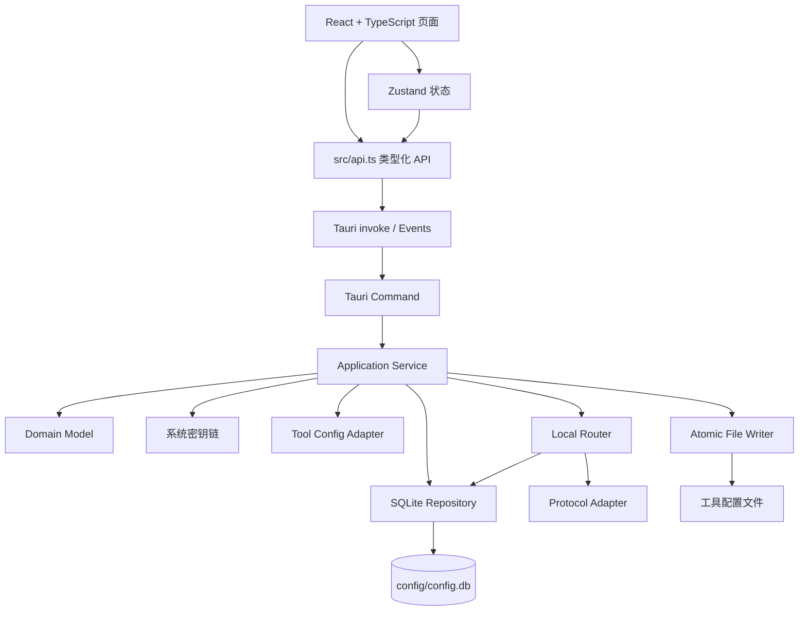
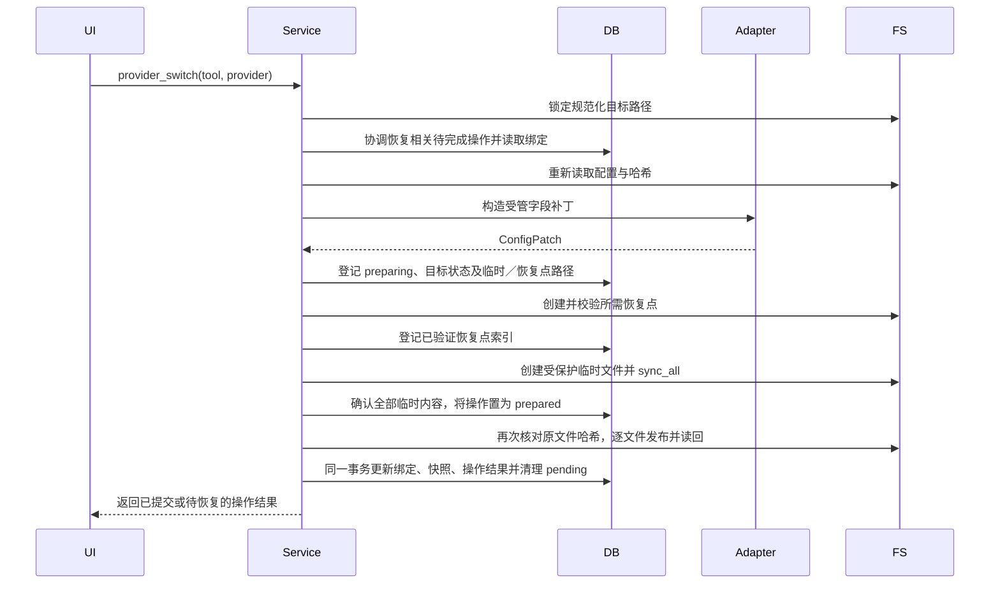

# Agent Dock 技术实现方案

> 文档类型：技术设计
>
> 文档状态：实现基线 v1.0；第 22 章起为可直接编码的规范性补充。外部工具版本、路径和协议证据仍需按第 20.2 节记录；未取得证据的适配器只能执行只读发现，不能写入或宣称已支持。
>
> 适用范围：Agent Dock 全部开发内容
>
> 参考项目：[cc-switch](https://github.com/farion1231/cc-switch)
>
> 更新时间：2026-10-14
>
> 说明：本方案定义 Agent Dock 的技术架构、数据结构和实现规范。实施时按本文规定的模块边界与现有工程衔接。

功能范围及唯一验收入口见[需求规格说明书](需求开发.md#9-验收与需求追踪)，统一术语和维护约定见其第 1.2、1.3 节，执行与交付要求见[开发目标](goal.md)。本文描述目标设计，不代表现有代码已完成实现。第 22 章定义的类型、状态、错误码、命令和默认值是规范性合同；正文中的早期示例只要与第 22 章冲突，以第 22 章为准。任何未在本文定义的行为必须先补充文档和测试，不能由实现者自行猜测。第 22 章未覆盖的外部事实按 `unverified` 处理，不能阻塞通用代码编译，但不得开启对应写入能力。

主要章节：[架构](#3-总体架构) · [数据目录](#4-数据目录与启动流程) · [数据库](#5-sqlite-数据库设计) · [工具适配](#8-工具配置适配器) · [安全发布](#9-provider-切换与安全写入) · [运行模式](#10-工具运行模式) · [路由](#11-本地路由实现) · [资源同步](#12-资源同步与项目配置) · [会话与用量](#13-会话管理与用量统计) · [前后端契约](#14-tauri-命令与前端通信) · [测试](#17-测试方案) · [待决事项](#202-待明确事项)。

### 修订记录

本次修订参考 `cc-switch` 主分支提交 [`51ac86f1c59abfefabadebd05ec5a5415b8ad72c`](https://github.com/farion1231/cc-switch/commit/51ac86f1c59abfefabadebd05ec5a5415b8ad72c)（核实日期：2026-10-14）。借鉴范围仅包括按工具区分能力、模式控制器与操作状态、配置文件增量补丁、按工具串行切换锁、Provider 路由与熔断、数据库备份以及固定夹具测试组织；不直接继承其数据目录、工具版本、认证方式或协议兼容结论。所有外部事实仍须按 D01～D17 提供对应版本和来源证据。

## 1. 目标与设计原则

Agent Dock 是一个桌面应用，用于集中管理 Claude Code、Claude Desktop、Codex、Gemini CLI、Grok Build、OpenCode、OpenClaw、Hermes、Pi 和 MiniMax Code 的 Provider、MCP、Prompt、Skills、项目配置、路由、会话和用量数据。

设计原则如下：

1. 首先保证配置文件不丢失、不损坏，并且能够恢复。
2. SQLite 作为应用配置和业务数据的唯一主存储。
3. 工具配置文件只作为运行时投影，Provider 切换只修改连接相关字段。
4. Agent Dock 自身不生成 `settings.json`、Provider JSON、路由 JSON、运行状态 JSON 等文本配置文件。
5. Agent Dock 管理的 API Key、OAuth Access Token 和 Refresh Token 仅通过系统密钥链持久化；工具原生认证投影及含凭据原文件的加密备份遵循第 19 章。
6. 本地路由集成在 Tauri 进程内，不部署独立后台服务。
7. 适配器保持静态注册，优先选择容易调试、容易测试的实现。
8. 按功能边界完成 Provider、配置安全写入、路由、聚合、会话和同步能力。

## 2. 技术方案概述

### 2.1 存储与凭据

应用数据固定保存于 `<程序目录>/config`，SQLite 是应用配置和业务数据的唯一主存储。Provider、工具绑定、MCP、Prompt、Skills 元数据、项目快照、路由参数、用量和待完成操作（pending）统一进入 `config.db`。API Key 和 OAuth 凭据保存于系统密钥链，数据库只保存引用。

Provider 使用全局实体，公共连接字段独立存储，工具专属非敏感配置保存于绑定表。MCP、Prompt 和 Skills 通过独立绑定表关联工具。模型价格由默认价格表和 Provider 覆盖价共同确定，费用统一使用整数纳美元。路由和会话共用用量明细、持久去重映射及日汇总。

### 2.2 工具配置与恢复

每个工具使用独立配置适配器，只更新受管字段，保留插件、Hooks、权限、MCP 和未知配置。写入流程为：锁定工具和规范化目标路径、读取并计算哈希、生成补丁、登记完整待完成操作及预期恢复路径、校验恢复点、写入同目录临时文件并刷新、再次核对原文件、逐文件原子发布并读回、提交数据库状态及操作结果。多文件操作不是跨文件原子事务，须通过待完成操作恢复部分发布；发布前与发布后失败分别处理，见第 9 章。

### 2.3 后端与路由

后端使用 Tauri 命令（Command）→ 应用服务（Application Service）→ 数据仓储（Repository）分层。协议与工具适配器使用静态 Rust 实现。本地路由使用 Axum，与桌面应用运行于同一进程，支持 Direct、Routing 和 Aggregation 三种模式；路由选择、协议转换、流式转发、故障转移、熔断及用量统计由独立模块负责。余额查询使用统一接口。

## 3. 总体架构



图中箭头表示逻辑调用或数据访问方向，不表示完整 Rust 模块引用；Writer 和 Keychain 属于 Platform 封装。适配器只返回配置补丁，应用服务协调备份、待完成记录、安全发布和数据库提交。

后端依赖方向固定为：

```text
Command → Application Service → Domain / Repository / Platform
                                      ↓
                         Tool Adapter / Router / Keychain
```

约束：

- Command 层不能直接访问文件系统、SQLite 或密钥链。
- Domain 层不能依赖 Tauri 类型。
- Repository 只负责数据库读写，不生成业务决策。
- Platform 层封装路径、文件、进程、密钥链和系统差异。
- 工具适配器只负责工具配置格式和字段映射。
- 协议适配器（`ProtocolAdapter`）只负责协议转换，不直接修改工具配置。

Rust 目标模块目录结构：

```text
src-tauri/src/
├── commands/
│   ├── app.rs
│   ├── provider.rs
│   ├── tool.rs
│   ├── routing.rs
│   ├── mcp.rs
│   ├── prompt.rs
│   ├── skill.rs
│   ├── session.rs
│   └── usage.rs
├── application/
│   ├── provider_service.rs
│   ├── tool_service.rs
│   ├── routing_service.rs
│   ├── mcp_service.rs
│   ├── prompt_service.rs
│   └── skill_service.rs
├── domain/
│   ├── provider.rs
│   ├── tool.rs
│   ├── routing.rs
│   ├── credential.rs
│   ├── session.rs
│   └── usage.rs
├── repository/
│   ├── database.rs
│   ├── provider_repository.rs
│   ├── routing_repository.rs
│   ├── session_repository.rs
│   └── usage_repository.rs
├── config/
│   ├── claude.rs
│   ├── codex.rs
│   ├── gemini.rs
│   ├── grok.rs
│   ├── coexist.rs
│   └── patch.rs
├── platform/
│   ├── paths.rs
│   ├── filesystem.rs
│   ├── keychain.rs
│   └── process.rs
├── operation/
│   ├── pending.rs
│   ├── publish.rs
│   └── recovery.rs
├── backup/
│   ├── envelope.rs
│   ├── storage.rs
│   └── retention.rs
├── router/
│   ├── server.rs
│   ├── request.rs
│   ├── response.rs
│   ├── provider_router.rs
│   ├── failover.rs
│   ├── circuit_breaker.rs
│   └── protocols/
├── sync/
│   ├── snapshot.rs
│   ├── webdav.rs
│   └── s3.rs
├── session/
│   ├── scanner.rs
│   ├── parser.rs
│   └── dedup.rs
├── contracts/
│   └── tools/
├── lib.rs                  # Tauri Builder、Command 注册和应用状态组装
└── main.rs
```

数据库迁移文件统一放在 `src-tauri/migrations/`，由 Repository 的数据库初始化流程加载。

## 4. 数据目录与启动流程

### 4.1 配置文件管理原则

Agent Dock 自身只保留一个结构化配置文件：`config/config.db`。Provider、MCP、Prompt、Skills 元数据、项目快照、路由参数、运行状态、备份索引和 pending 操作全部进入 SQLite，不再额外生成以下文件：

- `settings.json`、`app-config.json`、`runtime-state.json`。
- `providers.json`、`mcp.json`、`routing.json`、`projects.json`。
- `*_auth.json`、`*_oauth_auth.json` 和其他认证文本文件。
- 用于保存数据库表镜像的 YAML、TOML、CSV 或 Markdown 配置文件。

仍然存在的文本或实体文件只限于以下几类：

| 文件类型 | 是否由 Agent Dock 维护 | 原因 |
| --- | --- | --- |
| Claude Code、Codex 等工具原生配置 | 是，作为投影更新 | 目标工具必须从自己的路径读取配置 |
| `config/skills/` 下的 Skill 实体文件 | 是 | 工具需要读取实际 Skill 文件 |
| Prompt 原生文件，如 `CLAUDE.md` | 是，作为投影更新 | 工具通过约定文件加载 Prompt |
| `backups/` | 是 | 保留原始配置和数据库恢复点 |
| `locks/` | 是（运行时） | 保存实例锁和目标锁句柄对应的锁文件，不保存业务数据 |
| `logs/` | 是 | 持续追加日志不适合写入 SQLite |
| `sessions/` | 只缓存外部原始会话 | 会话原文可能很大，且需要保留原始格式 |

除上述文件外，不创建应用级文本配置。工具模式、路由恢复意图、监听端口和最后一次写入结果从 `config.db` 读取；目录由 `AppPaths` 固定推导，进程是否正在监听以当前运行时状态为准。

SQLite 在 WAL 模式下可生成 `config.db-wal`、`config.db-shm`，它们属于数据库运行辅助文件，不是独立应用配置。用户主动生成的脱敏导出文件也不作为应用运行配置读取。

### 4.2 数据目录结构

生产环境只允许使用程序所在目录下的 `config`：

```text
<程序目录>/
├── agent-dock.exe
└── config/
    ├── config.db          # 唯一的应用配置和业务数据库
    ├── backups/
    │   ├── database/
    │   └── live-first-write/
    ├── locks/                # 运行时锁文件，不是配置数据
    ├── logs/
    ├── skills/
    └── sessions/
```

规则：

- 不使用 `%APPDATA%`、`%LOCALAPPDATA%`、`~/.agent-dock` 或其他隐藏目录。
- 不在 `config` 根目录生成其他应用级 JSON、TOML、YAML 或 INI 配置文件。
- 不提供用户自定义数据目录和自动回退目录。
- 首次启动自动创建全部子目录。
- 程序目录或 `config` 不可写时直接提示用户移动程序后重试。
- 升级时只替换程序文件，不删除或重建 `config`。
- 所有路径由 `AppPaths` 统一生成，业务代码不能直接拼接路径。

### 4.3 路径解析（AppPaths）

```rust
pub struct AppPaths {
    pub executable_dir: PathBuf,
    pub config_dir: PathBuf,
    pub database_path: PathBuf,
    pub database_backup_dir: PathBuf,
    pub live_backup_dir: PathBuf,
    pub log_dir: PathBuf,
    pub skills_dir: PathBuf,
    pub sessions_dir: PathBuf,
}
```

生产环境调用 `AppPaths::from_current_executable()`。测试使用 `AppPaths::from_root(temp_dir)` 注入临时目录，但不能把该能力暴露给用户设置。

### 4.4 启动流程

```text
解析可执行文件路径
  → 创建 config 子目录
  → 检查目录读写权限
  → 获取该 config 目录的跨进程独占写锁
  → 打开 SQLite
  → 设置 SQLite PRAGMA
  → 检查数据库版本，需要升级时备份并执行迁移
  → 协调 credential_pending_operations（密钥链不可用则限制相关写入）
  → 恢复 pending_operations
  → 检查工具配置文件快照
  → 从 config.db 恢复路由意图并重新确认实际监听状态
  → 启动 Tauri 窗口
```

启动失败必须区分：

- 目录不可写：提示移动程序目录。
- 数据库损坏：提示选择数据库备份恢复。
- 数据库版本过高：提示升级程序。
- 密钥链不可用：允许打开只读界面，但禁止保存敏感配置。
- 待完成操作无法安全恢复：保留当前目标文件、恢复依据和记录，提示冲突范围；不继续覆盖外部内容。

错误提示和数据库备份选择使用不依赖正常业务数据库的恢复入口，不能因“尚未启动主窗口”而无法反馈错误。第二个实例不能取得写锁时，只允许只读打开或聚焦已运行实例，不得迁移、恢复或发布配置；锁和权限按第 22.8 节执行。锁通过 OS 句柄持有，进程退出由系统释放，不能仅凭 PID 文件或进程名称判定占用。不同程序副本也可能指向同一工具原生文件，相关目标还需按第 9.5 节协调。

## 5. SQLite 数据库设计

### 5.1 数据存储约定

通用约定：时间点统一保存为 UTC Unix 毫秒整数，耗时使用毫秒，日汇总日期使用 UTC 的 `YYYY-MM-DD`。布尔字段只接受 `0`、`1`，协议、工具、模式和状态集合按第 22.3 节固定；外部能力未核实时使用 `unverified`，不通过新增数据库枚举绕过契约。文本主键显式声明 `NOT NULL`，数量及耗时不得为负。JSON 字段在数据库检查语法，在服务边界按具体类型校验，禁止写入密钥、OAuth Token 或认证 Header。

请求明细中未知 Token 用量为 `NULL`，确认未消耗才为 `0`；日汇总的 Token 字段保存已知数量之和，并通过未知用量尝试数表示不完整。不得将缺失字段的默认值当作真实零消耗。

### 5.2 数据库连接配置

每次打开数据库执行：

```sql
PRAGMA foreign_keys = ON;
PRAGMA journal_mode = WAL;
PRAGMA synchronous = FULL;
PRAGMA busy_timeout = 2000;
PRAGMA temp_store = MEMORY;
```

使用 `rusqlite` 管理 SQLite。配置及 pending 的提交必须优先保证持久性，所有写连接使用 `synchronous = FULL`，不以 WAL 的进程崩溃恢复能力替代断电持久性。迁移前备份必须使用 SQLite Online Backup API 或经验证的一致性快照，不能直接复制正在使用的 `config.db` 而忽略 WAL。备份先创建、校验并登记后才开始迁移；失败则保持旧数据库可用并停止迁移。恢复写入独立临时数据库，完成完整性检查后由用户选择并在应用关闭时安全替换，不在活动连接上覆盖数据库。文件和数据库的刷新仍依赖 OS、文件系统及存储设备的实现，平台断电保证需实测，不能宣称绝对零丢失。

常规配置操作使用受 Mutex 保护的连接；文件 I/O、密钥链访问和网络请求不持有 SQLite 写事务。路由请求日志使用容量 1024 的有界异步队列，批量上限 100 条或 250 ms；队列满时暂停生产者，持续 5 秒仍无法入队则标记采集缺口并返回可观察状态，禁止静默丢弃。正常退出排空队列不等于异常退出时零丢失。页面不得将存在已知采集缺口的统计显示为完整账单。

SQLite 查询、迁移、FTS 查询、Argon2id、CBOR 编解码和大文件哈希属于可能阻塞的工作，异步入口必须使用 `tokio::task::spawn_blocking` 或专用有界线程池，并设置取消边界和队列上限；不能在 Tokio 核心线程或 Tauri Command 线程直接执行无界扫描。取消只在事务、哈希块或 FTS 查询之间的安全边界生效，已提交事务不可回滚式取消。

### 5.3 核心数据表

#### 5.3.1 应用设置与备份索引

```sql
CREATE TABLE settings
(
    key        TEXT NOT NULL PRIMARY KEY,
    value_json TEXT    NOT NULL CHECK (json_valid(value_json)),
    revision   INTEGER NOT NULL DEFAULT 0 CHECK (revision >= 0),
    updated_at INTEGER NOT NULL
);

CREATE TABLE backup_records
(
    id           TEXT NOT NULL PRIMARY KEY,
    backup_type  TEXT    NOT NULL CHECK (backup_type IN
        ('database', 'tool_first_write', 'tool_takeover', 'operation_rollback', 'prompt')),
    operation_id TEXT,
    tool_id      TEXT,
    source_path_id TEXT,
    backup_path  TEXT    NOT NULL UNIQUE,
    content_hash TEXT    NOT NULL,
    file_size    INTEGER NOT NULL CHECK (file_size >= 0),
    storage_format TEXT NOT NULL CHECK (storage_format IN ('plain', 'encrypted')),
    envelope_version INTEGER CHECK (envelope_version IS NULL OR envelope_version >= 1),
    key_wrap_mode TEXT NOT NULL CHECK (key_wrap_mode IN ('none', 'keychain', 'recovery_password')),
    keychain_ref_json TEXT CHECK (keychain_ref_json IS NULL OR json_valid(keychain_ref_json)),
    verified_at  INTEGER,
    created_at   INTEGER NOT NULL,
    CHECK (
        (backup_type = 'operation_rollback' AND operation_id IS NOT NULL)
        OR backup_type <> 'operation_rollback'
    ),
    CHECK (
        (storage_format = 'plain' AND key_wrap_mode = 'none' AND envelope_version IS NULL AND keychain_ref_json IS NULL)
        OR (storage_format = 'encrypted' AND key_wrap_mode = 'keychain' AND envelope_version IS NOT NULL AND keychain_ref_json IS NOT NULL)
        OR (storage_format = 'encrypted' AND key_wrap_mode = 'recovery_password' AND envelope_version IS NOT NULL AND keychain_ref_json IS NULL)
    )
);
```

`settings` 保存主题、语言、备份策略、同步配置的非敏感部分，以及唯一的路由监听地址和端口。`routing.restore_modes` 按工具保存用户期望在重启后恢复的模式，与 `tool_bindings` 中已经发布到工具文件的模式分开；退出应用时恢复直连不会清除该意图，用户主动关闭路由时则更新为直连。每个键在应用层有明确类型和默认值；Provider、绑定、用量和待完成操作的完整数据不复制到该表。同步认证信息也只保存密钥链引用，不提供数据目录覆盖设置。

`backup_records` 只保存文件索引，不保存备份正文。`source_path_id` 只能是由工具契约生成的稳定路径标识，不能保存绝对路径；需要恢复时由当前契约重新解析实际路径。`content_hash`／`file_size` 对应实际存储的备份字节；加密备份使用密文校验值和大小，明文哈希只在认证解密后的载荷中校验。`verified_at` 只有在完整性、解密（适用时）及恢复内容校验通过后才填写。`key_wrap_mode = keychain` 时 `keychain_ref_json` 只保存备份数据密钥的引用；`key_wrap_mode = recovery_password` 时封装信息只在加密信封内，数据库不保存本机密钥链引用。SQL 约束禁止明文记录携带加密元数据，也禁止加密记录缺少对应的密钥封装信息。未知敏感性按含凭据处理；纯明文备份仅限能确定不含秘密的内容。

首次写入备份与每次路由接管前的恢复点分开记录；每个发布操作还为将被替换的现有文件创建操作级回滚点，直到文件和数据库提交完成后才允许清理；同一次操作可复用已校验且源哈希相同的恢复点，避免重复复制。原文件不存在时在待完成操作中记录该状态，不生成备份文件。创建备份前先在 pending 文件记录中登记预期路径；备份文件原子写入后登记索引。崩溃恢复按 pending 中的路径核对已写入但尚未登记索引的备份，不能把它当成成功备份。启动时检查索引与文件是否一致。

含凭据的原始配置只能以加密形式保存恢复点，不能直接复制原文。加密信封、算法、参数和恢复失败基线按第 22.9 节固定；D07 只记录平台密钥链能力和安全核实证据。密钥不可用时不回退到明文；在加密实现和恢复测试完成前，不得对含凭据文件执行需要恢复点的覆盖操作。

#### 5.3.2 Provider 基础信息

```sql
CREATE TABLE providers
(
    id             TEXT NOT NULL PRIMARY KEY,
    name           TEXT    NOT NULL,
    name_zh        TEXT,
    category       TEXT    NOT NULL CHECK (category IN ('official', 'custom', 'local', 'preset')),
    protocol       TEXT    NOT NULL CHECK (protocol IN ('anthropic_messages', 'openai_chat', 'openai_responses', 'gemini_native')),
    base_url       TEXT    NOT NULL,
    auth_type      TEXT    NOT NULL CHECK (auth_type IN ('api_key', 'oauth', 'custom_header', 'none')),
    route_eligibility TEXT NOT NULL DEFAULT 'unknown' CHECK (route_eligibility IN ('allowed', 'denied', 'unknown')),
    verification_state TEXT NOT NULL DEFAULT 'unverified' CHECK (verification_state IN ('verified', 'unverified', 'expired', 'invalid')),
    verified_at    INTEGER,
    verification_source TEXT,
    enabled        INTEGER NOT NULL DEFAULT 1 CHECK (enabled IN (0, 1)),
    sort_order     INTEGER NOT NULL DEFAULT 0,
    metadata_json  TEXT    NOT NULL DEFAULT '{}' CHECK (json_valid(metadata_json)),
    revision       INTEGER NOT NULL DEFAULT 0 CHECK (revision >= 0),
    created_at     INTEGER NOT NULL,
    updated_at     INTEGER NOT NULL
);
```

`category` 使用固定枚举字符串：`official`、`custom`、`local`、`preset`；`auth_type`、`route_eligibility` 和 `verification_state` 分别表达认证方式、路由资格和核验状态，三者不能互相推断。`protocol` 使用固定枚举字符串：`anthropic_messages`、`openai_chat`、`openai_responses`、`gemini_native`。凭据引用统一由 `provider_credentials` 读取，不在 Provider 主表重复保存；`credential_kind` 只能使用下划线命名的固定值，禁止再引入 `api-key` 或 `oauth-access-token` 变体。

#### 5.3.3 Provider 模型与能力

```sql
CREATE TABLE provider_models
(
    id                                     TEXT NOT NULL PRIMARY KEY,
    provider_id                            TEXT    NOT NULL,
    model_id                               TEXT    NOT NULL,
    display_name                           TEXT,
    context_window                         INTEGER CHECK (context_window >= 0),
    supports_tools                         INTEGER NOT NULL DEFAULT 0 CHECK (supports_tools IN (0, 1)),
    supports_thinking                      INTEGER NOT NULL DEFAULT 0 CHECK (supports_thinking IN (0, 1)),
    supports_vision                        INTEGER NOT NULL DEFAULT 0 CHECK (supports_vision IN (0, 1)),
    input_price_per_million_nano_usd        INTEGER CHECK (input_price_per_million_nano_usd >= 0),
    output_price_per_million_nano_usd       INTEGER CHECK (output_price_per_million_nano_usd >= 0),
    cache_read_price_per_million_nano_usd   INTEGER CHECK (cache_read_price_per_million_nano_usd >= 0),
    cache_write_price_per_million_nano_usd  INTEGER CHECK (cache_write_price_per_million_nano_usd >= 0),
    metadata_json                          TEXT    NOT NULL DEFAULT '{}' CHECK (json_valid(metadata_json)),
    revision                               INTEGER NOT NULL DEFAULT 0 CHECK (revision >= 0),
    UNIQUE (provider_id, model_id),
    FOREIGN KEY (provider_id) REFERENCES providers (id) ON DELETE CASCADE
);
```

模型能力只作为路由和界面提示，不能替代上游实际能力验证。四个价格字段是该 Provider 的覆盖价；`NULL` 表示使用默认价格，`0` 表示明确免费。

#### 5.3.4 模型默认价格

```sql
CREATE TABLE model_pricing
(
    model_id                              TEXT NOT NULL PRIMARY KEY,
    display_name                          TEXT    NOT NULL,
    input_price_per_million_nano_usd       INTEGER CHECK (input_price_per_million_nano_usd >= 0),
    output_price_per_million_nano_usd      INTEGER CHECK (output_price_per_million_nano_usd >= 0),
    cache_read_price_per_million_nano_usd  INTEGER CHECK (cache_read_price_per_million_nano_usd >= 0),
    cache_write_price_per_million_nano_usd INTEGER CHECK (cache_write_price_per_million_nano_usd >= 0),
    price_source                          TEXT    NOT NULL CHECK (price_source IN ('builtin', 'imported', 'user')),
    revision                              INTEGER NOT NULL DEFAULT 0 CHECK (revision >= 0),
    updated_at                            INTEGER NOT NULL
);
```

价格单位统一为“每百万 Token 的纳美元”。逐项优先使用 `provider_models` 覆盖价，再使用 `model_pricing` 默认价；缺少本次实际消耗类别的价格时标记未计价，不能把未知价格当作免费。内置价格更新和外部导入不得覆盖用户自定义价格。

#### 5.3.5 Provider 凭据引用

```sql
CREATE TABLE provider_credentials
(
    provider_id      TEXT    NOT NULL,
    credential_kind  TEXT    NOT NULL CHECK (credential_kind IN ('api_key', 'oauth_access_token', 'oauth_refresh_token', 'custom_header')),
    slot             TEXT    NOT NULL DEFAULT '',
    credential_ref_version INTEGER NOT NULL DEFAULT 1 CHECK (credential_ref_version >= 1),
    keychain_service TEXT    NOT NULL,
    keychain_account TEXT    NOT NULL,
    account_label    TEXT,
    revision         INTEGER NOT NULL DEFAULT 0 CHECK (revision >= 0),
    updated_at       INTEGER NOT NULL,
    PRIMARY KEY (provider_id, credential_kind, slot),
    FOREIGN KEY (provider_id) REFERENCES providers (id) ON DELETE CASCADE
);
```

该表只保存密钥链引用，不保存 Key、Access Token 或 Refresh Token。使用 `(provider_id, credential_kind, slot)` 联合主键，使同一 Provider 可以同时持有 OAuth Access Token、Refresh Token 和多个命名的自定义 Header；`api_key`、OAuth 凭据的 `slot` 固定为空字符串，`custom_header` 必须使用契约声明的稳定槽位。

#### 5.3.6 工具模式与当前选择

```sql
CREATE TABLE tool_bindings
(
    tool_id             TEXT NOT NULL PRIMARY KEY,
    mode                TEXT    NOT NULL CHECK (mode IN ('direct', 'routing', 'aggregation')),
    current_provider_id TEXT,
    direct_provider_id  TEXT,
    route_provider_id   TEXT,
    revision            INTEGER NOT NULL DEFAULT 0 CHECK (revision >= 0),
    updated_at          INTEGER NOT NULL,
    FOREIGN KEY (current_provider_id) REFERENCES providers (id),
    FOREIGN KEY (direct_provider_id) REFERENCES providers (id),
    FOREIGN KEY (route_provider_id) REFERENCES providers (id)
);
```

`mode` 是最后一次成功发布并提交数据库的模式，不代表外部工具已经加载；`current_provider_id` 表示单 Provider 工具的当前选择，`direct_provider_id` 保存退出路由时恢复的直连选择。涉及工具配置的模式和选择只在配置发布成功后的同一事务中更新，`revision` 同时单调递增。`route_provider_id` 记录 Routing 的上游选择，可以在故障转移时单独更新；并发请求实际使用的 Provider 以请求明细为准。共存式工具可以将 `current_provider_id` 置空，由 `tool_provider_bindings` 记录多个 Provider。

#### 5.3.7 工具与 Provider 绑定

```sql
CREATE TABLE tool_provider_bindings
(
    tool_id            TEXT    NOT NULL,
    provider_id        TEXT    NOT NULL,
    enabled            INTEGER NOT NULL DEFAULT 1 CHECK (enabled IN (0, 1)),
    sort_order         INTEGER NOT NULL DEFAULT 0,
    config_patch_json  TEXT    NOT NULL DEFAULT '{}' CHECK (json_valid(config_patch_json)),
    model_mapping_json TEXT    NOT NULL DEFAULT '{}' CHECK (json_valid(model_mapping_json)),
    revision           INTEGER NOT NULL DEFAULT 0 CHECK (revision >= 0),
    updated_at         INTEGER NOT NULL,
    PRIMARY KEY (tool_id, provider_id),
    FOREIGN KEY (provider_id) REFERENCES providers (id) ON DELETE CASCADE
);
```

该表供单 Provider 与共存式工具共用。`config_patch_json` 只保存适配器允许的工具专属非敏感连接字段，`model_mapping_json` 保存工具模型槽位到真实模型的映射；不得覆盖 Provider 的凭据或混入 Hooks、权限、MCP 等无关配置。工具原文件中的未知字段继续通过读取、合并和原子写入保留。生效时同时检查 Provider 和绑定的启用状态。

#### 5.3.8 工具配置快照

```sql
CREATE TABLE tool_snapshots
(
    tool_id          TEXT NOT NULL,
    file_path        TEXT NOT NULL,
    file_hash        TEXT,
    desired_hash     TEXT,
    projection_version TEXT,
    file_modified_at INTEGER,
    last_imported_at INTEGER,
    last_written_at  INTEGER,
    last_verified_at INTEGER,
    restart_required INTEGER CHECK (restart_required IN (0, 1)),
    revision         INTEGER NOT NULL DEFAULT 0 CHECK (revision >= 0),
    restore_backup_id TEXT,
    sync_status      TEXT NOT NULL CHECK (sync_status IN
        ('pending', 'synced', 'external_drift', 'conflict', 'recovery_required', 'unsupported', 'error')),
    PRIMARY KEY (tool_id, file_path),
    FOREIGN KEY (restore_backup_id) REFERENCES backup_records (id)
);
```

`file_hash` 是最近一次读取时观察到的实际文件哈希，`desired_hash` 是数据库已提交配置对应的投影哈希；两者分开保存，不能把目标哈希当成文件已写入的证明。`projection_version` 指适配器及字段契约版本。`last_verified_at` 记录读回并验证目标内容的时间；`restart_required = NULL` 表示该工具是否需要重启尚未核实。`restore_backup_id` 指向本次路由接管前的备份，而非首次写入备份。恢复时核对当前受管文件哈希；外部修改按第 9 节处理，不能直接用旧备份覆盖用户新内容。

#### 5.3.9 路由策略配置

```sql
CREATE TABLE routing_configs
(
    tool_id                    TEXT NOT NULL PRIMARY KEY,
    max_attempts               INTEGER NOT NULL DEFAULT 3 CHECK (max_attempts BETWEEN 1 AND 3),
    first_byte_timeout_seconds INTEGER NOT NULL DEFAULT 60 CHECK (first_byte_timeout_seconds BETWEEN 1 AND 3600),
    idle_timeout_seconds       INTEGER NOT NULL DEFAULT 120 CHECK (idle_timeout_seconds BETWEEN 1 AND 3600),
    request_timeout_seconds    INTEGER NOT NULL DEFAULT 600 CHECK (request_timeout_seconds BETWEEN 1 AND 86400),
    failover_enabled           INTEGER NOT NULL DEFAULT 0 CHECK (failover_enabled IN (0, 1)),
    circuit_failure_threshold  INTEGER NOT NULL DEFAULT 3 CHECK (circuit_failure_threshold >= 1),
    circuit_success_threshold  INTEGER NOT NULL DEFAULT 2 CHECK (circuit_success_threshold >= 1),
    circuit_cooldown_seconds   INTEGER NOT NULL DEFAULT 60 CHECK (circuit_cooldown_seconds >= 1),
    half_open_max_probes        INTEGER NOT NULL DEFAULT 1 CHECK (half_open_max_probes >= 1),
    pricing_model_source       TEXT    NOT NULL DEFAULT 'response' CHECK (pricing_model_source IN ('request', 'response')),
    revision                   INTEGER NOT NULL DEFAULT 0 CHECK (revision >= 0),
    updated_at                 INTEGER NOT NULL
);
```

所有工具共用一个进程内路由服务。监听地址固定为 `127.0.0.1`，端口统一保存在 `settings` 的 `routing.listen_port`，默认值为 `15721`，允许用户在 `1024`～`65535` 范围内配置。端口变更必须先验证新端口可监听，再通过配置发布管线更新所有已接管工具的路由地址；端口被占用时不得自动选择其他端口。运行意图由工具模式和待完成操作恢复，实际监听状态通过内存和事件报告，历史运行记录不作为当前监听状态的依据。

`max_attempts` 包含首次请求，默认最多尝试三次；`failover_enabled` 只作用于 Routing。`pricing_model_source` 明确按请求模型还是响应模型计价，请求模型中的聚合别名先解析为真实模型。选定的计价模型及价格快照写入请求明细，历史费用以已记录的计价依据为准。

服务层还必须校验 `request_timeout_seconds >= idle_timeout_seconds >= first_byte_timeout_seconds`，并拒绝未知工具的路由配置。数据库 CHECK 负责基础范围，跨字段和工具能力约束由 Repository 事务内校验，不能只依赖前端表单。

```sql
CREATE TABLE route_credentials
(
    tool_id          TEXT NOT NULL PRIMARY KEY,
    auth_mode        TEXT NOT NULL CHECK (auth_mode IN ('header_token', 'api_key_token', 'loopback_untrusted')),
    keychain_service TEXT,
    keychain_account TEXT,
    revision         INTEGER NOT NULL DEFAULT 0 CHECK (revision >= 0),
    updated_at       INTEGER NOT NULL,
    CHECK (
        (auth_mode = 'loopback_untrusted' AND keychain_service IS NULL AND keychain_account IS NULL)
        OR (auth_mode IN ('header_token', 'api_key_token') AND keychain_service IS NOT NULL AND keychain_account IS NOT NULL)
    )
);
```

`route_credentials` 只保存每个工具的路由 token 引用，不保存 token 正文；token 由密钥链随机生成并与工具隔离。`loopback_untrusted` 必须由用户显式确认，不能作为缺少 token 时的自动回退。`auth_mode` 必须与工具契约和实际投影槽位一致，路由资格、Provider 凭据和路由 token 是三套独立状态。

#### 5.3.10 路由成员

```sql
CREATE TABLE routing_members
(
    tool_id     TEXT    NOT NULL,
    provider_id TEXT    NOT NULL,
    member_type TEXT    NOT NULL CHECK (member_type IN ('failover', 'aggregation')),
    sort_order  INTEGER NOT NULL DEFAULT 0,
    enabled     INTEGER NOT NULL DEFAULT 1 CHECK (enabled IN (0, 1)),
    is_default  INTEGER NOT NULL DEFAULT 0 CHECK (is_default IN (0, 1)),
    revision    INTEGER NOT NULL DEFAULT 0 CHECK (revision >= 0),
    PRIMARY KEY (tool_id, provider_id, member_type),
    FOREIGN KEY (provider_id) REFERENCES providers (id) ON DELETE CASCADE
);
```

`member_type` 取值为 `failover` 或 `aggregation`。Aggregation 不读取 `failover` 队列。

#### 5.3.11 聚合模型别名

```sql
CREATE TABLE routing_model_aliases
(
    tool_id     TEXT NOT NULL,
    alias       TEXT NOT NULL,
    provider_id TEXT NOT NULL,
    model_id    TEXT NOT NULL,
    revision    INTEGER NOT NULL DEFAULT 0 CHECK (revision >= 0),
    updated_at  INTEGER NOT NULL,
    PRIMARY KEY (tool_id, alias),
    FOREIGN KEY (provider_id, model_id)
        REFERENCES provider_models (provider_id, model_id) ON DELETE CASCADE
);
```

聚合别名显式保存，添加模型或重启后不会重新分配既有别名。服务层在同一事务中校验并更新聚合成员、唯一默认 Provider 和别名关系。

#### 5.3.12 Provider 健康状态

```sql
CREATE TABLE provider_health
(
    tool_id               TEXT    NOT NULL,
    provider_id           TEXT    NOT NULL,
    state                 TEXT    NOT NULL DEFAULT 'closed' CHECK (state IN ('closed', 'open', 'half_open')),
    consecutive_failures  INTEGER NOT NULL DEFAULT 0 CHECK (consecutive_failures >= 0),
    consecutive_successes INTEGER NOT NULL DEFAULT 0 CHECK (consecutive_successes >= 0),
    total_requests        INTEGER NOT NULL DEFAULT 0 CHECK (total_requests >= 0),
    failed_requests       INTEGER NOT NULL DEFAULT 0 CHECK (failed_requests >= 0),
    opened_at             INTEGER,
    last_error            TEXT,
    updated_at            INTEGER NOT NULL,
    PRIMARY KEY (tool_id, provider_id),
    FOREIGN KEY (provider_id) REFERENCES providers (id) ON DELETE CASCADE
);
```

#### 5.3.13 待完成操作与文件发布记录

`0001_initial.sql` 必须先创建通用 `operations`，再创建本节的 `pending_operations` 和后续凭据 pending 表；文档代码块仅按职责分组展示，外键不能省略。

```sql
CREATE TABLE pending_operations
(
    operation_id       TEXT NOT NULL PRIMARY KEY,
    tool_id            TEXT    NOT NULL,
    operation_type     TEXT    NOT NULL,
    request_hash       TEXT    NOT NULL,
    target_provider_id TEXT,
    target_state_json  TEXT    NOT NULL DEFAULT '{}' CHECK (json_valid(target_state_json)),
    expected_revision  INTEGER NOT NULL CHECK (expected_revision >= 0),
    source_versions_json TEXT NOT NULL DEFAULT '{}' CHECK (json_valid(source_versions_json)),
    recovery_action    TEXT NOT NULL DEFAULT 'forward' CHECK (recovery_action IN ('forward', 'rollback')),
    phase              TEXT    NOT NULL CHECK (phase IN
        ('preparing', 'prepared', 'publishing', 'files_published', 'rolling_back', 'recovery_required')),
    format_version     INTEGER NOT NULL DEFAULT 1 CHECK (format_version >= 1),
    created_at         INTEGER NOT NULL,
    updated_at         INTEGER NOT NULL,
    FOREIGN KEY (operation_id) REFERENCES operations (operation_id)
);

CREATE TABLE pending_operation_files
(
    operation_id TEXT    NOT NULL,
    file_path    TEXT    NOT NULL,
    before_hash  TEXT,
    after_hash   TEXT NOT NULL,
    temp_path    TEXT,
    rollback_temp_path TEXT,
    backup_plan_json TEXT NOT NULL DEFAULT '[]' CHECK (json_valid(backup_plan_json)),
    rollback_backup_id TEXT,
    phase        TEXT NOT NULL CHECK (phase IN ('planned', 'staged', 'published', 'recovery_required')),
    PRIMARY KEY (operation_id, file_path),
    FOREIGN KEY (operation_id) REFERENCES pending_operations (operation_id)
        ON DELETE CASCADE,
    FOREIGN KEY (rollback_backup_id) REFERENCES backup_records (id)
);
```

`target_state_json` 保存本次操作发布成功后需要提交的工具模式、绑定和别名等非敏感状态，使恢复流程能够重放数据库提交；不只依靠目标 Provider 推断整个操作。
`before_hash = NULL` 唯一表示发布前文件不存在；目标内容生成后 `after_hash` 必须非空。phase 只作恢复进度提示，不作为文件已发布或数据库已提交的事实依据；恢复必须重新读取文件并比对哈希。操作的所有目标文件、目标数据库状态、临时路径和回滚点引用须在发布第一个文件前登记完整，不能边发布边补全操作清单。

`backup_plan_json` 保存将要创建的恢复点 ID、类型、路径及加密密钥引用，不含正文；准备阶段先登记，再创建文件和填写 `rollback_backup_id`。`expected_revision` 是计划生成时该工具的配置版本，初次没有绑定行时按版本 0 处理；数据库提交使用比较后更新或首次插入，版本不同则保留 pending、将 `phase` 置为 `recovery_required` 并返回 `conflict`，不把旧操作提交到较新的绑定上。`source_versions_json` 保存参与投影的资源 ID、非敏感内容版本指纹、契约版本和凭据引用代次；发布前及恢复提交前重新核实，防止 Provider 编辑、资源删除或凭据轮换后重放旧计划。指纹不使用凭据正文。

所有改变工具投影状态的路径都须使用相同的工具与目标锁，含 Provider、MCP、Prompt、项目切换和路由模式变更；纯路由请求的上游选择不重放为旧操作目标。`recovery_action` 记录前滚或用户选择的回滚，回滚意图须在执行任何恢复写入前持久化；`rollback_temp_path` 登记回滚时使用的临时路径。新操作遇到尚未解决的关联 pending 时返回需要恢复，不抢占或重置旧记录。

配置发布之外的长任务也必须登记在同一张通用操作表中，不能只靠事件或内存任务 ID：

```sql
CREATE TABLE operations
(
    operation_id       TEXT NOT NULL PRIMARY KEY,
    operation_kind     TEXT NOT NULL CHECK (operation_kind IN
        ('config_publish', 'credential', 'mcp_sync', 'prompt_sync', 'skill_install',
         'skill_sync', 'session_delete', 'session_index', 'backup', 'sync', 'cli', 'quota')),
    owner_kind         TEXT NOT NULL CHECK (owner_kind IN ('app', 'tool', 'provider', 'mcp', 'prompt', 'skill', 'session', 'project', 'sync')),
    owner_id           TEXT,
    phase              TEXT NOT NULL CHECK (phase IN
        ('queued', 'preparing', 'running', 'transferring', 'indexing', 'publishing',
         'committing', 'cleaning', 'waiting_user', 'cancelling', 'files_published', 'rolling_back', 'completed', 'failed', 'recovery_required')),
    status             TEXT NOT NULL CHECK (status IN ('accepted', 'running', 'committed', 'completed', 'not_published', 'rolled_back', 'cancel_requested', 'cancelled', 'recovery_required', 'failed')),
    progress_current   INTEGER NOT NULL DEFAULT 0 CHECK (progress_current >= 0),
    progress_total     INTEGER CHECK (progress_total IS NULL OR progress_total >= 0),
    cancellable        INTEGER NOT NULL DEFAULT 0 CHECK (cancellable IN (0, 1)),
    cancel_requested   INTEGER NOT NULL DEFAULT 0 CHECK (cancel_requested IN (0, 1)),
    recovery_state     TEXT NOT NULL DEFAULT 'none' CHECK (recovery_state IN ('none', 'pending', 'required', 'completed')),
    error_code         TEXT,
    error_message      TEXT,
    cleanup_status     TEXT NOT NULL DEFAULT 'none' CHECK (cleanup_status IN ('none', 'pending', 'completed', 'failed')),
    remote_etag        TEXT,
    remote_manifest_hash TEXT,
    cursor_json        TEXT NOT NULL DEFAULT '{}' CHECK (json_valid(cursor_json)),
    revision           INTEGER NOT NULL DEFAULT 0 CHECK (revision >= 0),
    created_at         INTEGER NOT NULL,
    updated_at         INTEGER NOT NULL,
    completed_at       INTEGER
);
```

`operations` 是 `operation_status`、`task_cancel`、事件推送和崩溃恢复的唯一权威状态。配置发布的 `pending_operations` 保存逐文件恢复细节，并以相同 `operation_id` 对应一行 `operations`；Skill、MCP/Prompt 同步、会话删除／索引、WebDAV/S3、CLI 安装／升级、备份和额度刷新都必须使用该表。`phase` 由领域定义但必须有稳定枚举；`progress_total = NULL` 表示总量未知。取消只设置 `cancel_requested`，服务在可取消边界检查后进入 `cancelled`；文件替换、数据库提交、密钥链交换和已发送的非幂等网络请求不可强制中断。`remote_etag`、`remote_manifest_hash`、`cursor_json` 用于同步断点和恢复，不能由 UI 私自修改。

```sql
CREATE TABLE config_operation_results
(
    operation_id TEXT NOT NULL PRIMARY KEY,
    tool_id      TEXT NOT NULL,
    request_hash TEXT NOT NULL,
    result       TEXT NOT NULL CHECK (result IN ('committed', 'not_published', 'rolled_back')),
    revision     INTEGER CHECK (revision >= 0),
    cleanup_plan_json TEXT NOT NULL DEFAULT '[]' CHECK (json_valid(cleanup_plan_json)),
    cleanup_status TEXT NOT NULL DEFAULT 'pending' CHECK (cleanup_status IN ('pending', 'completed')),
    completed_at INTEGER NOT NULL
);
```

该表用于配置写入幂等结果查询和提交后的遗留物清理。`request_hash` 与 pending 中相同，对不敏感的命令类型、目标资源 ID 和期望版本计算，禁止使用密钥正文计算。完成事务同时保存结果、仍需清理的路径与归属依据并删除 pending；安全清理完成后才将 `cleanup_status` 置为 `completed`，清理失败不撤销已提交配置。结果查询先检查此表再检查 pending。同一 ID 携带不同请求参数返回 `OperationIdConflict`；结果保留至用户显式删除相关历史，不依赖 UI 临时内存去重。未完成清理的记录和被 pending 引用的恢复点不得删除。

#### 5.3.14 请求明细、用量去重与日汇总

```sql
CREATE TABLE request_logs
(
    attempt_id         TEXT NOT NULL PRIMARY KEY,
    request_id         TEXT    NOT NULL,
    tool_id            TEXT    NOT NULL,
    data_source        TEXT    NOT NULL CHECK (data_source IN
        ('routing', 'claude_session', 'codex_session', 'gemini_session')),
    session_id         TEXT,
    provider_id        TEXT,
    requested_model    TEXT,
    actual_model       TEXT,
    pricing_model      TEXT,
    is_final_attempt   INTEGER NOT NULL DEFAULT 0 CHECK (is_final_attempt IN (0, 1)),
    is_success         INTEGER CHECK (is_success IN (0, 1)),
    status_code        INTEGER,
    input_tokens       INTEGER CHECK (input_tokens >= 0),
    output_tokens      INTEGER CHECK (output_tokens >= 0),
    cache_read_tokens  INTEGER CHECK (cache_read_tokens >= 0),
    cache_write_tokens INTEGER CHECK (cache_write_tokens >= 0),
    latency_ms         INTEGER CHECK (latency_ms >= 0),
    first_byte_ms      INTEGER CHECK (first_byte_ms >= 0),
    request_latency_ms INTEGER CHECK (request_latency_ms >= 0),
    request_first_byte_ms INTEGER CHECK (request_first_byte_ms >= 0),
    cost_nano_usd      INTEGER CHECK (cost_nano_usd >= 0),
    pricing_status     TEXT    NOT NULL DEFAULT 'unpriced' CHECK (pricing_status IN ('priced', 'unpriced', 'not_billable')),
    pricing_snapshot_json TEXT NOT NULL DEFAULT '{}' CHECK (json_valid(pricing_snapshot_json)),
    error_code         TEXT,
    error_summary      TEXT,
    created_at         INTEGER NOT NULL,
    CHECK ((pricing_status = 'unpriced' AND cost_nano_usd IS NULL)
        OR (pricing_status = 'priced' AND cost_nano_usd IS NOT NULL AND cost_nano_usd >= 0)
        OR (pricing_status = 'not_billable' AND cost_nano_usd IS NOT NULL AND cost_nano_usd = 0))
);

CREATE TABLE usage_dedup
(
    tool_id         TEXT    NOT NULL,
    data_source     TEXT    NOT NULL,
    source_event_id TEXT    NOT NULL,
    semantic_id     TEXT,
    request_id      TEXT    NOT NULL,
    attempt_id      TEXT    NOT NULL,
    created_at      INTEGER NOT NULL,
    PRIMARY KEY (tool_id, data_source, source_event_id)
);

CREATE TABLE usage_daily_rollups
(
    id                     INTEGER PRIMARY KEY,
    usage_date             TEXT    NOT NULL,
    tool_id                TEXT    NOT NULL,
    data_source            TEXT    NOT NULL,
    provider_id            TEXT,
    requested_model        TEXT,
    actual_model           TEXT,
    pricing_model          TEXT,
    request_count          INTEGER NOT NULL DEFAULT 0 CHECK (request_count >= 0),
    success_count          INTEGER NOT NULL DEFAULT 0 CHECK (success_count >= 0),
    outcome_sample_count   INTEGER NOT NULL DEFAULT 0 CHECK (outcome_sample_count >= 0),
    attempt_count          INTEGER NOT NULL DEFAULT 0 CHECK (attempt_count >= 0),
    input_tokens           INTEGER NOT NULL DEFAULT 0 CHECK (input_tokens >= 0),
    output_tokens          INTEGER NOT NULL DEFAULT 0 CHECK (output_tokens >= 0),
    cache_read_tokens      INTEGER NOT NULL DEFAULT 0 CHECK (cache_read_tokens >= 0),
    cache_write_tokens     INTEGER NOT NULL DEFAULT 0 CHECK (cache_write_tokens >= 0),
    cost_nano_usd          INTEGER NOT NULL DEFAULT 0 CHECK (cost_nano_usd >= 0),
    unpriced_attempt_count INTEGER NOT NULL DEFAULT 0 CHECK (unpriced_attempt_count >= 0),
    unknown_usage_attempt_count INTEGER NOT NULL DEFAULT 0 CHECK (unknown_usage_attempt_count >= 0),
    latency_sum_ms         INTEGER NOT NULL DEFAULT 0 CHECK (latency_sum_ms >= 0),
    latency_sample_count   INTEGER NOT NULL DEFAULT 0 CHECK (latency_sample_count >= 0),
    updated_at             INTEGER NOT NULL
);
```

`request_logs` 是路由和会话扫描共用的用量明细，不再各存一份计费记录。一次逻辑请求保持同一 `request_id`，每次上游尝试拥有不同的 `attempt_id`；会话记录也由扫描器生成稳定的内部 ID。路由进行中各尝试保持 `is_final_attempt = 0`，请求结束时只将最终尝试标记为 `1`，用于请求次数及最终成功次数；会话扫描确认请求完成后也显式标记终态。尝试次数、Token 和已知费用按所有尝试汇总，失败重试不会覆盖先前消耗。无法确认成功状态的会话记录保留 `is_success = NULL`。进程异常退出遗留的请求在启动恢复时标记中断并确定最终尝试，不永久留作未结束请求。

`latency_ms`、`first_byte_ms` 表示单次上游尝试耗时；最终尝试的 `request_latency_ms`、`request_first_byte_ms` 保存包含重试等待的完整逻辑请求耗时。日汇总的耗时合计和样本数只使用最终尝试的完整请求耗时，不能将最后一次尝试的耗时当成用户实际等待时间。

`pricing_snapshot_json` 保存实际使用的四类单价、价格来源、单位和舍入规则。未计价费用为 `NULL`，不是 `0`；日汇总保存已知费用合计并通过 `unpriced_attempt_count` 标记费用不完整。四类 Token 在明细中分别允许 `NULL`，表示该类别用量未知，不能用默认零补齐；日汇总只累加各类别已知值，并以 `unknown_usage_attempt_count` 记录至少一个类别未知的尝试数。只有能确认无对应消耗时才写零；会话列表的 Token 缓存也保留未知语义。界面同时显示不完整标记，不能把已知数量或费用当成完整账单。

`usage_dedup` 保存来源事件到规范请求、尝试 ID 的映射。`source_event_id` 优先使用工具原生事件 ID，否则组合原生会话 ID、稳定的事件位置和内容哈希，不能仅用文件路径、扫描偏移或正文哈希；`semantic_id` 只使用能证明同一上游响应的稳定标识，支持跨来源或会话分支匹配。该表不外键关联明细，明细归档后仍保留去重依据。无法可靠匹配的跨来源记录按来源分别展示统计，不靠时间接近或 Token 相同直接合并，也不直接相加为统一总额。

同一来源重复扫描直接更新已有尝试，累计 Token 快照先转换成增量事件。跨来源可靠匹配时以路由记录为准补全同一尝试，并将两个来源事件映射到同一组内部 ID；会话先到、路由后到也按该规则在事务内合并。已归档事件再次出现时通过去重映射跳过，不能因明细不存在而重新插入；需要修正历史用量时显式按日重算受影响汇总，不能再次追加旧事件。

默认保留最近 30 天的请求明细。最终尝试也早于保留期且请求已结束时，才将整个请求的全部尝试在同一事务内按 UTC 日期、工具、来源、Provider、请求模型、实际模型和计价模型汇总，再删除对应明细；未结束请求整体保留，避免丢失后续终态。日汇总与在线明细以尝试 ID 为界互斥，统计时合并两者，不直接丢弃保留期外仍未归档的明细；重复执行归档不会重复累加。平均耗时由总耗时除以样本数计算，最终成功率只使用成功状态已知的 `outcome_sample_count` 作为分母。`usage_dedup` 保留到对应统计范围被用户明确删除，保证文件重写、分支或重扫不会重新累计已归档事件。

30 天外保留汇总维度、已知用量与未知用量标记、已知费用和未计价数量，不承诺逐请求审计或自动重新计价；需要历史重算时必须有完整原始来源或备份，不能使用当前单价覆盖历史汇总。

请求明细不保存 API Key、Authorization Header 和默认请求正文。错误只保存脱敏摘要；Provider 和会话标识不设置级联删除外键，删除配置或会话不会自动删除历史用量记录。明细索引和日汇总唯一性见第 5.6 节。

#### 5.3.15 跨密钥链操作日志

```sql
CREATE TABLE credential_pending_operations
(
    operation_id       TEXT NOT NULL PRIMARY KEY,
    owner_kind         TEXT NOT NULL CHECK (owner_kind IN ('provider', 'mcp', 'sync')),
    owner_id           TEXT NOT NULL,
    operation_type     TEXT NOT NULL CHECK (operation_type IN ('create', 'update', 'delete')),
    previous_refs_json TEXT NOT NULL CHECK (json_valid(previous_refs_json)),
    target_refs_json   TEXT NOT NULL CHECK (json_valid(target_refs_json)),
    phase              TEXT NOT NULL CHECK (phase IN
        ('prepared', 'secrets_staged', 'database_committed', 'cleanup_required', 'recovery_required')),
    created_at         INTEGER NOT NULL,
    updated_at         INTEGER NOT NULL,
    FOREIGN KEY (operation_id) REFERENCES operations (operation_id)
);
```

该表只保存凭据引用和不敏感操作元数据，不保存任何密钥链正文。`target_refs_json` 按凭据种类保存本次新引用，可将 OAuth Access Token 与 Refresh Token 作为一个组更新。每个凭据所有者同一时刻最多有一个未完成更新；应用层按所有者串行化并在启动时协调此表与密钥链。

### 5.4 资源、项目与会话数据表

#### 5.4.1 MCP 服务与工具绑定

```sql
CREATE TABLE mcp_servers
(
    id          TEXT NOT NULL PRIMARY KEY,
    name        TEXT    NOT NULL,
    config_json TEXT    NOT NULL CHECK (json_valid(config_json)),
    description TEXT,
    revision    INTEGER NOT NULL DEFAULT 0 CHECK (revision >= 0),
    created_at  INTEGER NOT NULL,
    updated_at  INTEGER NOT NULL
);

CREATE TABLE mcp_credentials
(
    mcp_id           TEXT NOT NULL,
    slot             TEXT NOT NULL,
    credential_kind  TEXT NOT NULL CHECK (credential_kind IN ('api_key', 'oauth_access_token', 'oauth_refresh_token', 'custom_header')),
    keychain_service TEXT NOT NULL,
    keychain_account TEXT NOT NULL,
    revision         INTEGER NOT NULL DEFAULT 0 CHECK (revision >= 0),
    updated_at       INTEGER NOT NULL,
    PRIMARY KEY (mcp_id, slot),
    FOREIGN KEY (mcp_id) REFERENCES mcp_servers (id) ON DELETE CASCADE
);

CREATE TABLE mcp_bindings
(
    mcp_id  TEXT    NOT NULL,
    tool_id TEXT    NOT NULL,
    enabled INTEGER NOT NULL DEFAULT 0 CHECK (enabled IN (0, 1)),
    revision INTEGER NOT NULL DEFAULT 0 CHECK (revision >= 0),
    PRIMARY KEY (mcp_id, tool_id),
    FOREIGN KEY (mcp_id) REFERENCES mcp_servers (id) ON DELETE CASCADE
);
```

`mcp_servers.config_json` 只能保存经过边界校验的非敏感配置和类型化凭据引用，例如 `{ "credential_ref": { "slot": "api_key" } }`；环境变量、Header、Token 和密码正文不得进入该 JSON。`mcp_credentials` 保存引用，不保存密钥链正文。导入时先识别工具原生字段，再将已知敏感字段转换为槽位引用；无法识别敏感性时按敏感字段处理，不能因为 JSON 校验通过就允许保存。

#### 5.4.2 Prompt 与工具绑定

```sql
CREATE TABLE prompts
(
    id          TEXT NOT NULL PRIMARY KEY,
    name        TEXT    NOT NULL,
    prompt_type TEXT    NOT NULL,
    content     TEXT    NOT NULL,
    enabled     INTEGER NOT NULL DEFAULT 1 CHECK (enabled IN (0, 1)),
    source_path TEXT,
    source_hash TEXT,
    revision    INTEGER NOT NULL DEFAULT 0 CHECK (revision >= 0),
    created_at  INTEGER NOT NULL,
    updated_at  INTEGER NOT NULL
);

CREATE TABLE prompt_bindings
(
    prompt_id   TEXT    NOT NULL,
    tool_id     TEXT    NOT NULL,
    target_path TEXT    NOT NULL,
    enabled     INTEGER NOT NULL DEFAULT 0 CHECK (enabled IN (0, 1)),
    sort_order  INTEGER NOT NULL DEFAULT 0,
    revision    INTEGER NOT NULL DEFAULT 0 CHECK (revision >= 0),
    PRIMARY KEY (prompt_id, tool_id, target_path),
    FOREIGN KEY (prompt_id) REFERENCES prompts (id) ON DELETE CASCADE
);
```

#### 5.4.3 Skills 仓库、安装与工具绑定

```sql
CREATE TABLE skill_repos
(
    id             TEXT NOT NULL PRIMARY KEY,
    repository_url TEXT    NOT NULL,
    branch         TEXT    NOT NULL DEFAULT 'main',
    enabled        INTEGER NOT NULL DEFAULT 1 CHECK (enabled IN (0, 1)),
    revision       INTEGER NOT NULL DEFAULT 0 CHECK (revision >= 0),
    created_at     INTEGER NOT NULL,
    updated_at     INTEGER NOT NULL,
    UNIQUE (repository_url, branch)
);

CREATE TABLE skills
(
    id                TEXT NOT NULL PRIMARY KEY,
    name              TEXT    NOT NULL,
    repository_id     TEXT,
    repository_path   TEXT,
    source_url        TEXT,
    installed_version TEXT,
    install_path      TEXT    NOT NULL,
    content_hash      TEXT,
    enabled           INTEGER NOT NULL DEFAULT 1 CHECK (enabled IN (0, 1)),
    revision          INTEGER NOT NULL DEFAULT 0 CHECK (revision >= 0),
    created_at        INTEGER NOT NULL,
    updated_at        INTEGER NOT NULL,
    FOREIGN KEY (repository_id) REFERENCES skill_repos (id)
);

CREATE TABLE skill_bindings
(
    skill_id         TEXT    NOT NULL,
    tool_id          TEXT    NOT NULL,
    target_path      TEXT    NOT NULL,
    enabled          INTEGER NOT NULL DEFAULT 0 CHECK (enabled IN (0, 1)),
    sync_status      TEXT    NOT NULL DEFAULT 'pending' CHECK (sync_status IN ('pending', 'synced', 'error')),
    last_synced_hash TEXT,
    last_synced_at   INTEGER,
    revision         INTEGER NOT NULL DEFAULT 0 CHECK (revision >= 0),
    PRIMARY KEY (skill_id, tool_id, target_path),
    FOREIGN KEY (skill_id) REFERENCES skills (id) ON DELETE CASCADE
);
```

#### 5.4.4 项目与配置快照

```sql
CREATE TABLE projects
(
    id         TEXT NOT NULL PRIMARY KEY,
    name       TEXT    NOT NULL,
    directory  TEXT    NOT NULL UNIQUE,
    revision   INTEGER NOT NULL DEFAULT 0 CHECK (revision >= 0),
    created_at INTEGER NOT NULL,
    updated_at INTEGER NOT NULL
);

CREATE TABLE project_snapshots
(
    project_id             TEXT NOT NULL PRIMARY KEY,
    provider_snapshot_json TEXT    NOT NULL CHECK (json_valid(provider_snapshot_json)),
    mcp_snapshot_json      TEXT    NOT NULL CHECK (json_valid(mcp_snapshot_json)),
    skill_snapshot_json    TEXT    NOT NULL CHECK (json_valid(skill_snapshot_json)),
    prompt_snapshot_json   TEXT    NOT NULL CHECK (json_valid(prompt_snapshot_json)),
    revision               INTEGER NOT NULL DEFAULT 0 CHECK (revision >= 0),
    updated_at             INTEGER NOT NULL,
    FOREIGN KEY (project_id) REFERENCES projects (id) ON DELETE CASCADE
);
```

#### 5.4.5 会话扫描与消息索引

```sql
CREATE TABLE session_files
(
    file_path        TEXT NOT NULL PRIMARY KEY,
    tool_id          TEXT    NOT NULL,
    file_size        INTEGER NOT NULL DEFAULT 0 CHECK (file_size >= 0),
    modified_at      INTEGER,
    byte_offset      INTEGER NOT NULL DEFAULT 0 CHECK (byte_offset >= 0),
    tail_fingerprint TEXT,
    last_scanned_at  INTEGER,
    index_status     TEXT    NOT NULL DEFAULT 'pending' CHECK (index_status IN ('pending', 'indexed', 'missing', 'error')),
    last_error       TEXT
);

CREATE TABLE sessions
(
    id            TEXT NOT NULL PRIMARY KEY,
    tool_id       TEXT    NOT NULL,
    source_session_id TEXT NOT NULL,
    project_id    TEXT,
    directory     TEXT,
    title         TEXT,
    source_path   TEXT    NOT NULL,
    started_at    INTEGER,
    ended_at      INTEGER,
    input_tokens  INTEGER CHECK (input_tokens >= 0),
    output_tokens INTEGER CHECK (output_tokens >= 0),
    updated_at    INTEGER NOT NULL,
    UNIQUE (tool_id, source_session_id)
);

CREATE TABLE session_messages
(
    id            TEXT NOT NULL PRIMARY KEY,
    session_id    TEXT    NOT NULL,
    sequence      INTEGER NOT NULL CHECK (sequence >= 0),
    message_type  TEXT    NOT NULL,
    content       TEXT,
    metadata_json TEXT    NOT NULL DEFAULT '{}' CHECK (json_valid(metadata_json)),
    created_at    INTEGER,
    FOREIGN KEY (session_id) REFERENCES sessions (id) ON DELETE CASCADE,
    UNIQUE (session_id, sequence)
);

-- 仅在 FTS5 能力探测成功后由 0002_enable_fts5.sql 执行，不属于 0001_initial.sql
CREATE VIRTUAL TABLE session_messages_fts USING fts5
(
    message_id UNINDEXED,
    session_id UNINDEXED,
    content,
    tokenize = 'unicode61'
);
```

#### 5.4.6 关联与同步约束

MCP、Prompt、Skills 的全局启用状态（存在时）与工具绑定状态共同决定是否投影；绑定表中的工具和目标路径由适配器解析，路径写入前统一规范化。Prompt 可按 `sort_order` 合并到多个工具或项目文件；`prompts.source_path`、`source_hash` 只描述导入来源，目标文件的当前哈希和同步状态统一保存于 `tool_snapshots`，按工具和目标路径分别维护。

`skill_repos` 保存启用的搜索、安装及更新来源，`skills.repository_path` 标识仓库内的 Skill 子目录，ZIP 安装可不关联仓库并使用 `source_url` 记录来源。关闭仓库不会卸载已安装 Skill。`skill_bindings` 保存目标目录及上次实际同步哈希，工具同步状态以实际目标文件的哈希为准；同一工具不得将两个 Skill 写入同一个目标目录。

项目快照的四个 JSON 字段内部均按 `tool_id` 分组，保存模式、资源 ID、顺序、工具专属配置和资源版本标识，不保存认证正文。项目引用通过应用层在删除和快照应用时检查。会话使用全局内部 `id`，原生 ID 保存于 `source_session_id`，避免不同工具的同名会话互相覆盖。

`session_messages_fts` 不是主消息表的一部分：主表在 `0001_initial.sql` 创建，FTS5 能力探测成功后再执行独立的 `0002_enable_fts5.sql`（或等价能力迁移）；探测失败时数据库仍可启动，搜索状态为 `unsupported`，不得退化为无上限的全表 `LIKE` 查询。启用后，`session_messages_fts` 与 `session_messages` 在同一批次事务中维护；消息新增、修改和删除必须同步更新 FTS 索引，更新使用 `message_id` 先删后写，禁止重复插入同一消息。中文搜索使用已验证的 tokenizer 和明确的词／前缀语义；若目标 SQLite 只提供 `unicode61` 且无法满足中文语义，则显示不支持，不宣称支持任意子串搜索。单次查询最多返回 200 条、最长执行 2 秒，单条进入 FTS 的正文上限为 1 MiB，超出上限的完整正文仍保存在 `session_messages` 但标记为不可全文检索。FTS 重建必须在独立可恢复操作中执行，不能删除主消息表。
已在其他平台启用 FTS5 的数据库迁移到不带 FTS5 的 SQLite 时，只读取主消息表并把全文搜索标记为 `unsupported`；不得因虚拟表无法打开而阻塞普通会话列表、删除和统计功能，也不得删除虚拟表或回退为无界 `LIKE`。

### 5.5 数据库迁移

迁移规则：

1. 每个迁移使用递增版本号和单独 SQL 文件，通过 `PRAGMA user_version` 记录已提交版本；`0001_initial.sql` 只创建不依赖可选扩展的主表，FTS5 使用能力探测后单独迁移，不能因扩展缺失阻塞主数据库启动。
2. 迁移前使用 SQLite Backup API 创建数据库备份，不直接复制正在写入的 WAL 数据库主文件；备份失败则停止升级。
3. 每次迁移在事务内完成。
4. 迁移失败时回滚事务，保留迁移前备份。
5. 数据库版本高于当前程序时拒绝写入并提示升级。
6. 迁移完成后执行 `PRAGMA integrity_check`。
7. 不自动删除未知表、未知字段和未知数据。

### 5.6 索引与一致性约束

```sql
CREATE INDEX idx_tool_provider_bindings_provider_id_tool_id
    ON tool_provider_bindings (provider_id, tool_id);
CREATE INDEX idx_mcp_bindings_tool_id_enabled
    ON mcp_bindings (tool_id, enabled);
CREATE INDEX idx_prompt_bindings_tool_id_target_path_enabled_sort_order
    ON prompt_bindings (tool_id, target_path, enabled, sort_order);
CREATE INDEX idx_routing_members_tool_id_member_type_enabled_sort_order
    ON routing_members (tool_id, member_type, enabled, sort_order);
CREATE UNIQUE INDEX uidx_routing_members_tool_id_default_aggregation
    ON routing_members (tool_id)
    WHERE member_type = 'aggregation' AND is_default = 1 AND enabled = 1;
CREATE INDEX idx_request_logs_tool_id_created_at
    ON request_logs (tool_id, created_at DESC);
CREATE INDEX idx_request_logs_provider_id_created_at
    ON request_logs (provider_id, created_at DESC);
CREATE INDEX idx_request_logs_created_at
    ON request_logs (created_at);
CREATE INDEX idx_request_logs_session_id_created_at
    ON request_logs (session_id, created_at);
CREATE INDEX idx_request_logs_request_id
    ON request_logs (request_id);
CREATE UNIQUE INDEX uidx_request_logs_request_id_final
    ON request_logs (request_id) WHERE is_final_attempt = 1;
CREATE INDEX idx_usage_dedup_tool_id_semantic_id
    ON usage_dedup (tool_id, semantic_id) WHERE semantic_id IS NOT NULL;
CREATE INDEX idx_usage_dedup_attempt_id
    ON usage_dedup (attempt_id);
CREATE UNIQUE INDEX uidx_usage_daily_rollups_dimensions
    ON usage_daily_rollups (
        usage_date, tool_id, data_source, COALESCE(provider_id, ''),
        COALESCE(requested_model, ''), COALESCE(actual_model, ''), COALESCE(pricing_model, '')
    );
CREATE INDEX idx_sessions_tool_id_started_at
    ON sessions (tool_id, started_at DESC);
CREATE UNIQUE INDEX uidx_skill_bindings_tool_id_target_path
    ON skill_bindings (tool_id, target_path);
CREATE INDEX idx_backup_records_backup_type_created_at
    ON backup_records (backup_type, created_at DESC);
CREATE INDEX idx_pending_operations_tool_id_phase_updated_at
    ON pending_operations (tool_id, phase, updated_at);
CREATE INDEX idx_pending_operation_files_file_path_phase
    ON pending_operation_files (file_path, phase);
CREATE INDEX idx_operations_status_updated_at
    ON operations (status, updated_at);
CREATE INDEX idx_operations_owner_kind_owner_id_status
    ON operations (owner_kind, owner_id, status);
CREATE UNIQUE INDEX uidx_credential_pending_owner
    ON credential_pending_operations (owner_kind, owner_id);
CREATE INDEX idx_config_operation_results_cleanup_status
    ON config_operation_results (cleanup_status, completed_at);
```

日汇总的可空维度使用表达式唯一索引，使未知 Provider 或模型也只能形成一个分组；数据仍以 `NULL` 表达未知，空字符串只用于索引归一化。写入边界拒绝空 ID，空模型名转换为 `NULL`。`request_id` 和 `attempt_id` 使用全局内部 ID，不直接复用可能在不同工具间冲突的原生 ID。

唯一索引保证聚合默认项最多一个；至少一个默认项、默认项有效、成员与工具绑定一致等跨表规则由服务层在事务内校验。禁用或移除默认项时必须同时选择替代项，或退出聚合模式。配置绑定、别名、文件快照、配置版本、操作结果和 pending 完成状态在同一事务提交；用量明细、去重映射和扫描游标也在同一事务提交。清理计划只允许删除仍由该操作创建且哈希／路径／密钥引用均可核实的临时文件和操作级回滚点，不清理首次写入备份或路由接管恢复点。

## 6. 系统密钥链

### 6.1 引用格式

```text
Service: agent-dock
Account: provider/{provider_id}/{credential_kind}/{credential_generation}
```

`credential_generation` 为每次写入新建的随机唯一标识，更新凭据时不覆盖当前密钥链条目。MCP 和同步服务凭据也使用 `CredentialRef`，所有者命名必须包含资源类型和稳定 ID，不能借用无关 Provider ID。数据库中的 `credential_kind` 固定为 `api_key`、`oauth_access_token`、`oauth_refresh_token`、`custom_header`；路由 token 使用独立的 `route-token` 密钥链槽位，但不作为 Provider 或 MCP 的凭据类型。未声明槽位的认证字段拒绝写入。

路由入口令牌使用独立的密钥链槽位，账户名为 `route/{tool_id}/{generation}`，每个工具一个当前引用；它与 Provider 凭据不可互换。工具契约支持 Header 时使用 `header_token`，只能写入契约声明的 Header；工具不支持自定义 Header 但有原生 API Key 槽位时使用 `api_key_token`；两者都不支持时只能使用 `loopback_untrusted`，必须用户明确启用并展示本机进程可伪造请求的风险。

非敏感 JSON 中的凭据引用须有类型化表示，区分字面值与引用，不使用字符串猜测替换。数据库与密钥链不是同一个事务，所有新增、轮换和删除均按第 6.3 节的日志式补偿流程执行；禁止先删除旧凭据再确认新引用已提交。

### 6.2 抽象接口

```rust
pub struct CredentialRef {
    pub service: String,
    pub account: String,
}

pub trait CredentialStore {
    fn get(&self, reference: &CredentialRef) -> Result<SecretValue, CredentialError>;
    fn set(&self, reference: &CredentialRef, value: &SecretValue)
           -> Result<(), CredentialError>;
    fn delete(&self, reference: &CredentialRef) -> Result<(), CredentialError>;
}
```

实现：

- Windows 使用 Windows Credential Manager。
- macOS 使用 Keychain。
- Linux 使用 Secret Service。
- 密钥链不可用返回 `CredentialUnavailable`，禁止降级到 SQLite 或普通文件。
- 日志只能记录凭据引用、类型和操作结果，不能记录实际内容。
- 配置导出不包含凭据正文，只保留非敏感内容与凭据引用。

### 6.3 数据库与密钥链的更新协议

凭据更新按所有者串行处理，使用“先写新引用、再切换数据库引用、最后清理旧条目”的前滚流程：

1. 校验所有者、凭据种类及引用权限；生成新的 `credential_generation`，在 `credential_pending_operations` 中提交旧引用、新引用和操作 ID。此时数据库正式凭据引用仍指向旧条目。
2. 将新凭据写入新密钥链引用。凭据正文只短暂存在于内存和系统密钥链；写入结果不确定时先按新引用回读核验，不重写旧条目。
3. 确认新引用均可读取后，在单个 SQLite 事务中创建或更新所有者及凭据引用，并将 pending 阶段改为 `database_committed`。OAuth Token 对必须作为同一组完成此事务。删除操作的新引用为空，事务中解绑并删除已通过引用检查的所有者，随后才清理旧密钥链条目。
4. 数据库提交后删除旧密钥链条目；删除失败不回滚已提交的新引用，保留 `cleanup_required` 记录并重试清理。清理完成后删除 pending。

启动恢复按数据库当前引用、新旧引用是否可读和 pending 阶段判定：数据库仍指向旧引用且新条目完整时，可重放引用切换；新条目不完整时保持旧引用有效，清除新条目只能在确认它未被数据库引用后进行；数据库已指向新引用时只重试旧条目清理。密钥链不可访问或状态无法证明时标记 `recovery_required`，禁止猜测、删除或明文降级，并提示用户重新认证。Provider 删除须先将引用解绑意图写入同一日志，不能依赖 SQLite 外键级联后再猜测密钥链中应删除什么。

OAuth 刷新使用相同协议，按账号凭据组加锁并基于当前引用做比较后交换；并发刷新只允许一个结果成为当前引用，过期刷新结果不得覆盖较新的 Token。上游可能在刷新成功时撤销旧 Refresh Token；若响应丢失或进程在保存新 Token 前崩溃，日志式补偿也无法重建未保存的 Token，必须标记认证状态待确认并按已核实账号契约要求重新认证，不盲目重试刷新。凭据命令的成功语义以数据库当前引用可从密钥链读取为准；旧条目清理失败作为可见的待清理状态，不误报新凭据未生效。

## 7. Provider 模型与预设

### 7.1 Provider 统一模型

```rust
pub struct Provider {
    pub id: String,
    pub name: String,
    pub name_zh: Option<String>,
    pub category: ProviderCategory,
    pub protocol: Protocol,
    pub base_url: String,
    pub credential_ref: Option<CredentialRef>,
    pub models: Vec<ProviderModel>,
    pub capabilities: ProviderCapabilities,
    pub enabled: bool,
    pub sort_order: i32,
}
```

Provider 的非敏感设置保存在 SQLite，`credential_ref` 由 Repository 根据 `provider_credentials` 的主认证类型组装，Key 再由密钥链读取；Refresh Token 等辅助凭据按类型单独查询，不重复保存引用。协议和地址不能为空；自定义 Provider 必须至少提供地址、协议和模型。

### 7.2 Provider 预设范围

内置：

- 官方 Provider。
- Anthropic Messages 通用 Provider。
- OpenAI Chat Completions 通用 Provider。
- OpenAI Responses 通用 Provider。
- Gemini Native 通用 Provider。

具体服务清单及更新规则见第 20.2 节。其他服务使用“自定义 Provider”接入，不因为没有预设而限制使用。预设使用版本化种子数据写入 SQLite，可以增量添加，不修改用户已编辑字段；没有完成种子证据时只提供自定义 Provider，不生成虚构预设。

### 7.3 Provider 删除规则

删除前必须检查：

- 是否是单 Provider 工具当前生效项。
- 是否是 Routing 当前路由项。
- 是否是 Aggregation 默认 Provider。
- 是否被项目快照引用。
- 是否存在故障转移或聚合队列引用。

当前生效 Provider 必须先切换到其他 Provider 后才能删除。

### 7.4 账号认证与路由资格

官方 API 服务与官方订阅账号分开处理。ChatGPT、GitHub Copilot、Grok 等不同账号分别建立 Provider，OAuth Access Token 与 Refresh Token 按凭据类型保存在密钥链，账号切换不覆盖其他账号的凭据。

认证方式、主凭据类型和路由资格属于独立的类型契约。v1 默认认证类型为 `api_key`、`oauth`、`custom_header`、`none`，路由资格为 `allowed`、`denied`、`unknown`；凭据存在不等于已验证，资格未知时不得按已通过显示。`category` 描述来源分类，不能同时承担账号类型与路由资格判断。

官方 API Provider 按其协议能力接入路由；官方订阅账号默认禁止路由及聚合。Codex 官方账号只有在对应版本的认证与协议兼容性明确后才能接管，不根据 Provider 名称或 `category` 字段直接放行。未确认兼容的账号配置不得显示为已通过连接或路由验证。

### 7.5 Provider 地址与 SSRF 边界

`base_url` 是用户可导入的外部输入，保存和每次请求前都必须解析为绝对 `http` 或 `https` URL：禁止 userinfo、片段、嵌入凭据、非标准协议和无法规范化的主机名；端口和路径按 URL 解析器规范化后再校验。默认拒绝回环、链路本地、私网、云元数据地址及 DNS 解析到这些地址的主机；`category = local` 只有在用户显式开启“允许本机／私网 Provider”后才能放行，并在 Provider 和路由页面显示该风险，Unix socket 等非 HTTP 入口不由通用 Provider 支持。

Reqwest 默认不跟随重定向。契约若明确允许重定向，最多跟随 3 次，每一跳重新解析 DNS、执行私网策略并校验端口；跨主机或协议降级时丢弃 Authorization、API Key 和自定义认证 Header，不能把凭据转发到新主机。代理只使用应用显式配置，不读取未经确认的 `HTTP_PROXY`／`HTTPS_PROXY` 环境变量；连接、解析和重定向失败分别映射为稳定错误并记录脱敏主机类别。该策略同样适用于余额、同步和 CLI 下载请求。

## 8. 工具配置适配器

### 8.1 静态适配器接口

```rust
pub trait ToolConfigAdapter {
    fn tool_id(&self) -> ToolId;
    fn detect(&self, paths: &AppPaths) -> DetectResult;
    fn read(&self, paths: &AppPaths) -> Result<ToolSnapshot, ConfigError>;
    fn import_provider(
        &self,
        snapshot: &ToolSnapshot,
    ) -> Result<ProviderDraft, ConfigError>;
    fn build_patch(
        &self,
        current: &ToolSnapshot,
        projection: &Projection,
    ) -> Result<ConfigPatch, ConfigError>;
    fn validate_projection(
        &self,
        before: &ToolSnapshot,
        after: &ToolSnapshot,
        projection: &Projection,
    ) -> Result<(), ConfigError>;
}
```

`Projection` 是 Direct、Routing、Aggregation 的判别联合，包含 Provider、工具绑定、路由入口和模型映射；适配器按允许字段合并公共 Provider 与该工具的配置差异。三种模式都经过同一 `build_patch` 和 `validate_projection`，不得通过绕过验证的专用写入函数投影路由 token 或聚合别名。补丁应用后必须重新解析文件，再由 `validate_projection` 验证未知字段、受管字段、凭据槽位、路径和格式。

通过静态 `match` 注册适配器，不使用运行时动态加载：

```rust
pub fn adapter(tool_id: ToolId) -> &'static dyn ToolConfigAdapter {
    match tool_id {
        ToolId::ClaudeCode => &CLAUDE_ADAPTER,
        ToolId::Codex => &CODEX_ADAPTER,
        ToolId::GeminiCli => &GEMINI_ADAPTER,
        ToolId::GrokBuild => &GROK_ADAPTER,
        ToolId::ClaudeDesktop => &CLAUDE_DESKTOP_ADAPTER,
        ToolId::OpenCode => &OPENCODE_ADAPTER,
        ToolId::OpenClaw => &OPENCLAW_ADAPTER,
        ToolId::Hermes => &HERMES_ADAPTER,
        ToolId::Pi => &PI_ADAPTER,
        ToolId::MiniMaxCode => &MINIMAX_CODE_ADAPTER,
    }
}
```

每个注册实例返回唯一且匹配的 `tool_id`，独立声明路径、字段映射和能力。共存式工具可以复用内部解析逻辑，但不共用一个无法区分工具身份的静态实例；工具 ID 以第 22.3 节枚举为准。认证正文由应用服务从密钥链读取并在原生投影边界短暂注入，不要求适配器自行访问密钥链。

### 8.2 配置格式处理

- JSON 使用 `serde_json::Value` 和明确 KeyPath，只修改已知路径。
- TOML 使用 `toml_edit`，保留注释、顺序和未管理字段。
- YAML 用于 MCP 等配置，修改管理节点，保留未知节点。
- dotenv 按行查找 Key，保留注释、空行和未知环境变量。
- 解析失败必须在写入前返回错误。
- 未知字段和用户自定义配置默认保留。

“保留”按格式区分：JSON 承诺未受管字段的语义，不承诺空白和键顺序；TOML 按 `toml_edit` 的受支持能力保留注释和格式；YAML 承诺未知节点语义，不默认承诺注释或原始排版；dotenv 保留未改写行。v1 默认拒绝 JSONC、YAML 标签和无法验证的特殊值；只有工具契约显式声明解析器和夹具后才允许写入，不静默转成丢失语义的普通结构。

### 8.3 单 Provider 切换与多 Provider 共存

单 Provider 工具：Claude Code、Claude Desktop、Codex、Gemini CLI、Grok Build。切换时只写一个当前 Provider 的投影。

共存式工具：OpenCode、OpenClaw、Hermes、Pi、MiniMax Code。新增或编辑 Provider 时将该 Provider 合并到工具配置的受管节点，不删除其他 Provider。

### 8.4 版本化投影契约

每个适配器必须维护第 22.7 节格式的可审查投影契约，并为支持的工具版本分别核实；未验证的工具版本只允许读取或显示“兼容性待核实”，不得显示同步成功。契约至少逐项记录：

| 契约项 | 必须说明的内容 |
| --- | --- |
| 身份与版本 | 工具 ID、已核实版本范围、版本识别来源、适配器契约版本及不支持版本的行为 |
| 路径与格式 | 各平台的原生配置路径、项目级覆盖路径、路径发现优先级、文件编码与格式变体 |
| 受管字段 | Direct／Routing／Aggregation 各模式的精确字段路径、类型、必填条件、认证投影位置及所有权边界 |
| 未知内容 | 未知字段和格式注释的保留承诺；无法保真时的拒绝条件；受管字段与用户自定义值冲突时的提示和处理 |
| 缺失与损坏 | 文件不存在、有效空配置、必填字段缺失、语法损坏、版本不兼容分别采取的只读、初始化或拒绝策略 |
| 共存资源 | MCP、Prompt、Skills 的稳定身份、匹配优先级、受管归属标记、禁用与删除边界 |
| 生效条件 | 修改后是否需要重启目标工具、是否有可验证的运行时状态来源；无可靠信号时明确标记“运行时未确认” |
| 验收依据 | 官方文档或对应版本源码路径、样例文件、字段级差异测试和最后核实日期 |

配置文件缺失与配置损坏不得合并处理：只有契约明确支持的首次初始化操作才能从版本化最小模板创建文件；普通读取不创建空文件。语法损坏、关键结构不兼容或无法区分用户配置与受管字段时停止写入，保留原字节并提示导出／人工修复。可选字段缺失只有在契约明确了默认语义时才补齐。JSON 对未知字段的语义保留不等于格式字节保留；各格式的具体保证遵循第 8.2 节。

契约用固定样例建立测试夹具，每个支持版本至少验证 Direct、Routing、外部未知字段保留、字段缺失和格式损坏。工具升级导致结构变化时先新增契约版本和夹具，再开放写入；不能依赖“解析成功”推断结构兼容。

### 8.5 首次发现与导入

工具发现和读取默认只读，不改变工具文件或创建认证文件。首次启动显示发现的路径、版本、解析结果及可导入受管字段，用户选择导入后才保存 Provider／资源。只导入已核实且可识别的字段，未知字段继续留在工具文件中；损坏、版本未知、多个配置来源冲突或账号认证归属不明确时提供原路径和错误，不把空值写入数据库作为成功导入。

导入凭据使用第 6.3 节协议；所有新凭据条目可读后，将资源、凭据引用和 `last_imported_at` 在同一数据库事务提交。首次导入成功不等于工具已由 Agent Dock 接管，也不将 `sync_status` 设为 `synced`，只记录观察结果；只有首次明确发布操作才能创建必要恢复点、确认受管归属并更新工具绑定。重复导入依据工具、规范化源路径、受管字段身份和已保存映射去重；同名 Provider 或 MCP 仅作为候选，不能据名称直接覆盖。导入过程中文件哈希变化则重新读取并提示差异，不将锁前的观察结果当作当前配置。

## 9. Provider 切换与安全写入

### 9.1 切换流程



箭头表示操作顺序，不表示数据库能够原子提交文件系统变更。任一阶段失败均按第 9.3 节报告实际发布状态。

### 9.2 切换步骤

1. 获取工具级锁，解析实际目标路径，再按固定顺序获取所有目标文件锁；工具级锁不能替代共享目标文件锁。具体锁和路径规则按第 22.8 节执行；锁在备份、准备、发布、数据库提交或恢复状态登记完成前不释放。
2. 先恢复与这些目标相关的待完成操作，再读取当前绑定与文件；恢复改变文件后重新读取，不使用锁前快照。
3. 读取原始字节并计算 SHA-256；原文件不存在时以明确的不存在状态记录，不用空文件哈希替代。
4. 解析配置并验证格式、必要字段和目标可写性；创建文件时检查父目录。
5. 从数据库读取目标 Provider、工具绑定和所需密钥链凭据，在投影边界构造受管字段补丁。
6. 计算目标内容和目标哈希；内容相同则核实实际文件后只更新对应状态，不重写文件。
7. 为所有目标分配同目录唯一临时路径和所需恢复点路径，将完整操作、期望配置版本、写前／目标哈希、目标数据库状态及这些路径以 `preparing` 状态登记到待完成表。登记不含凭据正文。
8. 创建并校验恢复点，再登记备份索引：首次改写创建原始恢复点，每次进入路由创建本次接管恢复点，当前操作为现有文件保留回滚依据。含凭据原文件按第 19 章加密；原文件不存在则记录该状态。任一所需备份失败时不发布目标文件。
9. 以限制性权限创建临时文件，写入并 `sync_all`；读取校验临时文件哈希，全部确认后将操作置为 `prepared`。创建后立即失败的文件仍有所属操作，不能成为无索引的明文遗留物。
10. 发布前重新读取目标并核对写前哈希。检测到外部变更且尚无文件发布时，只有可安全合并才重算，最多三次；先安全清理仍归本操作的旧临时文件，再更新 pending 中的写前／目标哈希和新路径，重新准备临时文件。清理或登记失败则停止，不沿用旧目标。
11. 根据第 9.4 节执行新建或替换。已有文件发布后检测到其他目标冲突时，不把整个操作回报为未发布，按第 9.3 节保留实际状态。
12. 全部文件发布成功并读回校验后，以 `expected_revision` 做比较后更新，在同一数据库事务提交绑定、模式、别名、快照和操作结果并清理 pending；提交失败保留恢复依据。
13. 清理仍归本操作的无用临时文件并释放锁，返回完整成功、发布前失败或待恢复结果。

哈希核对与文件发布之间仍存在不参与锁协作的外部写入窗口；原子替换只保证单个文件发布完整性，不等于条件写入或跨文件事务。平台锁和无法协作的外部写入边界按第 22.8 节执行；检测到窗口内变化即进入 `external_modified`，不能宣称能够阻止所有外部修改。

### 9.3 外部修改检测与异常恢复

待完成记录中的 `before_hash = NULL` 表示发布前原文件不存在；`after_hash` 为预期目标内容哈希，临时文件必须实际校验后才能发布。`phase` 是进度提示，恢复以目标与临时文件实际状态为依据，不能只信该标记。

| 失败阶段 | 目标状态与报告 | 恢复规则 |
| --- | --- | --- |
| 尚未发布任何文件 | Agent Dock 未改变目标文件；外部编辑保持原样 | 清理已确认归本操作的临时文件，结束未发布操作；清理失败保留记录与指引 |
| 已发布部分文件 | 明确列出已发布和待发布目标，不报告完整成功 | 保留 pending、恢复点和目标状态，按下述哈希规则恢复 |
| 全部发布但数据库提交失败 | 文件可能已是目标版本，数据库仍是旧状态 | 核实所有文件后补交数据库状态，不重复覆盖 |
| 与写前、目标哈希均不匹配 | 存在外部冲突或未知状态 | 保留当前文件与待完成记录，提示重新加载或明确的恢复选择，不自动覆盖 |

启动或再次写入前按第 9.5 节逐文件核对并决策；临时文件缺失、损坏、权限不满足或备份不可用时，不从哈希推测目标正文，也不重新读取已改变的凭据生成旧操作。清理临时文件前必须验证所属路径、类型和内容；无法证明归属时保留记录与指引，不按文件名通配删除。

不承诺多文件失败后所有文件字节都未变化；承诺发布前失败不修改目标、已发布状态可识别、恢复依据不丢失，无法安全恢复时停止自动覆盖。

### 9.4 原子发布与权限

Windows 已存在目标：同目录以 `CREATE_NEW` 创建临时文件，在写入正文前设置符合目标保护要求的 ACL，写入和刷新后使用 `ReplaceFileW` 或经验证的等价方式发布。不能只在发布后设置权限。

Windows 首次创建：目标不存在时使用不覆盖式新建发布，并事先确定新文件 ACL；不将替换已有文件的 API 当作新建保证。目标在发布窗口出现时返回 `external_modified`，不能覆盖期间新出现的未知文件。

macOS/Linux：同目录以排他方式创建临时文件；含凭据文件从创建起使用 `0600`，写入并 `sync_all` 后按已确认的新建／替换规则发布，需要持久化目录项时同步父目录。普通 `rename` 不提供基于旧内容哈希的条件替换保证。

替换失败时保留已登记的临时文件与恢复记录；清理只处理可证明属于该操作的文件。文件不存在、为空、为链接或被外部替换属于不同状态，处理和测试须分别覆盖。

### 9.5 发布状态机与数据库提交边界

单个配置操作的权威状态分为：

| 状态 | 含义 | 允许的后续状态 |
| --- | --- | --- |
| `preparing` | 已登记完整清单，正在生成和校验恢复点及临时内容，禁止发布目标文件 | `prepared`、`recovery_required`；未发布且安全清理后结束 |
| `prepared` | 完整目标清单、目标数据库状态、回滚点及临时内容均已登记和校验，尚未发布文件 | `publishing`、`recovery_required` |
| `publishing` | 至少一个文件可能已发布；逐个文件状态只作提示，实际状态必须读回核验 | `files_published`、`recovery_required` |
| `files_published` | 所有目标文件读回后均匹配 `after_hash`，数据库目标状态尚未确认提交 | 数据库事务成功后清理 pending；提交失败保持此状态重试 |
| `rolling_back` | 用户选择的回滚意图已持久化，按恢复点逐文件恢复发布前状态 | 全部恢复校验后提交 `rolled_back` 结果；失败进入 `recovery_required`，保留回滚方向 |
| `recovery_required` | 文件、临时内容、备份、权限或外部修改使自动继续不安全 | 仅在重新核验后转入可恢复状态，或由用户选择修复／放弃 |

数据库提交只在所有目标文件已发布并读回匹配后开始；同一 SQLite 事务比较 `expected_revision`，更新受本操作管理的绑定、模式、快照和相关别名，递增配置版本、写入 `config_operation_results` 并删除 pending。任何一步失败均回滚整个数据库事务，不能出现绑定已提交而同事务 pending 删除失败的半提交。该事务不覆盖文件系统操作，提交失败时文件仍可能是目标版本，必须保留原先已持久化的 pending。

SQLite 提交结果返回前进程可能崩溃；恢复先检查 `config_operation_results`：已有结果则只做安全清理和状态重新核实，不重放旧配置；没有结果则以文件状态及期望版本决定是否补交。数据库不可用时不得用 UI 缓存猜测提交成败。仅在结果事务成功且快照记录了实际读回哈希后返回 `committed`；该结果说明配置已保存，外部工具是否加载另行确认。

启动恢复逐个目标读取实际文件，并将其状态分类为 `before`、`after`、`missing` 或 `conflict`：

- 全部为 `before`，且完整有效的目标临时文件、恢复点和源版本仍在：可继续发布；若临时内容不完整且没有文件发布，则清理本操作临时文件、持久化 `not_published` 结果和清理计划后结束。
- 全部为 `after`：只重放目标数据库事务，不重写配置文件。
- `before` 与 `after` 混合：仅当所有未发布目标都有哈希匹配的临时文件、回滚点有效且无冲突时前滚；否则保留现状并进入 `recovery_required`。
- 任一目标为 `conflict`，或目标文件／备份／权限无法核实：不自动覆盖、不自动回滚用户当前内容；保留 pending 和所有可用恢复点，要求重新加载或显式修复。
- 原文件不存在（`before_hash = NULL`）且当前文件仍不存在时归类为 `before`；如果目标文件已存在，只有哈希匹配 `after_hash` 才归类为 `after`。

操作级回滚点用于用户明确选择回滚已部分发布操作；先持久化 `recovery_action = rollback` 和 `rolling_back`，再登记回滚临时路径、校验恢复点并逐文件发布。当前仍为 `before` 的目标无需回滚，等于本操作 `after_hash` 的目标才允许恢复原始字节；原先不存在时只删除本操作创建且哈希匹配的文件。任何第三方修改都会阻止该目标回滚。回滚崩溃后按同一方向继续核验，不能再自动前滚；全部为 `before` 后保留原数据库绑定，在事务内更新实际快照、保存 `rolled_back` 结果及清理计划、删除 pending。回滚也不具备跨文件原子性，失败须显示已恢复和未恢复的目标。

含凭据回滚点按第 22.9 节加密；备份失败时在第一个目标文件发布前终止。操作级回滚点在成功提交后按保留策略清理，首次写入备份和路由接管恢复点不随之删除。提交后清理依赖持久化结果中的清理计划；崩溃或清理失败可重试，禁止先删除索引再删除文件。备份密钥仅在确认没有任何保留备份引用后才能删除。

每个配置写入命令接受 `operation_id` 作为幂等键，并返回结构化状态：`in_progress`、`committed`、`not_published`、`rolled_back`、`recovery_required` 或 `conflict`；后两项保留 pending 供显式恢复。重复提交同一 `operation_id` 返回既有操作状态，不创建第二次写入。按工具、规范化路径排序获取锁；同路径操作串行执行，排队后重新读取配置、哈希和绑定，不能复用排队前构造的补丁。UI 提交预览时的配置版本和快照哈希；不匹配时返回冲突并要求重新加载。

Agent Dock 同目录多进程写入由单实例写锁阻止；不同程序副本访问同一工具文件时仍需第 22.8 节目标锁，不得开放未取得锁的多副本同时写入。目标锁应同时覆盖 Provider、MCP、Prompt 及项目发布，不能各模块各自持有互不相识的锁。对不存在目标使用解析后的真实父目录与文件名，对现有目标核实实际文件身份；链接、别名路径、大小写和共享挂载未核实的组合拒绝发布。不协作的外部程序不受此锁保护，哈希检查只能缩小竞态窗口，不能构成条件写保证。

### 9.6 路由停止、退出与恢复直连

用户主动停止路由或正常退出时，先停止接受新的切换和路由配置修改，等待正在进行的发布操作到达可恢复边界，再恢复工具直连投影并读回验证，最后才停止 Axum 服务和后台任务。恢复直连失败时默认取消关闭／停止动作、保持路由服务运行并显示重试及恢复入口；不能显示“已停止”或静默关闭服务。用户明确选择强制退出时，必须提示工具配置仍指向本机路由、退出后请求会失败，并保留 pending 与恢复说明；强制退出不得由超时自动触发。进程崩溃或系统强制终止无法执行此流程，下次启动先恢复 pending，再读取 `routing.restore_modes` 并重新确认实际监听状态。

路由“期望恢复模式”“工具文件当前投影”“Axum 实际监听”和“外部工具实际加载状态”是四项不同状态。应用只能确认自身监听及文件读回；除非该工具有可验证的运行时查询能力，否则不得把配置写入或 Axum 已启动显示为目标工具已切换成功。

## 10. 工具运行模式

每个工具的模式为：

```text
Direct       工具直接访问当前 Provider
Routing      工具访问本地路由，由路由选择 Provider
Aggregation  工具模型列表映射多个 Provider
```

### 10.1 直连模式（Direct）

Direct 模式向工具写入 Provider 的真实地址、模型和工具需要的连接字段。API Key 从密钥链读取后，仅按工具原生格式写入工具规定路径；Agent Dock 自有配置、明文备份及导出文件不得保存凭据正文。目标文件与临时文件的权限按第 9.4 节处理。

### 10.2 路由模式（Routing）

Routing 模式向工具写入由工具契约生成的本地地址，并按工具契约投影独立路由 token。默认逻辑归属可表示为：

```text
route_path_strategy = contract_defined
route_base_url = http://127.0.0.1:{routing.listen_port}/agent-dock/{tool_id}
route_suffix = <tool-declared protocol suffix, or empty>
route_header = X-Agent-Dock-Token: <per-tool-route-token>   # header_token
api_key  = <per-tool-route-token>                            # api_key_token
```

上例不是所有工具的最终 URL。工具客户端会自行追加 `/v1`、`/messages` 或 `/responses` 时，契约只能写追加前的 `base_url`；追加规则和是否能携带唯一工具路径必须由目标版本夹具确认。无法唯一归属的工具使用专用监听端口、契约支持的 token/header，或保持只读／不支持。

真实 Provider 地址和模型从数据库读取，真实凭据只从密钥链进入请求内存。`PROXY_MANAGED` 不是认证值，也不能作为所有工具的通用 API Key；只有契约明确支持固定占位且同时使用 `loopback_untrusted` 时才允许出现。`header_token` 必须写入工具支持的 Header 槽位，`api_key_token` 必须将密钥链中的 per-tool token 写入工具原生 API Key 槽位，不能复用 Provider 凭据。进入路由前保存直连 Provider 和接管恢复点；退出路由时基于当前文件恢复直连受管字段、保留外部编辑，必要时使用恢复点与待完成记录重放。应用退出前保存 `routing.restore_modes`，先恢复直连，再停止路由；恢复失败时按第 22.10 节阻止正常退出，不能只登记下次启动恢复就报告已恢复直连。启动时重新检测实际监听状态并按恢复意图接管，不将退出时已发布的直连模式误认为用户关闭了路由。

默认监听地址为 `127.0.0.1`，默认端口为 `15721`，用户可配置 `1024`～`65535` 范围内的端口。端口被占用时直接返回错误，不能自动改端口；端口变更必须作为一次配置发布操作，先启动并验证新监听，再更新工具投影，避免工具指向未知端口。

### 10.3 聚合模式（Aggregation）

目标支持 Claude Code 和 Codex；在对应工具版本、模型目录和协议夹具完成前，Aggregation 仅允许只读发现或返回 `unsupported_version`／`unsupported_format`，不能以别名映射模拟兼容：

- 默认 Provider 使用原始模型 ID。
- 其他 Provider 使用 `ad-{provider-slug}-{model-id}` 别名。
- 别名映射保存于 `routing_model_aliases`，关系为 `alias → provider_id → model_id`。
- 冲突时追加稳定哈希后缀。
- Aggregation 不使用故障转移队列。
- 默认 Provider 不能直接删除。
- Codex 模型目录变化后按版本兼容矩阵提示重启客户端或守护进程。
- 默认 Provider 变更、原始模型 ID 与别名冲突、成员移除及旧别名有效期使用同一安全发布流程；重复别名或模型 ID 返回 `path_conflict`，不自动重分配既有别名。工具契约未声明模型目录时只显示数据库中的用户绑定，不从上游响应推断持久化别名。

## 11. 本地路由实现

### 11.1 服务结构

```rust
pub struct RoutingService {
    pub server: Arc<ProxyServer>,
    pub provider_router: Arc<ProviderRouter>,
    pub http_client: reqwest::Client,
    pub shutdown: CancellationToken,
}
```

Axum 监听回环地址并在 Tauri 进程内运行。Reqwest 使用共享 Client 和连接池，避免每个请求重新建立连接。

### 11.2 统一请求模型

```rust
pub struct UnifiedRequest {
    pub request_id: RequestId,
    pub tool_id: ToolId,
    pub model: String,
    pub messages: Vec<UnifiedMessage>,
    pub tools: Vec<UnifiedTool>,
    pub thinking: Option<ThinkingConfig>,
    pub stream: bool,
    pub metadata: RequestMetadata,
}

pub enum UnifiedEvent {
    MessageStart,
    ContentDelta { item: StreamItemRef, text: String },
    ThinkingDelta { item: StreamItemRef, text: String },
    ToolCallStart { item: StreamItemRef, call: ToolCall },
    ToolCallDelta { item: StreamItemRef, delta: String },
    ItemEnd(StreamItemRef),
    Usage(UsageSnapshot),
    MessageEnd,
    Error(UpstreamError),
}

pub struct StreamItemRef {
    pub item_id: String,
    pub content_index: u32,
}
```

同一请求内的内容块和工具调用使用稳定关联标识，增量与结束事件必须能定位原块，不能依赖“最近一次工具调用”推断交错事件。图片只能作为 `UnifiedMessage.content` 中的 `ContentBlock::Image` 出现，禁止再维护独立图片列表；这样可以保持图片在原始消息中的位置。字段和协议映射按已加载工具契约确认，未覆盖参数按能力矩阵拒绝或执行已获允许的降级。

### 11.3 协议适配器

```rust
pub trait ProtocolAdapter {
    fn protocol(&self) -> Protocol;
    fn decode_request(&self, request: HttpRequest)
                      -> Result<UnifiedRequest, ProtocolError>;
    fn encode_request(&self, request: &UnifiedRequest)
                      -> Result<HttpRequest, ProtocolError>;
    fn decode_response(&self, response: HttpResponse)
                       -> Result<UnifiedResponse, ProtocolError>;
    fn encode_response(&self, response: &UnifiedResponse)
                       -> Result<HttpResponse, ProtocolError>;
    fn decode_stream_event(&self, state: &mut ProtocolStreamState, event: &[u8])
                           -> Result<Vec<UnifiedEvent>, ProtocolError>;
    fn encode_stream_event(&self, state: &mut ProtocolStreamState, event: &UnifiedEvent)
                           -> Result<Vec<u8>, ProtocolError>;
}
```

非流式响应先解码为统一响应，再由客户端协议适配器编码。流式解码与编码上下文按请求、方向独立创建，用于事件关联、片段拼接、结束与用量累计，不能放入共享静态适配器污染其他请求；`ProtocolStreamState` 按第 22.11 节实现，协议终态必须在适配器测试夹具中逐一验证。

实现：

- `AnthropicMessagesAdapter`
- `OpenAIChatAdapter`
- `OpenAIResponsesAdapter`
- `GeminiNativeAdapter`

协议适配器必须处理：模型字段、消息角色、工具调用、图片输入、Thinking 参数、流式事件、错误格式和 Token 用量。不影响请求语义的可选参数可按能力矩阵移除；图片、工具调用等影响语义的内容不受支持时返回明确错误，只有已定义且经用户允许的降级才能执行，不得静默丢弃用户内容。处理结果写入脱敏日志，兼容边界按第 20.2 节明确。

### 11.4 请求处理流程

1. 按已确认入口契约校验 HTTP 方法、路径、Content-Type 和来源要求。
2. 对所有 JSON 请求体设置大小限制，包含要求流式响应的请求；响应是否流式不决定请求体是否受限，分块上传也不能绕过累计限制。
3. 按工具契约的 `route_path_strategy`、基地址和协议后缀确定 `tool_id`，再验证回环来源、route token（若契约支持）和工具能力；不根据上游 Provider 或模糊路径猜测归属。
4. 解码为 `UnifiedRequest` 并执行能力校验。
5. 解析模型聚合别名或 Routing 上游选择，确定实际 Provider 和模型。
6. 获取熔断器放行许可，从密钥链读取凭据并构造上游请求。
7. 转换请求并发送；分别处理非流式响应和流式事件，编码回客户端协议。
8. 客户端取消或超时后停止转发、取消上游任务并释放连接与探测许可；已知用量仍按尝试记录。
9. 记录状态、完整耗时、各尝试模型与用量，更新健康状态；日志持久性按第 5.2 节的 1024 队列、100 条／250 ms 批量和缺口标记规则执行。

所有工具共用地址不意味着天然共享策略。请求归属使用第 22.11 节和工具契约声明的路径策略；`/agent-dock/<tool_id>/<protocol>` 仅是默认逻辑示例。路径缺失、工具 ID 未登记、原生追加路径无法核实或 route token（适用时）错误分别返回 `route_not_found` 或 `route_unauthorized`。工具配置中不得把根地址或 `PROXY_MANAGED` 当作通用凭据；路由 token 必须按第 10.2 节契约投影并按工具隔离。

HTTP 入口使用稳定错误体（非流式响应为 JSON，流式响应尚未发送响应头时仍返回 HTTP 错误）：

| 条件 | HTTP 状态 | 错误码 |
| --- | ---: | --- |
| 方法、路径或请求 JSON 无效 | 400 | `invalid_input` 或 `route_not_found` |
| 浏览器 Origin、route token 或工具认证失败 | 401 | `route_unauthorized` |
| Content-Type 不支持 | 415 | `unsupported_format` |
| 请求体超过累计上限 | 413 | `body_too_large` |
| 上游连接、DNS/TLS 或候选耗尽 | 503 | `upstream_unavailable` |
| 上游响应超时 | 504 | `upstream_timeout` |
| 上游明确拒绝、认证或参数失败 | 映射上游 4xx（不超过 499） | `upstream_rejected` |
| 路径、工具或协议未注册 | 404 | `route_not_found` |

错误体只包含 `code`、脱敏 `message`、`request_id` 和可选的白名单 `retryable`；不得回显 URL、Header、请求正文或上游原始响应。响应头已经发送后不能改变 HTTP 状态，协议适配器必须发出对应的终止错误事件并将最终尝试标记为失败或结果未知；不能把半截流伪装为成功。

| 配置 | 默认值 | 计时与边界 |
| --- | --- | --- |
| `first_byte_timeout_seconds` | 60 秒 | 从发送上游请求到收到响应头 |
| `idle_timeout_seconds` | 120 秒 | 任意有效协议事件重置，连接心跳不算有效内容 |
| `request_timeout_seconds` | 600 秒 | 包含所有尝试、退避和流式结束 |
| 请求体限制 | 10 MiB | 按解码前原始字节累计，超限返回 `body_too_large` |

超时、取消和错误一旦触发，必须有可观察终态；上游执行结果未知时不能按“未执行”处理。

### 11.5 故障转移规则

以下失败类型仅为重试候选，仍须满足重试安全条件、次数上限和流式发布边界：

- TCP 连接失败。
- DNS 或 TLS 连接失败。
- 请求超时。
- HTTP 429。
- HTTP 500、502、503、504。

禁止重试：

- 客户端主动取消。
- 已向客户端发送响应头或响应体后上游失败。
- 参数格式错误。
- 认证失败。
- 模型不存在或权限不足。
- 已知不具备安全重试条件的非幂等操作。

须区分连接前失败、确认未被上游接受、以及已发送但结果未知。客户端尚未收到响应头不能证明上游未执行或未计费；发送后超时、连接断开等未知结果按第 22.11 节返回 `upstream_result_unknown`，不再自动重试。候选耗尽返回最后一个稳定错误，并在日志中保留每次尝试，不隐藏可能发生的额外消耗。

按工具的 `routing_configs.max_attempts` 限制尝试次数，默认包含首次请求在内最多尝试三个 Provider。每次尝试使用独立 `attempt_id`，同一用户请求保持一个 `request_id`；分别写入 `request_logs`，请求结束时标记最终尝试。切换原因写入错误摘要，不能写入 Authorization Header。

### 11.6 熔断器

状态机：

```text
Closed → Open → HalfOpen → Closed
                  └──────→ Open
```

阈值保存在 `routing_configs`，各工具可以独立调整，默认值：

- 连续失败阈值：3。
- 冷却时间：60 秒。
- 半开状态（HalfOpen）探测并发数：1。
- 恢复成功阈值：2。

内存状态用于快速判断，SQLite 状态用于页面展示和重启恢复。SQLite 更新失败不能阻塞当前响应，但必须写入脱敏日志并在下次状态同步时修复。只有连接失败、DNS/TLS 失败、超时、429、500、502、503、504 计入连续失败；客户端取消、认证、参数、权限和模型不存在不计入。HalfOpen 同一时刻最多一个探测，连续成功达到 `circuit_success_threshold` 才回到 Closed。

## 12. 资源同步与项目配置

### 12.1 MCP 同步

MCP 正文保存于 `mcp_servers.config_json`，工具启用关系保存于 `mcp_bindings`，敏感字段引用保存于 `mcp_credentials`；三者必须按 MCP 稳定 ID 关联，删除 MCP 时由外键级联删除绑定和凭据引用。

保存或导入前，将已知认证字段及用户标记的环境变量、Header 凭据提取到密钥链，`config_json` 只保存非敏感内容与引用。同步到工具时在内存中解析引用，再按工具原生格式投影；不得将含认证信息的原始配置直接存入数据库。

同步流程：

1. 读取目标工具的当前配置。
2. 根据稳定 ID、名称、启动命令和地址识别已有 MCP。
3. 生成 Agent Dock 管理节点。
4. 合并已启用 MCP，保留未知节点。
5. 使用原子写入更新工具配置。
6. 写回同步哈希和时间。

批量启用和禁用先生成目标绑定，执行一次合并写入；文件发布成功后将绑定和快照一起提交，失败时保留待完成记录，避免页面启用状态与实际文件不一致。

每个适配器明确稳定 ID、原生名称、命令和地址的匹配优先级及冲突处理；不能仅因名称相同就覆盖未知节点。新增节点记录受管归属，更新与禁用只修改可证明受管的节点；同一目标连续同步两次应产生相同语义结果，第二次内容无变化时不重写。具体原生字段映射来自第 22.7 节契约；契约未验证或身份有歧义时只读并返回 `unsupported_version` 或 `path_conflict`。

### 12.2 Prompt 同步

支持 `CLAUDE.md`、`AGENTS.md`、`GEMINI.md`、Hermes 的 `MEMORY.md` 和 `USER.md` 等文件；后两者只有在 Hermes 契约声明路径、标记或整文件归属后才能写入，否则只读导入。保存 Prompt 前：

1. 检查编辑器是否有未保存草稿。
2. 读取外部文件并计算哈希。
3. 将外部内容保存为数据库版本或备份。
4. 合并启用的 Prompt。
5. 原子替换文件。
6. 更新该工具、目标路径对应的 `tool_snapshots` 哈希和同步状态；只有重新导入来源时才更新 Prompt 的来源哈希。

Prompt 合并须使用可识别的受管片段或等价归属机制，明确顺序、分隔、外部编辑和重复同步规则；文本格式默认使用稳定的 `<!-- agent-dock:prompt:<id>:begin -->`／`<!-- agent-dock:prompt:<id>:end -->` 标记，工具契约不允许标记时该目标只读。不能每次向全文无条件追加。禁用只移除本资源拥有的片段；无法证明归属时停止覆盖并提示重新导入。外部内容保存为可恢复正文或备份，“数据库版本”不能仅指 `updated_at` 或哈希。

离开编辑页时，若草稿哈希与已保存哈希不同，必须二次确认。

### 12.3 Skills 安装与同步

实体文件保存于：

```text
config/skills/{skill_id}/
```

`skill_repos` 保存仓库地址、分支和启用状态，`skills` 保存仓库子目录、安装版本、内容哈希和安装路径，`skill_bindings` 保存每个工具或项目目标的启用及同步状态。

Windows 使用增量复制，比较文件哈希后只复制变化文件，默认纯复制，不创建符号链接；其他平台只有契约声明允许时才使用符号链接。搜索来源与安装来源分开登记，skills.sh 结果未能核实实际下载源和版本时只显示搜索结果，不安装。

安装流程：下载到已登记的临时位置 → 解压前逐条校验路径及链接目标不越过暂存根目录 → 解压并校验 Skill 结构 → 计算清单与哈希 → 在目标文件系统内准备发布 → 发布实体 → 提交数据库元数据。不能先解压越界路径再靠结构校验补救；跨文件系统移动不承诺原子性，须在目标文件系统重新暂存。

更新保留发布前版本和恢复依据；工具同步按清单处理新增、修改和已移除的受管文件，不删除未知文件。默认使用逐文件临时目录、哈希校验和原子改名；仅在目标实际内容校验通过后更新 `last_synced_hash` 和 `synced` 状态。复制中断、链接不可用、实体发布后数据库失败均报告实际状态并提供恢复，不把部分复制显示为同步成功；不支持安全原子目录替换的目标保持只读。

### 12.4 项目快照

项目通过规范化目录路径识别。项目快照按工具保存模式、Provider、MCP、Skills、Prompt 的 ID、顺序、工具专属配置及版本标识（如 `updated_at`、`content_hash`），不复制完整敏感凭据。应用快照前检查资源是否存在、版本是否匹配；有变化时提示选择当前版本或从备份恢复，不把 ID 引用当成不可变历史内容。切换项目按工具执行安全发布流程，文件成功发布后再提交对应绑定；中途失败通过 pending 恢复。

### 12.5 深度链接导入

v1 注册固定 scheme `agent-dock://`，仅支持 `agent-dock://import/{kind}/{payload}` 和 `agent-dock://open/{resource}/{id}` 两类路径；载荷使用版本化 Base64URL 编码的 UTF-8 JSON，必须包含 `version`、`nonce`、`expires_at` 和 `payload`，总长度不超过 8 KiB。Tauri 单实例插件接收链接后将请求转发给已运行实例；未运行时先进入预览页，不在协议处理器中直接写库或访问工具文件。`nonce` 在本机 `operations` 或短期去重表中只接受一次，过期、重复、未知版本、未知资源和签名（若契约要求）失败均返回稳定错误。预览展示差异和权限范围，用户确认后才创建对应长任务；禁止把深度链接中的路径、URL、凭据或完整配置文本直接作为写入参数。

## 13. 会话管理与用量统计

### 13.1 增量扫描

`session_files` 记录文件大小、修改时间、字节偏移和尾部指纹。

扫描规则：

- 文件不存在：标记索引失效。
- 文件长度增加：验证上次已提交字节偏移前的既定窗口指纹，匹配后从该偏移继续读取；不是比较新文件末尾与旧末尾。
- 文件被重写、截断或尾部指纹变化：重新扫描。
- 单个文件解析失败：记录错误，继续处理其他文件。
- 会话、消息、用量事件、去重映射和扫描游标按批次事务一起写入。

会话适配器固定使用 UTF-8、最多保留 64 KiB 不完整尾行缓冲、尾指纹取末 64 KiB 的 SHA-256，偏移只推进到已完整解析并提交的边界。尾部窗口匹配不能证明文件较早内容未被重写；发现文件大小回退、修改时间异常或尾指纹变化时从文件头重新扫描，不宣称能够发现任意历史修改。

### 13.2 会话消息

统一消息类型：

- 文本。
- 思考内容。
- 工具调用。
- 工具结果。
- 图片引用。
- 错误。
- 系统事件。

前端使用虚拟列表展示长会话，详情页支持按轮次折叠、会话内搜索、复制和 Markdown 导出。轮次／步骤边界、失败依据、工具调用与结果关联、图片导出及恢复命令必须来自会话契约；契约未核实的记录只显示原始事件和解析错误，不自行推断成功、失败或完整轮次。

批量删除前展示原始日志、`config/sessions/` 缓存、索引及消息的实际影响；删除按文件、会话、索引三步记录 pending，部分失败保留已删除范围和恢复提示。重扫不会自动恢复用户已删除的会话；历史用量不因会话删除级联清除，删除会话也不能顺带删除用量去重映射；需要删除统计时必须使用独立的统计删除命令和范围。

### 13.3 用量与费用计算

统计字段：请求次数、成功次数、输入 Token、输出 Token、缓存读取 Token、缓存写入 Token、首字节耗时、总耗时、Provider、请求模型、实际模型和费用。

费用使用整数纳美元保存：

```text
cost_nano_usd INTEGER
```

价格使用第 5.3.3、5.3.4 节的 Provider 覆盖价和默认价，统一以每百万 Token 的纳美元表示。输入、输出、缓存读取、缓存写入按互不重叠的 Token 数量计算；适配器先将上游“输入已包含缓存”等差异归一化，累计用量转成增量，避免同一 Token 反复计价。

单次尝试费用先累加四类 `token_count × price_per_million_nano_usd`，最后除以 `1_000_000`，以纳美元为单位四舍五入一次。Rust 使用受检查的 `i128` 中间值，再校验转换为 SQLite 的 `INTEGER`；价格快照随尝试保存，后续价格更新不自动改变历史账目。任一实际计费类别的用量或所需单价缺失时标记未计价，不能用 `NULL` 参与计算后按零补齐；只有可以确认未产生计费用量时才标记 `not_billable`。

路由与会话用量统一写入 `request_logs`，通过 `usage_dedup` 完成重扫、分支和跨来源去重。统计读取互不重叠的在线明细与 `usage_daily_rollups`；逻辑请求次数只统计最终尝试，费用包含所有实际消耗的尝试。会话列表的 Token 合计只是展示缓存，不再额外加入费用总量。无可靠跨来源标识时分开展示来源，未知用量尝试数、未计价数量与已知合计一并显示。

失败率为已知失败终态逻辑请求数除以 `outcome_sample_count`，分母为零时显示无有效样本。输出速率定义为已知输出 Token ÷ 完整请求耗时秒数；缓存命中率定义为 `cache_read_tokens / (input_tokens + cache_read_tokens)`，分母为零或任一所需字段未知时显示未知。v1 冻结所有统计使用 UTC 日边界，界面显示时区只影响时间格式，不改变 `usage_date`；若需求后续要求用户本地日边界，必须保留原始请求明细并按目标时区重新聚合，不能在现有 UTC 汇总上直接改日期。日汇总只保留已定义维度，不能以汇总数据推断已删除的逐请求速度或分位数。

## 14. Tauri 命令与前端通信

### 14.1 命令分组

```text
app_initialize
app_get_paths
app_get_runtime_status

provider_list
provider_create
provider_update
provider_delete
provider_switch
operation_status
provider_import_live
provider_test_connection

tool_detect
tool_read_config
tool_get_binding
tool_set_mode

routing_get_config
routing_update_config
routing_start
routing_stop
routing_get_status
routing_switch_provider
routing_get_health
routing_reset_circuit
routing_get_logs

mcp_list
mcp_import
mcp_save
mcp_sync
mcp_set_enabled

prompt_list
prompt_save
prompt_sync

skill_search
skill_install
skill_update
skill_sync

session_search
session_get
session_export_markdown
session_delete

usage_summary
usage_details
pricing_get
pricing_update

settings_get
settings_update
backup_list
backup_create
backup_restore

project_list
project_save
project_apply
sync_preview
sync_execute
sync_status
export_snapshot
import_snapshot
task_cancel
quota_get
cli_list
cli_check_update
cli_install
cli_update
account_authenticate
account_refresh
```

上述名称是 v1 命令目录。命令名、参数、返回值和错误语义必须在 `src/api.ts` 与对应 Rust Command 中一一存在；未支持的外部能力也必须返回明确的 `unsupported_version` 或 `not_found`，不能以省略命令或模拟成功代替。

Command 层只做参数校验、服务调用和错误序列化。业务规则放在 Application Service。所有新增 Command 都必须在 Tauri handler 注册列表中注册，并在前端提供类型化 API 封装。

每个命令在实现前定义：所属需求编号、输入类型与校验、返回类型、稳定错误码与脱敏消息、实际发布状态、重试／幂等语义以及权限和取消边界。Rust `snake_case` 与前端命名通过显式序列化映射保持一致，不能依赖未声明的字段名猜测。配置写入输入含调用方生成的 `operation_id`、期望工具 `revision`、可选的目标文件快照哈希和目标资源版本；后端返回第 9.5 节定义的状态、各目标实际哈希、当前 revision、需要重启提示和未确认的运行时状态。错误不得将局部文件发布伪装为普通失败，不直接向前端暴露底层异常。

### 14.2 事件定义

任务进度、操作结果和持续状态通过以下事件推送：

```text
provider-switched
config-write-progress
routing-status
provider-health-changed
skill-install-progress
session-index-progress
backup-progress
```

长任务事件包含 `operation_id`、阶段、完成状态、可重试性和稳定错误码；进度在总量可知时提供。文件操作结果按工具及目标返回发布状态与经核实的哈希，不包含完整配置文本。持续状态事件包含对象标识、来源（数据库、文件或运行时）、状态、更新时间和单调递增 revision，不要求虚构任务进度。事件不携带 API Key、Token、密钥链内容或完整请求正文；目标路径在不需要展示时只给工具及文件类别，日志不输出绝对个人目录。

启动长任务先返回可关联任务 ID，事件载荷与 `operation_status(operation_id)` 查询使用同一标识；明确已提交、未发布、已回滚、冲突、需要恢复和清理待完成状态，页面重新进入可查询实际状态，不能只依靠已错过的事件。配置锁等待、准备和发布阶段均不能通过关闭页面取消持久化操作；尚未登记 pending 的纯计算可取消。工具切换 UI 分开显示数据库期望、工具文件读回状态、外部漂移／恢复状态、目标重启要求和运行时确认状态，只有契约支持的运行时证据可显示“已生效”。

### 14.3 前端状态管理

Zustand Store 按领域划分：

```text
appStore
providerStore
toolStore
routingStore
mcpStore
promptStore
skillStore
sessionStore
usageStore
```

编辑草稿与后端已保存数据分开。离开页面前检查草稿是否有未保存的修改。列表按工具和筛选条件缓存，长列表使用虚拟滚动。配置投影相关 Store 按来源存储 `desiredRevision`、`actualFileHash`、`syncStatus`、`restartRequired` 和 `runtimeStatus`；收到旧 revision 事件时丢弃，窗口恢复焦点时通过状态命令重新读取权威状态。写入 pending、冲突、外部漂移或恢复错误期间禁止把缓存的旧成功状态显示为当前生效。

### 14.4 前端工程方案

#### 14.4.1 技术栈与职责边界

前端采用 React 19、TypeScript、Vite、Tailwind CSS 4、Zustand 和 Lucide React，页面路由使用 React Router。基础组件按需采用 shadcn/ui 的组件组织方式，组件代码纳入仓库并按项目主题调整，不依赖运行时远程资源。依赖版本由项目锁文件统一管理。

前端职责限定为页面展示、输入校验、草稿管理、交互状态和 Tauri API 调用。文件、数据库、系统密钥链、进程及路由服务能力只能通过 `src/api.ts` 中的类型化 API 与 Tauri Command 通信。组件不直接调用 `invoke`。API Key 或 OAuth Token 不写入全局 Store、浏览器持久化、错误提示或日志；用户编辑凭据时仅短暂保存在表单局部状态，提交后清空输入。复制凭据由用户显式触发，按需读取并写入剪贴板，不缓存凭据正文。

#### 14.4.2 目录与模块组织

前端目录按功能边界组织：

```text
src/
├── app/                 # 应用外壳、导航、全局提示和路由
├── pages/               # 概览、工具、Provider、路由等页面入口
├── features/            # provider、mcp、prompt、skills 等业务组件
├── components/ui/       # 按需纳入并主题化的基础交互组件
├── api.ts               # Tauri invoke 封装、前后端数据类型
├── store.ts             # Zustand 状态与跨页面草稿状态
├── styles.css           # Tailwind 入口、主题变量和浏览器重置
└── main.tsx             # React 应用启动
```

页面组件负责组合视图和触发操作；`features/` 组件负责可复用的业务表单、列表和详情；`api.ts` 负责命令名、参数和返回类型。Store 按业务领域组织，只保存需要跨组件共享的状态；简单页面状态保留在组件内，页面只依赖对应业务模块的状态。

#### 14.4.3 布局、主题与可访问性

界面采用桌面优先的工作台布局：固定侧边栏承载主导航，顶部区域显示页面标题、当前工具和主要操作，内容区按任务组织表格、筛选、详情和编辑表单。列表页支持搜索、筛选、排序、空状态和加载/错误状态；编辑页区分已保存数据与草稿，并在关闭、切换页面或切换工具时保护未保存内容。窄窗口下侧边栏折叠为可操作的导航面板，表格转为可横向滚动或紧凑列表，不隐藏关键操作。

样式遵循需求文档中的 Tailwind 工具类与 shadcn/ui 变体约束。全局 CSS 只管理 Tailwind 导入、字体、滚动条、主题变量和必要重置；颜色、边框、间距及状态语义由统一令牌表达。暗色、浅色和系统主题共享相同组件结构。图标使用 Lucide React；图标按钮提供可访问名称和悬停提示，表单控件关联标签，界面使用语义化标题、导航和主内容区域。键盘操作必须可达，焦点样式使用 `focus-visible` 且保持清晰；普通文字与背景满足 WCAG AA 4.5:1 对比度，组件边界和状态指示至少达到 3:1。动效不得妨碍操作，并遵循减少动态效果偏好。

Tauri 的生产配置必须使用非空 CSP，默认只允许本地打包资源、Tauri IPC 和明确声明的外部打开动作；不得以 `csp: null` 交付。会话正文、Prompt、MCP 描述和 Skill 文档均按不可信文本处理，Markdown 展示使用 AST 或 React 文本节点，不使用未审查的 `dangerouslySetInnerHTML`。外部链接通过受控 opener 命令打开，前端不直接拼接可执行协议。

#### 14.4.4 交互反馈与实施顺序

涉及配置修改的操作统一呈现校验、保存中、成功和失败状态；破坏性操作确认目标对象；Provider 切换展示关键差异；敏感字段默认掩码且不得进入错误提示、事件或普通日志。长任务订阅 Tauri 事件，以任务 ID 区分进度并在页面卸载时解除监听；可取消任务提供明确取消入口。已加载数据的展示筛选在前端完成；数据库范围的会话搜索通过 `session_search` 执行。明确每个搜索的提交／输入触发时机、结果范围与取消或过期结果处理，不把数据库搜索误作纯界面行为。

前端实现按页面纵向交付：先完成应用外壳、主题、概览、工具和 Provider，再逐步接入路由、MCP、Prompt、Skills、项目、会话、用量和设置。每个页面先确定数据类型和 Command，再完成加载/空/错误/成功状态、表单校验及敏感信息处理，最后补充必要的交互验证。长会话和大数据列表使用虚拟滚动；普通规模列表优先保持简单实现，不提前引入复杂缓存或组件抽象。

## 15. 页面与交互规范

主导航：概览、工具、Provider、路由、MCP、Prompt、Skills、会话、用量、项目、设置。

统一交互规则：

- 删除操作二次确认。
- Provider 切换前显示地址、模型、协议和模式差异。
- API Key 默认掩码，复制操作需要明确按钮。
- 配置写入显示成功、失败和恢复提示。
- 检测到外部文件修改时提示重新加载。
- 长任务显示阶段与进度；总量未知时显示进行中状态。可安全取消的阶段提供取消入口，原子提交阶段不强行中断。
- 路由页面显示监听地址、端口、运行状态、当前 Provider 和失败策略。
- 样式优先使用 Tailwind 工具类和 shadcn/ui 组件变体，不新增语义化 CSS 类。

## 16. 实施计划

以下按依赖顺序列出实施模块，各模块均纳入开发范围。

### 16.0 实施前置门禁（阶段 0）

在任何会改写外部工具文件、发送上游请求、保存敏感恢复点或执行凭据操作前，先完成以下工作并形成可审查记录：

- 建立 D01～D17 决议台账，补齐工具版本、配置路径、协议字段、路由入口、文件锁、重试、凭据和备份加密的来源证据；未核实项标记为 `unverified`。
- 为每个允许写入的工具建立版本化契约和固定夹具，覆盖读取、字段补丁、未知字段保留、格式损坏、外部修改和重启恢复；协议适配器覆盖四种协议的请求、响应、流式事件和拒绝边界。
- 完成威胁模型和安全基线评审，至少确认回环路由认证、浏览器来源拒绝、密钥链不可用、敏感文件加密备份、CSP 和不可信文本渲染边界。
- 运行迁移、密钥链、备份信封、路由认证和 FTS5 能力的最小验证；验证失败时保留只读／不支持行为，不以模拟成功放行写入。

阶段 0 的验收标准：每项写入能力均有契约版本、来源证据、输入／输出夹具、失败错误码和回滚测试；D03、D04、D07、D08、D09、D10、D16 未完成前，相关功能只能只读发现或返回稳定的不支持错误。

### 16.1 基础设施

实现：

- Tauri 2、React、TypeScript 和 Vite 初始化。
- 程序目录解析和 `config` 目录创建。
- SQLite 连接、迁移、备份和错误模型。
- 密钥链封装。
- 日志脱敏。
- 原子文件写入器。
- Provider、Tool、Credential 基础类型。

验收：程序能启动，目录不可写时给出明确提示，数据库迁移可重复执行，数据库备份可恢复。

### 16.2 Provider 与配置管理

实现：

- Claude Code、Claude Desktop、Codex、Gemini CLI、Grok Build、OpenCode、OpenClaw、Hermes、Pi 和 MiniMax Code 配置适配器。
- Provider CRUD、预设和自定义 Provider。
- 多账号 Provider 的凭据隔离、OAuth 刷新及官方订阅账号的路由资格检查。
- Direct 模式切换。
- 首次写入备份、原子写入和冲突检测。
- 基础工具和设置页面。

验收：能够发现配置文件、导入当前配置、新增 Provider、切换 Provider；切换后非 Provider 配置不丢失；写入失败不破坏原文件。

### 16.3 资源同步与项目配置

实现：

- MCP 导入、编辑、按工具启用和同步。
- Prompt 编辑、外部内容回收和同步。
- Skills 安装、更新、哈希和增量复制。
- 项目快照和切换。
- 深度链接导入。

### 16.4 本地路由与模型聚合

实现：

- Axum 本地路由服务。
- Anthropic、OpenAI Chat、OpenAI Responses、Gemini Native 协议转换。
- 路由接管、恢复和退出。
- 故障转移、健康检查和熔断。
- 请求日志和模型聚合。

### 16.5 会话管理与用量统计

实现：

- Claude Code、Codex、Gemini CLI 会话扫描。
- 增量索引和全文搜索。
- Token、耗时、失败率和费用统计。
- Markdown 导出、恢复命令和批量删除。
- 自定义模型价格。

### 16.6 跨平台适配、云同步与 CLI 管理

实现：

- macOS/Linux 密钥链和路径适配。
- WebDAV 和 S3 一致性配置快照同步。
- WSL 配置支持。
- CLI 工具版本检测、安装和升级。
- Provider 余额和订阅额度查询接口。

WebDAV 与 S3 不直接同步活动数据库主文件、WAL 文件或设备运行状态；快照通过一致性读取生成，只包含允许跨设备同步的非敏感配置与资源。密钥链凭据不上传，设备专属路径及凭据引用在导入端重新关联，项目快照范围按第 20.2 节明确。云盘仅传递已关闭应用的便携目录，不支持多台设备同时打开同一数据库，也不引入自定义数据目录设置。

## 17. 测试方案

### 17.1 单元测试

- 数据库 CHECK、唯一约束和服务层校验覆盖 Provider `category`、路由尝试次数／超时范围及 `request_timeout >= idle_timeout >= first_byte_timeout`；非法值不能写入。
- Provider 字段补丁只修改目标字段。
- 每个已核实适配器版本的固定夹具覆盖 Direct、Routing、未知字段保留、用户自定义字段冲突、字段缺失、文件不存在、格式损坏和不支持格式拒绝。
- JSON、YAML 的未受管字段语义保留，TOML 的受支持注释和格式保留，dotenv 未改写行保留；未支持变体在写入前拒绝。
- 首次写入备份只生成一次。
- 临时文件写入失败时原文件不变。
- 已有目标替换与首次创建分别验证；失败时已登记临时文件可定位，权限从创建起正确。
- 外部修改后的哈希冲突和最多三次重算。
- 待完成记录登记前后、临时文件准备、哈希重算、部分发布及数据库提交各阶段的恢复与外部冲突处理；临时文件缺失或损坏不继续覆盖。
- 密钥链不可用时禁止明文回退。
- 含凭据恢复点的加密与解密失败、备份不可用时禁止覆盖原文件。
- 密钥链新凭据写入失败、写入结果未知、数据库提交失败、旧凭据清理失败、删除补偿和 OAuth Token 对轮换并发；密钥链不可用时状态保持可恢复且无明文回退。
- 四种协议已确认样例的请求、非流式响应与流式事件转换，交错工具调用关联、不完整事件和明确拒绝的语义。
- 熔断器 Closed、Open、HalfOpen 状态转换。
- 模型聚合别名和冲突处理。
- 整数费用计算和舍入。
- Provider 覆盖价、默认价回退、明确免费和缺价未计价的区别。
- 缓存 Token 口径归一化、累计快照转增量、未知用量与真实零值区分、整数溢出处理。
- `UnifiedMessage.content` 中文本、图片、工具调用的顺序保持不变；不存在独立图片列表，图片不支持时返回明确错误。
- MCP 导入和保存拒绝环境变量、Header、Token、密码等敏感正文，正确生成 `mcp_credentials` 引用；引用类型和槽位非法时拒绝。
- ADBK 信封随机 salt、AAD、KDF／AEAD 标识、密钥封装信息和认证失败；覆盖本机密钥链封装与恢复口令封装两种模式，篡改任一认证字段不得解密，密钥链不可用不得明文回退。
- 路由三种认证模式（`header_token`、`api_key_token`、`loopback_untrusted`）的资格判断、token 隔离和显式风险状态；浏览器 Origin 默认拒绝。
- FTS5 消息新增、修改、删除与 `session_messages` 同事务维护，重复消息 ID 不产生重复索引；重建索引、2 秒查询超时、最多 200 条结果和 1 MiB 单条消息长度限制生效；FTS5 未验证时不执行无界 `LIKE`。

### 17.2 集成测试

- SQLite 初始化、迁移和完整性检查。
- SQLite 目标平台 FTS5 能力探测和迁移回滚；启用／禁用 FTS5 的状态均不能破坏消息主表。
- 数据库备份和恢复。
- 多文件配置操作中途失败和重启恢复。
- 故障注入覆盖 pending 登记前后、备份创建与索引之间、临时文件写入／刷新、首个及后续目标发布、文件读回、数据库事务开始／提交／结果提交各边界；每个注入点模拟进程崩溃后重启并核对最终文件哈希、数据库 revision、恢复点和操作终态。
- Provider 切换后数据库指针和文件内容一致。
- 数据库与文件反向失败组合：目标发布成功而数据库提交失败时只在条件满足后前滚；数据库事务提交成功但 UI 丢失响应时仍能查询操作结果。
- 外部程序在读取后、发布前、发布之间和重启恢复期间修改目标；多文件混合 before／after、冲突内容和临时文件丢失均不静默覆盖。
- 连续并发及重复 `operation_id` 切换、Provider 编辑与切换竞态、MCP／Prompt／Provider 共用目标文件、锁等待后的新快照、跨进程单实例锁和无锁外部程序竞态边界。
- 配置权限不足、父目录不可写、备份创建失败、磁盘写满、刷新失败、备份文件成功但索引未写入、索引存在但备份缺失、密文损坏／密钥不可用均阻止目标发布或进入明确恢复状态。
- 路由服务启动、端口占用、停止和退出恢复。
- 端口配置变更先验证新监听再发布工具投影；端口占用不自动改端口，失败后原端口和工具配置保持可恢复状态。
- 路由 Header／API Key／回环非信任三种认证模式、错误路径归属、浏览器 Origin 拒绝和跨工具 token 隔离。
- 路由退出时恢复直连失败必须继续保留服务与可见状态；强制退出提示本机地址仍写在目标文件，下次启动能重试恢复。
- 首次只读发现不改动文件；文件不存在、字段缺失、格式损坏和重复导入分别符合适配器契约，不把畸形配置自动覆写为空默认值。
- 配置发布后重启要求和运行时状态按能力契约验证；UI 收到乱序事件、进程重启或漏收事件后重新查询，不能显示虚假的已生效状态。
- Provider 故障转移、不可重试失败、结果未知场景、取消与熔断恢复；日志队列背压和写入失败按决议策略呈现。
- MCP、Prompt、Skills 重复同步、禁用和移除时保留未受管内容；Skills 删除旧受管文件及复制中断后状态准确。
- 会话日志增量扫描、重写检测和去重。
- 同一 Provider 的工具专属配置互不覆盖，OAuth 双凭据可独立读取。
- 聚合默认项唯一、别名重启后稳定，单次请求的多次尝试只计一次逻辑请求。
- 路由与会话按不同到达顺序去重，归档后重扫和重复归档不增加费用。
- 日汇总正确合并未归档明细、缺价数量和完整请求耗时，不把未知成功状态算成失败。
- MCP 凭据引用与工具配置同步不落敏感正文；凭据更新、删除补偿和 MCP 删除级联保持一致。

### 17.3 端到端测试

- 新增 Provider。
- 编辑 Provider。
- 切换 Provider。
- 启动和停止路由。
- Provider 故障后自动切换。
- MCP 批量启停和同步。
- Prompt 未保存离开提示。
- Skill 安装和更新。
- 搜索和导出会话。
- 备份恢复。
- API Key 默认隐藏。
- 生产 Tauri CSP 为非空安全策略；会话、Prompt、MCP 描述和 Skill 文档中的脚本／危险链接按不可信文本渲染并通过受控 opener 打开外部链接。
- 云同步、导入导出、项目快照、CLI／WSL 和账号隔离等条目按第 22.12 节协议和第 22.15 节默认值执行端到端或真实环境验证；外部能力未核实则验收只检查预览、拒绝和状态一致性，不以模拟成功通过。

## 18. 性能目标

以下保留既定目标值；验收默认使用固定数据集、冷启动与热缓存各 10 次预热后采集 30 次，报告 P50/P95、硬件、系统、依赖版本和原始结果。目标达成仍需真实测量，不能用设计文字代替结果。

| 指标 | 目标 | 验收前须明确 |
| --- | --- | --- |
| 1000 个 Provider 列表查询 | 小于 50 ms | 数据大小、数据库冷／热状态，计时是否仅含查询及返回转换 |
| 普通配置切换额外耗时 | 小于 100 ms | 文件数量和大小、是否含备份／刷新／数据库提交；系统密钥链弹窗和磁盘异常单独记录 |
| 本地路由增加的回环处理开销 | 小于 10 ms，不含上游响应时间 | 请求规模、协议组合、并发量和计时边界，分别测量普通响应和流式事件 |

每次性能验证记录系统、硬件、存储、工具／依赖版本、固定数据集、并发、样本数、冷／热状态及原始结果。采用均值、分位数或其他统计量须先明确，不用单个最快样本证明达标；不擅自改变以上阈值。

工程约束：

- Provider 投影内容未变化时不重写工具文件。
- 使用共享 Reqwest Client 和连接池。
- 会话增量扫描不因单个文件变化重新解析全部历史，重写检测边界见第 13.1 节。
- 路由日志使用第 5.2 节定义的 1024 容量队列、100 条／250 ms 批量和 5 秒背压；不能以静默丢弃记录达成耗时目标。
- 启动阶段不全量扫描所有会话和 Skills，后台任务推送可关联进度。
- 长会话和达到确认规模的长列表使用虚拟滚动，普通列表保持简单实现。

## 19. 安全与故障处理

- API Key、OAuth Token 和 Authorization Header 不写普通日志。
- 日志采用结构化字段白名单；在异常、URL、Header、JSON/TOML/YAML 配置片段、上游错误响应和路径中做凭据脱敏，不靠单一正则清洗任意原始错误串。错误正文长度受限，日志包含 operation_id、工具 ID、脱敏错误码和发布阶段；默认不记录用户绝对目录。
- 默认不保存完整请求和响应正文。
- 配置导出不包含凭据正文，只保存非敏感内容与凭据引用。
- 密钥链不可用时禁止明文回退。
- 所有配置写入前检查文件可读写权限。
- 首次改写工具文件自动保存原始恢复点；含凭据文件必须加密备份，加密与恢复不可用时停止改写。
- 数据库迁移和恢复前自动创建安全备份。
- 本地路由默认只监听 `127.0.0.1`。
- 删除 Provider 前检查当前引用和项目引用。
- 路由停止前先恢复工具直连配置并读回验证；正常退出时恢复失败则按第 22.10 节阻止停止／关闭并保持路由可用，向用户提供重试及恢复入口。用户主动选择强制退出时明确提示工具配置可能仍指向本机路由，并保留 pending 与恢复材料。崩溃无法执行退出钩子，下次启动先恢复 pending。
- 应用退出时停止接受新的修改操作，等待配置操作到达提交或明确可恢复边界，排空路由日志队列；配置提交与日志排空结果分别报告。
- 若启动期间密钥链不可用，允许查看不涉及敏感恢复的只读信息；不执行凭据投影、含凭据备份解密或需读取凭据才能完成的 pending 自动恢复，提供保持文件并等待密钥链恢复的入口。
- 路由日志中的错误信息统一脱敏，限制单条错误长度。

## 20. 配置约定与待明确事项

### 20.1 配置约定

本方案的配置约定如下：

- 同时支持 Windows、macOS 和 Linux。
- 实现 Claude Code、Claude Desktop、Codex、Gemini CLI、Grok Build、OpenCode、OpenClaw、Hermes、Pi 和 MiniMax Code。
- Provider 预设覆盖官方 Provider 和四种通用协议。
- 默认路由地址为 `127.0.0.1:15721`；监听地址固定为回环地址，端口允许在 `1024`～`65535` 范围内配置，端口变更通过配置发布管线同步工具投影。
- WebDAV、S3、余额查询和 CLI 管理纳入完整开发范围。
- 不生成 `*_auth.json`、OAuth JSON 或其他明文认证文件。
- Agent Dock 自身只生成 `config.db` 这一份结构化配置文件；不生成独立的应用级 JSON、TOML、YAML 或 INI 配置。
- 不提供用户自定义数据目录。
- 不使用动态插件加载。
- Aggregation 支持 Claude Code 和 Codex。

### 20.2 待明确事项

下表为外部事实和发布证据登记。第 22 章已经固定通用代码的默认行为；表中“待明确”只表示尚未取得对应工具、平台、服务或依赖的证据，不阻塞通用模块、状态机、错误处理和安全默认值的编码。未取得证据的能力必须保持 `unverified` 或 `unsupported`，不得打开写入路径。每项形成决议时记录结论、依据、版本／核实日期和受影响章节，再将状态改为已明确；实现和验证状态另行记录，不能混同。

#### 实施前置门禁

阶段 0 完成前允许实现通用类型、数据库迁移、只读发现和错误状态，但不得接通任何会改变外部文件或产生上游副作用的路径。以下决议未完成时，相关能力只能执行安全探测、展示原始差异或返回稳定的不支持错误：

- D03：工具版本、路径、受管字段和资源格式未核实，适配器不得写入。
- D04：协议请求、响应、流式事件或降级边界未核实，路由不得转发或静默丢弃字段。
- D07：备份加密、密钥封装或恢复口令协议未核实，含凭据文件不得覆盖。
- D08：路由归属、来源和认证边界未核实，路由只允许关闭或返回 `route_unauthorized`。
- D09：目标锁、符号链接和条件发布能力未核实，所有外部配置写入保持关闭。
- D10：非幂等和结果未知的重试边界未核实，禁止自动重试并返回稳定错误。
- D16：凭据类型、路由资格或刷新补偿未核实，禁止路由、聚合和凭据投影。

门禁解除必须同时提交决议记录、契约版本、固定夹具、失败测试和需求追踪更新；只完成文档阅读或 UI 占位不算解除门禁。

| 编号 | 决议必须包含的内容 | 影响范围 | 责任人 | 状态 |
| --- | --- | --- | --- | --- |
| D01 | 三平台发布产物、安装与便携形式、运行依赖、签名及程序目录定义 | 数据目录、打包、T1、T5 | 待指派 | 基线已定，证据待核实 |
| D02 | Provider 预设服务清单、种子版本与更新来源、用户编辑字段识别规则 | P1、P2、预设更新 | 待指派 | 基线已定，证据待核实 |
| D03 | 各工具版本、配置路径及受管字段；MCP／Prompt／Skills／会话／账号能力矩阵；资源归属、格式变体、增量扫描窗口与消息语义；会话支持集合和聚合目录更新规则 | 全部工具适配、需求第 3.1 节、P11、A、M、S | 待指派 | 基线已定，证据待核实 |
| D04 | 四种协议的参数、错误、普通响应与流式事件、交错工具调用、图片、Thinking、降级边界及超时事件；模型目录和别名兼容 | P4、R2、R6、R8、A、§11 | 待指派 | 基线已定，证据待核实 |
| D05 | 余额、订阅额度和重置时间的数据源、认证、刷新频率、未知值及失败语义 | U7、U8 | 待指派 | 基线已定，证据待核实 |
| D06 | 项目快照及资源跨设备范围、设备路径和凭据引用重关联；云盘整目录的异机恢复边界 | P13、T3～T5 | 待指派 | 基线已定，证据待核实 |
| D07 | 含凭据备份的确切 AEAD／KDF 算法及参数、操作系统主密钥封装、恢复口令格式与强度提示、跨设备解封 UI、密钥轮换和旧索引迁移；v1 保留每类 20 个／30 天、总空间上限 2 GiB 或可用空间 10%（取小）；不得改变第 5、6 章的失败关闭基线 | P8、T13、全部敏感文件改写 | 待指派 | 加密和保留默认值已冻结，平台密钥链证据待核实 |
| D08 | 回环入口路径与工具归属、来源／认证边界、大小限制及错误；共享服务下歧义或未知请求处理 | R1、R3、R7、R9、§11.4 | 待指派 | 基线已定，证据待核实 |
| D09 | 规范化目标锁在 Windows／macOS／Linux 的具体 API 与共享卷能力、符号链接和路径别名判定、新建／替换发布 API 与 ACL 细节及目标工具非协作写入的可接受边界；第 9 章定义的串行发布与冲突关闭为基线 | T14、§8～9、MCP／Prompt／Skills 发布 | 待指派 | 基线已定，证据待核实 |
| D10 | 非幂等和结果未知的重试规则、候选耗尽、等待／退避、Retry-After、各层超时计时与失败计数 | R5、R6、§11.5～11.6 | 待指派 | 基线已定，证据待核实 |
| D11 | 强制退出的二次提示内容、可恢复入口和各平台窗口关闭／退出拦截行为；正常退出／用户停止恢复失败时默认阻止关闭并保持路由运行 | R10、路由停止、§9.6、§19 | 待指派 | 基线已定，证据待核实 |
| D12 | 各类导入导出和同步快照的格式版本、资源清单、校验、重复对象、冲突、删除传播、部分失败与重试；深度链接契约；备份触发、保留、清理与恢复范围 | P5、M5、M6、U10、T3、T4、T13、T19 | 待指派 | 基线已定，证据待核实 |
| D13 | 各 CLI 支持渠道、版本比较、权限、执行环境、升级失败与重复安装；WSL 发行版、路径转换和进程归属 | T6～T9、S8 | 待指派 | 基线已定，证据待核实 |
| D14 | 会话批量删除的原始文件、缓存、索引范围，重扫行为、部分失败及历史用量保留提示 | S9 | 待指派 | 基线已定，证据待核实 |
| D15 | 缓存命中率、输出速率的公式与有效样本，性能环境、计时范围和统计口径；v1 日边界固定 UTC，未来本地日边界必须基于原始明细重聚合 | U2～U5、S10、§18 | 待指派 | 公式和 UTC 基线已冻结，未来时区需求仍需产品决议 |
| D16 | Provider 认证类型、主凭据与路由资格；MCP／同步凭据引用、Header 槽位、OAuth 刷新并发、更新与删除补偿 | P12、R11、MCP、§6～7 | 待指派 | 基线已定，证据待核实 |
| D17 | 日志队列容量、背压、持久化确认、故障与异常退出的记录缺口，以及页面完整性提示 | R7、U6、用量恢复与统计 | 待指派 | 基线已定，证据待核实 |

相关功能开发前须明确对应外部输入、输出、失败结果和验收样例；通用实现直接使用第 22 章合同。已确定的固定数据目录、系统密钥链、四种协议、目标工具模式、全部优先级功能范围及性能目标不因待决项改变。外部证据冲突时保留只读／不支持基线，不以模拟成功、静默覆盖、丢弃语义或未声明默认策略替代决议。

### 20.3 决议与依赖核实记录

每项决议记录：编号、责任人、结论、依据、适用工具／平台／依赖版本、核实日期、影响章节和验收条目；未能获取依据时标注待核实。平台 WebView 与运行依赖、`keyring` 后端、skills.sh、models.dev 和账号接口均需按实际版本核实，不因写入选型表就视为可用。阶段 0 额外记录契约文件路径、夹具路径、威胁模型结论、门禁解除时间和对应提交；证据失效或工具升级时门禁自动恢复，旧契约只能继续只读解析，不能沿用写入权限。

准确依赖版本在工程建立后由锁文件和工具链配置固定；当前目标路径不是现有文件证明。决议更新时同步三份文档的引用和能力矩阵，需求编号及原开发优先级保持不变。

截至 2026-10-15 的外部证据记录如下。源码参考只能证明对应提交中的实现事实，不能替代目标工具版本的官方兼容性确认；官方页面抓取返回 403 的内容不计为已核实证据。

| 编号 | 已观察事实 | 证据 | 状态与边界 |
| --- | --- | --- | --- |
| D03 | Codex 默认配置目录为用户目录下 `.codex`，可由 `CODEX_HOME` 覆盖；配置使用 `config.toml`、`[model_providers.<id>]`、`base_url` 和 `wire_api`。Hermes 参考实现读取 `~/.hermes/config.yaml`，并处理 `MEMORY.md`、`USER.md` 与 `base_url`。 | Context7 `/openai/codex` 源码参考；cc-switch 提交 `51ac86f1c59abfefabadebd05ec5a5415b8ad72c` 的 `codex_config.rs`、`hermes_config.rs` | 源码参考；目标工具版本、平台路径和可写字段仍须夹具核实 |
| D04 | Codex 参考实现声明 `wire_api = responses/chat`；cc-switch 路由实现包含 `/v1/messages`、`/chat/completions` 和 Gemini `/v1beta/*path` 等原生协议路径。 | Context7 `/openai/codex`；cc-switch `proxy/server.rs` 同一提交 | 仅证明参考实现存在；具体流事件、工具调用、Thinking、图片和错误字段仍须目标版本夹具或官方依据 |
| D08 | cc-switch 为不同协议提供不同路径和转发逻辑，不能据此推导 Agent Dock 所有工具共用最终 URL。 | cc-switch `proxy/server.rs`、`proxy/forwarder.rs` 同一提交 | 参考实现；Agent Dock 路由合同以 `route_path_strategy` 和工具契约为准 |
| D10 | cc-switch 有上游转发和错误映射实现，错误体透传语义与 Agent Dock 的脱敏要求不同。 | cc-switch `proxy/forwarder.rs`、`error_mapper.rs` 同一提交 | 仅作流程参考；Agent Dock 必须使用本方案的稳定错误码、结果未知和脱敏规则 |
| D07 | 当前没有足够外部证据确认跨平台密钥链后端、XChaCha20-Poly1305 信封和恢复口令协议的组合可直接复用。 | 本方案第 22.9 节设计；尚无目标平台验收证据 | `unverified`；加密实现和恢复夹具完成前保持写入门禁 |
| D09 | 当前没有足够外部证据确认 Windows／macOS／Linux 目标锁、符号链接拒绝和共享卷能力的统一语义。 | 本方案第 22.8 节设计；尚无跨平台验收证据 | `unverified`；无法验证平台能力时禁止外部配置写入 |
| D16 | 当前没有足够外部证据确认各工具凭据槽位、OAuth 刷新并发和路由资格语义。 | 本方案第 6～7 节设计；尚无目标工具版本夹具 | `unverified`；资格未知时禁止路由和聚合 |

当前 `src-tauri/Cargo.toml` 只包含 Tauri、`tauri-plugin-opener`、`serde` 和 `serde_json`；第 22.2 节是目标依赖基线，不表示依赖已经安装，数据库、路由、适配器、备份、同步和命令实现均尚未落地。实现前应锁定实际版本并更新 `Cargo.lock`，本轮不修改工程配置。

## 21. 核心验收标准

唯一验收入口为[需求规格说明书第 9 章](需求开发.md#9-验收与需求追踪)。第 9.1 节维护整体闭环标准，第 9.2 节逐项覆盖全部 78 项需求，第 9.3 节规定交付状态和验证证据；本章不再复制另一份验收清单。

第 17 章是测试计划，第 18 章是待明确测量条件的性能目标，第 20.2 节是开发前置决议。测试计划、设计接口、文档检查结果均不能代替实现或真实环境验证证据。

## 22. 编码冻结基线

本章把前文的目标设计收敛为可直接编码的合同。实现者必须先阅读本章，再按章节实现；本章与正文不一致时以本章为准。外部工具的事实（版本、路径、字段、重启要求）不能凭经验填写，必须写入工具契约文件并附源码或官方文档证据；没有证据时使用本章规定的只读／不支持行为。

### 22.1 规范性用词与未知输入处理

“必须”表示违反即为实现错误；“不得”表示禁止行为；“应”表示默认实现，确需例外时必须在代码和测试中说明；“可以”表示可选能力。所有状态字符串、命令名、错误码、JSON 字段名和数据库列名均大小写敏感，按本文拼写实现。

外部输入分为 `verified`、`unverified`、`unsupported` 和 `invalid` 四种状态：

| 状态 | 允许读取 | 允许写入 | UI 展示 |
| --- | --- | --- | --- |
| `verified` | 是 | 按契约 | 已核实能力 |
| `unverified` | 仅安全探测 | 否 | 兼容性待核实 |
| `unsupported` | 仅原始文件哈希和路径 | 否 | 不支持 |
| `invalid` | 原始字节和错误摘要 | 否 | 配置损坏或冲突 |

未定义的枚举值、缺失必填字段、超出大小限制、无法验证来源或版本的输入统一返回稳定错误，不自动降级、不创建空配置、不覆盖原文件。应用启动时只恢复 `verified` 契约对应的 pending 操作；其他操作进入 `recovery_required`。

### 22.2 固定工程边界与依赖基线

后端模块必须按下列目录实现；目录之外不得新增平行业务层：

```text
src-tauri/src/
├── commands/              # Tauri 参数解析和错误序列化
├── application/           # 用例编排、事务边界和状态机
├── domain/                # 纯业务类型、校验和状态转换
├── repository/            # SQLite 查询、迁移和事务封装
├── config/                # 工具契约、解析器和字段补丁
├── operation/             # pending、发布、恢复、幂等结果
├── backup/                # 备份、加密、校验和清理计划
├── platform/              # 路径、锁、文件、密钥链、进程
├── router/                # HTTP 入口、协议和故障转移
├── sync/                  # 快照、WebDAV、S3 和冲突处理
├── session/               # 会话扫描、解析和去重
├── lib.rs                 # Tauri Builder、Command 注册和应用状态组装
└── main.rs
```

数据库迁移放在 `src-tauri/migrations/`；工具契约和固定测试夹具放在 `src-tauri/contracts/tools/` 与 `src-tauri/tests/fixtures/`，随二进制构建打包；运行时不从用户可写目录加载契约。

依赖只允许从以下基线集合选择；同一职责不得引入第二套库。准确补丁版本写入 `Cargo.lock` 和 `package-lock.json`，升级必须同步更新本方案的核实记录。

| 能力 | 基线依赖 | 约束 |
| --- | --- | --- |
| SQLite | `rusqlite`，启用 `bundled`、`backup`，并核实 FTS5 能力 | 所有 SQL 通过 Repository；禁止业务层拼接 SQL；FTS5 未验证前不得实现无界全文 `LIKE` 查询 |
| 序列化 | `serde`、`serde_json`、`toml_edit`、`serde_yaml`、`ciborium` | 外部 JSON/YAML 必须在边界校验；备份和快照按声明格式编码 |
| Markdown | `pulldown-cmark` | 只生成 AST／文本节点；不直接渲染不可信 HTML，链接和图片按第 14.4.3 节策略过滤 |
| 异步 | `tokio`、`tokio-util` | 取消使用 `CancellationToken`，不得强行中断提交阶段 |
| HTTP | `axum`、`reqwest` | 共享 `reqwest::Client`；每次请求显式超时 |
| S3 | `aws-config`、`aws-sdk-s3` | 使用 AWS SDK 的 SigV4、区域和重试实现；不得以未验证的普通 HTTP 请求替代 |
| 错误 | `thiserror` | Command 层只返回稳定 `CommandError` |
| 标识和哈希 | `uuid`、`sha2` | UUID v4；文件哈希 SHA-256 小写十六进制 |
| 版本和日志 | `semver`、`tracing`、`tracing-subscriber`、`tracing-appender` | 版本范围解析和结构化滚动日志按第 22.16 节白名单；不得引入第二套日志门面 |
| 密钥和加密 | `keyring`、`chacha20poly1305`、`argon2`、`zeroize` | 凭据正文不得进入 SQLite、日志或前端 Store |
| 文件锁 | 平台原生 API 封装 | 不使用 PID 文件判断锁占用 |
| 深度链接与单实例 | `tauri-plugin-deep-link`、`tauri-plugin-single-instance`、`tauri-plugin-opener`（版本与平台支持须锁定） | 协议入口只接收并转发预览请求；外部链接必须经过受控 opener |
| 前端 | `React 19`、`TypeScript 6`、`Vite 8`、`react-router-dom 7`、`Zustand 5`、`lucide-react`、`Tailwind CSS 4` | 组件不得直接调用 `invoke`；版本写入 package-lock |

### 22.3 规范性领域类型

以下类型是 Rust 与 TypeScript 的共同合同。Rust 使用 `snake_case`，通过 `serde(rename_all = "camelCase")` 输出前端字段；枚举使用 `serde(rename_all = "snake_case")`。数据库值使用同一字符串。

```rust
pub enum ToolId {
    ClaudeCode, ClaudeDesktop, Codex, GeminiCli, GrokBuild,
    OpenCode, OpenClaw, Hermes, Pi, MiniMaxCode,
}

pub enum ProviderCategory { Official, Custom, Local, Preset }
pub enum AuthType { ApiKey, OAuth, CustomHeader, None }
pub enum CredentialKind { ApiKey, OAuthAccessToken, OAuthRefreshToken, CustomHeader }
pub enum RouteEligibility { Allowed, Denied, Unknown }
pub enum VerificationState { Verified, Unverified, Expired, Invalid }
pub enum ToolMode { Direct, Routing, Aggregation }
pub enum Projection { Direct { provider_id: EntityId }, Routing { route_path: String }, Aggregation { default_provider_id: EntityId } }
pub enum Protocol { AnthropicMessages, OpenAiChat, OpenAiResponses, GeminiNative }
pub enum CapabilityState { Verified, Unverified, Unsupported, Invalid }
pub enum RouteAuthMode { HeaderToken, ApiKeyToken, LoopbackUntrusted }
pub enum SyncStatus { Pending, Synced, ExternalDrift, Conflict, RecoveryRequired, Unsupported, Error }
pub enum OperationPhase {
    Queued, Preparing, Prepared, Running, Transferring, Indexing, Publishing,
    FilesPublished, Committing, Cleaning, WaitingUser, Cancelling, RollingBack,
    Completed, Failed, RecoveryRequired,
}
pub enum OperationResult { Committed, NotPublished, RolledBack }
pub enum OperationStatus { Accepted, Running, Committed, Completed, NotPublished, RolledBack, CancelRequested, Cancelled, RecoveryRequired, Failed }
pub enum OperationFileState { Planned, Staged, Published, Before, After, Missing, Conflict, RecoveryRequired }
pub enum CleanupStatus { None, Pending, Completed, Failed }
pub enum OperationKind { ConfigPublish, Credential, McpSync, PromptSync, SkillInstall, SkillSync, SessionDelete, SessionIndex, Backup, Sync, Cli, Quota }
pub enum OwnerKind { App, Tool, Provider, Mcp, Prompt, Skill, Session, Project, Sync }
pub enum RecoveryState { None, Pending, Required, Completed }
pub enum RuntimeStatus { Unknown, Listening, NotListening, ToolNotConfirmed, RestartRequired, Error }
pub enum ErrorCode {
    InvalidInput, NotFound, AlreadyExists, PermissionDenied, Conflict, PathConflict,
    UnsupportedVersion, UnsupportedFormat, ParseFailed, ExternalModified,
    BackupFailed, BackupUnavailable, KeychainUnavailable, CredentialConflict,
    LockBusy, DatabaseCorrupt, MigrationFailed, DatabaseCommitFailed,
    OperationIdConflict, OperationInProgress, RecoveryRequired, RuntimeUnconfirmed,
    RouteNotFound, RouteUnauthorized, BodyTooLarge, UpstreamTimeout,
    UpstreamUnavailable, UpstreamRejected, UpstreamResultUnknown, Cancelled, Internal,
}

pub struct EntityId(pub uuid::Uuid);
pub struct RequestId(pub String);
pub struct Revision(pub u64);
pub struct UnixMillis(pub i64);
pub struct Sha256Hex(pub String);       // 必须匹配 [0-9a-f]{64}
pub struct NormalizedPath(pub String);  // 仅由 AppPaths 生成
pub struct OperationId(pub uuid::Uuid);
```

`EntityId`、`OperationId` 序列化为带连字符的小写 UUID。`RequestId` 是边界校验后的外部或内部请求标识，长度为 1～128 个 ASCII 字符；它与表示持久化操作的 `OperationId` 不可互换。`Revision` 从 0 开始，仅在数据库事务成功提交后加 1；文件读回、运行时事件和 UI 草稿不得自行增加 revision。所有时间写入 UTC Unix 毫秒；持续时间使用非负 `u64` 毫秒。

### 22.4 统一错误合同

后端所有可预期失败都转换为：

```rust
pub struct CommandError {
    pub code: ErrorCode,
    pub message: String,       // 已脱敏、最多 512 个 Unicode 标量
    pub retryable: bool,
    pub operation_id: Option<OperationId>,
    pub details: serde_json::Value, // 只允许白名单字段
}
```

`ErrorCode` 的初始集合固定为：`invalid_input`、`not_found`、`already_exists`、`permission_denied`、`conflict`、`path_conflict`、`unsupported_version`、`unsupported_format`、`parse_failed`、`external_modified`、`backup_failed`、`backup_unavailable`、`keychain_unavailable`、`credential_conflict`、`lock_busy`、`database_corrupt`、`migration_failed`、`database_commit_failed`、`operation_id_conflict`、`operation_in_progress`、`recovery_required`、`runtime_unconfirmed`、`route_not_found`、`route_unauthorized`、`body_too_large`、`upstream_timeout`、`upstream_unavailable`、`upstream_rejected`、`upstream_result_unknown`、`cancelled`、`internal`。

新增错误码必须同时补充本表、前端显示映射和至少一个失败测试。底层错误文本只写入受控调试日志，Command 响应不得携带绝对用户路径、凭据、请求正文或上游原始响应。

### 22.5 数据库版本、迁移和事务边界

首个可交付数据库版本固定为 `user_version = 1`，所有当前第 5 章表和索引放入 `src-tauri/migrations/0001_initial.sql`。后续变更使用四位递增编号，例如 `0002_add_projection_contract.sql`；每个迁移文件只能改变数据库结构或迁移数据，不能访问工具文件、密钥链或网络。

启动迁移严格按以下顺序执行：取得实例写锁 → 打开数据库 → `foreign_keys=ON`、`journal_mode=WAL`、`synchronous=FULL`、`busy_timeout=2000` → `PRAGMA user_version` → Online Backup API 备份并校验 → 在单事务中执行迁移 → `PRAGMA integrity_check` → 更新 `user_version` → 提交。任一步失败都关闭连接并保留旧数据库和备份；版本高于程序时只读打开。

事务边界固定如下：

| 用例 | 同一 SQLite 事务包含 | 事务外操作 |
| --- | --- | --- |
| Provider CRUD | Provider 非敏感字段、模型、绑定引用、revision | 密钥链写入按第 6.3 节先后执行 |
| 配置发布完成 | `tool_bindings`、`tool_snapshots`、别名、`config_operation_results`、删除 pending | 文件备份、临时文件、原子发布和读回 |
| 配置恢复 | pending 阶段、恢复意图、快照和结果 | 文件读回、回滚发布 |
| 凭据轮换 | 凭据引用和 `credential_pending_operations` 阶段 | 密钥链写入、读取和旧条目清理 |
| 用量写入 | `request_logs`、`usage_dedup`、扫描游标 | 文件扫描和网络读取 |
| 设置更新 | 单个 settings 键 | 不得同时写工具配置 |

SQLite 事务不跨越文件 I/O、密钥链、网络或用户交互；禁止持有写事务等待这些操作。所有 Repository 写操作由 `Database::transaction` 统一提交，业务层不能调用裸 `BEGIN`。

### 22.6 配置发布状态机和幂等合同

配置写入请求固定为：

```rust
pub struct ConfigWriteRequest {
    pub operation_id: OperationId,
    pub tool_id: ToolId,
    pub expected_revision: Revision,
    pub expected_file_hashes: Vec<FileHashExpectation>,
    pub intent: ConfigIntent,
    pub confirm: bool,
}

pub struct TaskCancelRequest { pub operation_id: OperationId }
pub struct ListRequest { pub cursor: Option<String>, pub limit: u32 }
pub struct SettingsWriteRequest { pub operation_id: OperationId, pub expected_revision: Revision, pub patch: SettingsPatch, pub confirm: bool }
pub struct ResourceWriteRequest { pub operation_id: OperationId, pub resource_id: EntityId, pub expected_revision: Revision, pub confirm: bool, pub intent: ResourceWriteIntent, pub patch: ResourcePatch }
pub struct BackupCreateRequest { pub operation_id: OperationId, pub target: BackupTarget, pub storage_mode: BackupStorageMode, pub confirm: bool }
pub struct SyncRequest { pub operation_id: OperationId, pub expected_revision: Revision, pub direction: SyncDirection, pub conflict_policy: ConflictPolicy, pub target: SyncTarget, pub confirm: bool }
pub struct ExportSnapshotRequest { pub snapshot_id: Option<EntityId>, pub include_resources: bool, pub confirm: bool }
pub struct ImportSnapshotRequest { pub operation_id: OperationId, pub preview_only: bool, pub conflict_selections: Vec<ConflictSelection>, pub confirm: bool }
```

```rust
pub struct FileHashExpectation { pub path_id: String, pub sha256: Option<Sha256Hex> }
pub enum BindingKind { Provider, Mcp, Prompt, Skill }
pub struct BindingTarget { pub kind: BindingKind, pub id: EntityId, pub enabled: bool, pub sort_order: i32 }
pub enum ConfigIntent {
    SetMode { mode: ToolMode },
    SetProvider { provider_id: EntityId },
    SetBindings { bindings: Vec<BindingTarget> },
    SyncResources { resource_ids: Vec<EntityId> },
    Restore { backup_id: EntityId },
}
pub enum ResourceWriteIntent { Create, Update, Delete, Enable, Disable, Sync }
pub enum SyncDirection { Pull, Push, Bidirectional }
pub enum ConflictPolicy { PreviewOnly, KeepLocal, ReplaceLocal, AskEach }
pub enum BackupStorageMode { Keychain, RecoveryPassword }
pub enum BackupTarget { Provider, ToolConfig, Resource, DatabaseMigration, Snapshot }
pub enum RoutingAction { Start, Stop, ResetCircuit }
pub struct OperationAccepted { pub operation_id: OperationId, pub status: OperationStatus }
pub struct OperationStatusResponse {
    pub operation_id: OperationId,
    pub operation_kind: OperationKind,
    pub owner_kind: OwnerKind,
    pub owner_id: Option<EntityId>,
    pub status: OperationStatus,
    pub phase: Option<OperationPhase>,
    pub result: Option<OperationResult>,
    pub progress_current: u64,
    pub progress_total: Option<u64>,
    pub cancellable: bool,
    pub cancel_requested: bool,
    pub recovery_state: RecoveryState,
    pub error_code: Option<ErrorCode>,
    pub files: Vec<OperationFileStatus>,
    pub revision: Option<Revision>,
    pub cleanup_status: CleanupStatus,
    pub remote_etag: Option<String>,
    pub remote_manifest_hash: Option<Sha256Hex>,
    pub runtime_status: RuntimeStatus,
}
pub struct OperationFileStatus {
    pub path_id: String,
    pub before_hash: Option<Sha256Hex>,
    pub actual_hash: Option<Sha256Hex>,
    pub after_hash: Sha256Hex,
    pub state: OperationFileState,
}
```

`ConfigIntent` 仅允许上述五种操作；Provider、MCP、Prompt、Skills 和项目切换必须转换为同一发布管线。`SetBindings` 的顺序就是发布顺序，重复 ID 或空列表按调用方约束拒绝。请求哈希只包含操作类型、工具 ID、目标资源 ID、期望 revision 和非敏感字段，禁止包含凭据正文。

状态转换固定为：`preparing → prepared → publishing → files_published → committed`，或任意阶段进入 `recovery_required`；用户显式回滚使用 `recovery_required → rolling_back → rolled_back`。`not_published` 只写入 `config_operation_results`，不作为 pending phase。比较 revision 失败时 pending 保留、phase 置为 `recovery_required`，Command 返回 `conflict`。

同一 `operation_id`：

1. 只存在 pending 时返回 `in_progress` 或已记录的恢复状态；
2. 只存在结果表时返回结果并执行可重试清理；
3. 请求哈希不同返回 `operation_id_conflict`；
4. 不得创建第二份临时文件或第二次发布。

所有带 `revision` 的实体（Provider、模型、价格、凭据引用、工具／资源绑定、MCP、Prompt、Skill、项目、路由配置和别名）都使用同一 CAS 规则：请求携带读取时的 revision，服务端在事务内执行 `UPDATE ... WHERE id = ? AND revision = ?`（复合主键按完整键匹配），影响行数不是 1 时返回 `conflict`；成功提交后只递增一次并在结果和事件中返回新 revision。新对象使用 revision `0` 作为不存在版本的创建前置值，不能用 `updated_at` 毫秒时间戳替代 revision。批量写入要么在同一事务中全部成功，要么保持所有对象原 revision，并把长任务的逐步文件状态交给 `operations`。

`operations` 覆盖配置发布之外的长任务。创建任务时先写入 `accepted`，开始执行改为 `running`；产生持久化配置结果使用 `committed`，只完成索引、扫描或检查而没有配置提交的任务使用 `completed`；失败、取消或需要恢复都必须更新同一行并设置 `completed_at`（需要恢复时可为空）。服务崩溃后启动扫描 `accepted`／`running`／`cancel_requested`，按领域恢复游标、远端 ETag 和清理计划；不能依据前端是否收到事件判断完成。`task_cancel` 只接受 `cancellable = 1` 且尚未进入不可中断边界的操作，否则返回当前状态。

### 22.7 工具契约与适配器实现规则

每个工具必须有一个编译期契约文件 `src-tauri/contracts/tools/<tool_id>.toml`，格式固定为：

```toml
tool_id = "claude_code"
contract_version = 1
verified_versions = []
verification_date = ""
verification_sources = []
config_format = "json"
requires_restart = "unknown"
capabilities = { direct = "unverified", routing = "unverified", aggregation = "unsupported", mcp = "unverified", prompt = "unverified", skills = "unsupported", sessions = "unverified" }
route_path_strategy = "contract_defined"
route_base_url_template = "http://127.0.0.1:{port}/agent-dock/{tool_id}"
route_suffix_strategy = "tool_declared"
route_suffix_template = ""
route_auth = "header_token"
route_auth_header = "X-Agent-Dock-Token"
route_api_key_path = []
route_token_slot = "route-token"
replay_policy = "never"
idempotency_header = ""
redirect_policy = "reject"

[[paths]]
platform = "windows"
kind = "user"
path_template = "{user_profile}/.tool/config.json"
priority = 1

[[managed_fields]]
mode = "direct"
key_path = ["provider", "base_url"]
value_type = "url"
secret_slot = "api_key"

[[managed_fields]]
mode = "routing"
key_path = ["provider", "base_url"]
value_type = "url"
secret_slot = ""
```

`paths`、`managed_fields`、`capabilities`、`requires_restart`、`verification_sources`、`route_path_strategy`、`route_base_url_template`、`route_suffix_strategy`、`route_suffix_template`、`route_auth`、`replay_policy` 和 `redirect_policy` 缺一不可。`route_path_strategy` 只能是 `contract_defined`、`native_suffix`、`dedicated_port` 或 `unverified`；`route_base_url_template` 只允许使用固定的监听端口和工具 ID，不能接受用户提供的任意路径。`route_suffix_strategy = "tool_declared"` 时，契约必须声明工具原生追加的协议后缀（无后缀时显式为空）；工具客户端会自动追加 `/v1`、`/messages`、`/responses` 等路径时，不能在模板中重复拼接。若工具不能携带唯一工具路径，只能使用契约声明的专用监听端口、工具支持的认证 token/header 做归属校验，或保持只读／不支持。Codex 当前只能记录为 `route_path_strategy = "unverified"`，因为已有源码参考能确认 `base_url` 和 `wire_api`，尚不能确认目标版本会否自行追加路径。`route_auth` 只能是 `header_token`、`api_key_token` 或显式启用的 `loopback_untrusted`；`header_token` 必须声明合法 Header 名和 `route_token_slot`，`api_key_token` 必须声明工具原生 API Key 槽位，`loopback_untrusted` 必须把风险写入能力状态。工具投影写入必须保存实际生效的完整 URL 和路径策略。`replay_policy` 取 `never`、`idempotent_only` 或 `idempotency_key`，只有后两者并且满足第 22.11 节条件才允许重试；`idempotency_header` 为空时不得伪造幂等语义。`redirect_policy` 默认 `reject`，允许跟随后必须逐跳重新执行 URL 和凭据边界校验。契约版本升级必须新增夹具，不得原地改变字段含义。`verified_versions` 为空或当前工具版本不在范围内时，`detect` 仍可返回路径和哈希，但 `read` 只能返回只读快照，所有写入命令返回 `unsupported_version`。

适配器必须实现 `detect → read → import → build_patch → validate_projection` 五步；`build_patch` 只能产生受管字段路径和值，不能返回完整文件。补丁应用后必须重新解析并验证：未知字段语义不变、受管字段等于目标值、凭据只写入契约声明的槽位、文件编码和格式满足契约。未支持 JSONC、YAML 标签、特殊 TOML 方言或无法保真的格式直接返回 `unsupported_format`。

### 22.8 跨平台锁与原子文件写入

实例锁固定为 `<config>/locks/agent-dock.instance.lock`；目标锁固定为 `<config>/locks/<sha256(normalized_target_path)>.lock`。Windows 使用 `CreateFileW` 持有句柄并禁止其他写入／删除共享；Unix 使用 `open(O_CREAT|O_RDWR, 0600)` 加 `flock(LOCK_EX|LOCK_NB)`。锁对象必须持有到 pending 阶段和结果登记完成，进程退出由 OS 释放。锁失败返回 `lock_busy`，不得通过 PID、进程名或过期时间抢占。

规范化路径规则固定为：绝对路径 → 清理 `.` 和 `..` → 解析现有父目录 → Windows 大小写按不区分处理、Unix 保持大小写 → 现有目标必须读取文件身份 → 符号链接、重解析点、无法解析的共享卷和路径别名默认拒绝写入。不同程序副本指向同一目标时必须取得同一目标锁；不协作的外部程序通过发布前哈希检查处理，冲突即停止。

原子写入器固定流程：同目录 `CREATE_NEW`／排他创建临时文件 → 设定最终权限 → 写入全部字节 → `sync_all` → 读回临时文件并校验 SHA-256 → 再读目标确认 `before_hash` → 原子替换或不覆盖式新建 → 读回目标并校验 `after_hash` → Unix 同步父目录。目标在新建窗口突然出现时返回 `external_modified`，不得覆盖。清理临时文件前必须校验路径属于当前 operation_id、文件类型正确且内容哈希匹配。

### 22.9 备份加密格式和恢复

含凭据文件或敏感性未知的文件一律使用加密备份。v1 加密信封固定为：魔数 `ADBK`、版本 `1`、KDF 标识、AEAD 标识 `XChaCha20-Poly1305`、随机 16 字节 salt、随机 24 字节 nonce、Argon2id 参数 `m=65536 KiB,t=3,p=1`、密钥封装信息、密文和 16 字节认证标签；`chacha20poly1305` 必须启用 XChaCha20-Poly1305 能力，不能以 12 字节 nonce 的 ChaCha20-Poly1305 替代。Argon2id 的 salt 不得复用；本机备份使用密钥链中的数据密钥，跨设备导出使用恢复口令派生的封装密钥包裹该数据密钥。AEAD 的 AAD 固定为信封版本、算法、salt、nonce、KDF 参数和密钥封装信息，任何字段变化均导致认证失败。明文载荷使用确定性 CBOR（Map 键按 UTF-8 字节字典序编码，禁止浮点和非标准扩展），包含原始文件字节、规范化路径、源 SHA-256、原文件存在状态和格式版本；绝对路径与明文哈希不得出现在信封外的备份元数据中，索引只保存稳定的 `path_id`。

`key_wrap_mode = keychain` 时，数据密钥随机生成并存入系统密钥链；`key_wrap_mode = recovery_password` 时，数据密钥只由用户明确输入的恢复口令通过 Argon2id 派生封装密钥包裹并随信封保存，不保存口令或本机密钥链引用。未设置恢复口令的备份只能使用本机密钥链模式。密钥链不可用、解密失败、认证标签错误或恢复内容校验失败时返回 `backup_unavailable`，禁止回退明文和覆盖目标。

自动备份触发固定为：首次改写某个受管文件、进入 Routing 接管、数据库迁移、用户执行备份和云同步导出；普通读取、无变化投影和同哈希重复写入不创建新备份。v1 默认保留每类最近 20 个恢复点且最多 30 天，所有备份总空间上限为配置目录可用空间的 10% 或 2 GiB（取较小值）；清理顺序为已验证且未被 pending／快照引用的最旧操作级回滚点、再是超期路由接管点，最后才清理超出数量的首次写入点，任何情况下不得清理唯一可恢复点。清理前必须在事务中登记计划并校验引用，空间不足时停止需要备份的写入并返回 `backup_failed`。本机 keychain 封装的备份不进入 ADSN/1；跨设备或 portable 导出只能选择 `recovery_password`，导入时不得假设目标设备存在原密钥链引用。密钥轮换生成新数据密钥并重新封装保留备份，全部引用完成后才删除旧密钥；恢复口令不写入数据库，强度不足（少于 12 个 Unicode 字符）拒绝创建便携备份。

备份写入顺序固定为：pending 登记预期路径 → 同目录临时文件写入并刷新 → 原子改名 → 读回校验 → 写入 `backup_records` → 提交索引事务。崩溃发生在索引前时，启动只把文件标记为未登记候选，不得当作有效备份；清理必须先删除正文、确认成功后再删除索引，正在被 pending 或保留策略引用的备份不得删除。

### 22.10 启动、退出和崩溃恢复

启动固定顺序为：路径和权限检查 → 实例锁 → SQLite 打开与迁移 → 密钥链可用性探测 → 备份索引校验 → credential pending 协调 → config pending 恢复 → 工具快照只读扫描 → 路由监听状态查询 → UI。任何 pending 恢复无法证明文件、备份、权限和源版本时保持文件原样并进入 `recovery_required`。

正常退出固定顺序为：拒绝新写入 → 等待现有操作到达 `committed` 或明确恢复边界 → 保存 `routing.restore_modes` → 恢复工具直连并读回 → 排空日志队列 → 停止 Axum → 释放锁。恢复失败时取消关闭并保持路由运行；30 秒后只显示强制退出按钮，不能自动强退。强制退出必须保留 pending、显示工具仍可能指向本机路由，并在下次启动先恢复 pending。

### 22.11 本地路由、协议和重试默认值

路由统一模型的缺省类型固定如下，协议适配器不得自行增加隐含字段：

```rust
pub enum MessageRole { System, User, Assistant, Tool }
pub enum ContentBlock {
    Text { text: String },
    Image { media_type: String, data_base64: String },
    Thinking { text: String },
    ToolCall { call_id: String, name: String, arguments_json: String },
    ToolResult { call_id: String, content: Vec<ContentBlock>, is_error: bool },
}
pub struct UnifiedMessage { pub role: MessageRole, pub content: Vec<ContentBlock> }
pub struct UnifiedTool { pub name: String, pub description: Option<String>, pub input_schema: serde_json::Value }
pub struct ThinkingConfig { pub enabled: bool, pub budget_tokens: Option<u32> }
pub struct RequestMetadata { pub operation_id: Option<OperationId>, pub client_request_id: Option<RequestId> }
pub struct UsageSnapshot { pub input_tokens: Option<u64>, pub output_tokens: Option<u64>, pub cache_read_tokens: Option<u64>, pub cache_write_tokens: Option<u64> }
pub struct UnifiedResponse { pub model: String, pub content: Vec<ContentBlock>, pub stop_reason: Option<String>, pub usage: UsageSnapshot }
pub struct ProtocolStreamState { pub request_id: RequestId, pub emitted_headers: bool, pub ended: bool, pub item_map: std::collections::BTreeMap<String, StreamItemRef> }
```

消息内容顺序、工具调用与结果的 `call_id`、图片媒体类型和 base64 数据必须保留。单个内容块超过 10 MiB、无效 base64、重复 `call_id` 或流结束后继续产生事件均返回 `parse_failed`；不支持的 Thinking、图片或工具调用返回 `unsupported_format`，不得静默丢弃。

共享监听固定为回环地址 `127.0.0.1`，默认端口为 `15721`，实际端口从 `settings.routing.listen_port` 读取。`/agent-dock/<tool_id>/<protocol>` 只能作为默认逻辑归属示例；最终 URL 必须由工具契约的 `route_path_strategy`、`route_base_url_template` 和 `route_suffix_strategy` 生成。工具原生客户端会自动追加 `/v1`、`/messages`、`/responses` 等路径时，`base_url` 只能写到追加前的位置，不能重复拼接；具体追加行为没有夹具证据时标记 `unverified`。无法携带唯一工具路径的工具只能使用专用监听端口、契约支持的认证 token/header，或保持只读／不支持。路由认证按工具契约选择 `header_token`、`api_key_token` 或 `loopback_untrusted`：前两者使用密钥链中的 per-tool route token，第三种仅在用户明确启用时允许，并在 UI 标记为“本机进程可伪造请求”，不得显示为无认证风险。浏览器来源默认拒绝，不能仅凭 loopback 地址作为身份认证。

请求体累计上限 10 MiB，超限返回 `413 body_too_large`。默认超时为首字节 60 秒、空闲 120 秒、逻辑请求 600 秒；首字节定义为收到上游响应头，空闲以任意有效协议事件重置。每个逻辑请求最多 3 次尝试，退避为 100 ms、500 ms、2000 ms，指数退避加 20% 随机抖动，`Retry-After` 取值上限 30 秒。一次尝试从向上游发送请求开始计时；逻辑请求超时包含所有退避和尝试时间。

重试先按发送阶段判定：连接建立前失败属于 `not_dispatched`，可按候选队列重试；请求已发送但尚未收到响应头属于 `result_unknown`，非幂等请求禁止重试；收到 429、500、502、503、504 后，只有工具契约明确声明请求可重放时才允许重试。认证、参数、模型不存在、权限错误、客户端取消、已发送响应头后失败和结果未知的非幂等 POST 禁止重试。结果未知统一返回 `upstream_result_unknown`，不得伪装为未执行。所有尝试分别写入 `request_logs`，最终尝试由事务标记。

可重放必须同时满足：契约 `replay_policy` 不是 `never`；请求体可重新编码且没有一次性流／文件；工具支持契约声明的幂等 Header 时，Header 使用同一逻辑 `RequestId` 且不泄露给不支持该协议的上游；上游请求尚未向客户端发送响应头。未满足任一条件即按结果未知结束。重定向默认拒绝；若契约允许，跟随每一跳都重新校验目标 URL、私网策略和凭据，跨主机时丢弃原认证 Header，并将重定向次数限制为 3。

### 22.12 同步、CLI 和会话功能的固定默认值

云同步使用版本化快照 `ADSN/1`：ZIP 容器内固定包含 `manifest.json`、`database.json`、`resources/`。`database.json` 是独立快照 DTO，不是 SQLite 文件或表的直接序列化，只允许以下集合及字段：`providers`（非敏感基础字段、`revision`、模型 ID／能力和价格快照）、`tool_bindings`／`tool_provider_bindings`（模式、资源 ID、顺序、非敏感 patch、`revision`）、`mcp_servers`／`mcp_bindings`（非敏感配置和绑定）、`prompts`／`prompt_bindings`（内容、类型、绑定和内容哈希）、`skills`／`skill_repos`／`skill_bindings`（来源、版本、清单哈希和相对资源路径）、`projects`／`project_snapshots`（快照 DTO 和相对目录标识）、用户价格和路由策略。明确排除 `provider_credentials`、`mcp_credentials`、`route_credentials`、`keychain_service/account`、`operations`、`pending_operations`、`backup_records`、`request_logs`、健康状态、活动监听状态、绝对设备路径、`projects.directory`、`skills.install_path`、`prompts.source_path`、`sessions.source_path` 和 WAL；这些字段在导入端以待重关联或本机状态处理。资源文件只允许位于 ZIP 内的相对路径，解压前拒绝 `..`、绝对路径、符号链接和超过总大小上限的条目。

`manifest.json` 固定字段为 `format`、`snapshot_id`、`created_at`、`app_version`、`contains_device_paths`、`objects`、`manifest_sha256`；`manifest_sha256` 计算时将该字段置空并对规范化 JSON 编码求 SHA-256，避免自引用；每个 `objects` 元素包含 `kind`、`id`、`relative_path`、`size`、`sha256`、`deleted` 和 `revision`。`contains_device_paths` 在 v1 必须为 `false`；若未来引入可迁移路径，只能使用逻辑 `path_id` 并在导入预览中逐项重关联。导入先校验全部哈希、DTO 版本、引用完整性和资源大小，再展示差异，默认 `preview_only`；同 ID 同哈希跳过，冲突对象逐项要求用户选择 `keep_local` 或 `replace_local`，不自动合并或删除。删除传播只有 manifest 明确标记且用户逐项确认时才执行。

WebDAV 使用 `PROPFIND`、`GET`、`PUT`、`DELETE`，S3 使用官方 AWS SDK 的 `HEAD`、`GET`、`PUT`、`DELETE`；远端 ETag 与 manifest SHA-256 同时校验，不能把单部分上传的 ETag 当作内容哈希。每次同步都创建 `operations(operation_kind = 'sync')`，将远端 ETag、manifest 哈希、分片游标和冲突记录写入 `cursor_json`；网络中断保留本地 pending 和分片临时文件，恢复时从 ETag 重新确认，不能继续使用过期远端内容。同步凭据通过密钥链引用保存，网络错误统一映射为 `upstream_unavailable` 或 `permission_denied`。S3 区域、端点和桶路径必须通过 URL／SSRF 校验；不支持自定义签名实现时不得用普通 `reqwest` 请求冒充 AWS 认证。

CLI 执行只允许固定可执行文件名和显式参数数组，禁止 shell 拼接；单次进程超时 30 秒，stdout/stderr 各最多 1 MiB，退出码、版本解析和权限错误分别记录。升级先读取版本和安装路径，下载文件写入临时目录并校验 SHA-256，替换失败保留旧文件；未确认来源或重复安装只报告，不自动删除。

会话扫描器使用文件大小、修改时间和尾指纹增量读取；单文件上限 100 MiB，单批最多 1000 条消息。解析失败保留原始文件和错误偏移，已解析消息不得伪造为完整会话。来源未列入契约时只保存文件索引和哈希，不进入已支持会话统计。

### 22.13 Tauri 命令、事件和前端状态合同

所有命令都返回 `Result<T, CommandError>`。配置相关命令的输入和输出固定为：

| 命令 | 输入 | 输出 | 语义 |
| --- | --- | --- | --- |
| `provider_switch`、`tool_set_mode`、`routing_switch_provider` | `ConfigWriteRequest` | `OperationAccepted { operation_id, status }` | 配置发布走 pending、CAS 和恢复状态机 |
| `operation_status` | `{ operation_id }` | `OperationStatusResponse`（phase、result、各文件 before/actual/after 哈希、revision、cleanup_status、runtime_status） | 读取持久化权威状态，不依赖事件 |
| `task_cancel` | `TaskCancelRequest { operation_id }` | `OperationStatusResponse` | 只设置持久化取消请求；不可中断边界返回当前状态 |
| `tool_detect` | `{ tool_id }` | `ToolDetection[]`（路径、版本、契约状态、解析状态、只读原因） | 只读发现；未核实版本不得写入 |
| `tool_read_config` | `{ tool_id, path_id }` | `ToolSnapshotView`（原始哈希、受管字段、未知字段摘要、restart_required） | 读前重新校验文件哈希 |
| `backup_restore` | `{ backup_id, target, operation_id }` | `OperationAccepted`，恢复仍走发布状态机 | 解密、校验、冲突和发布均可恢复 |
| `app_get_runtime_status` | `{}` | `RuntimeStatusView`，不得用 UI 缓存代替 | 仅返回运行时权威状态 |

列表命令统一使用 `{ cursor: Option<String>, limit: u32 }`，`limit` 强制在 1～200；写入命令不接受前端生成的完整配置文本，只接受领域输入和 revision。事件固定包含 `event_id`、`operation_id`（适用时）、`revision`、`occurred_at`、`status` 和脱敏 `error`；前端收到旧 revision 丢弃，窗口恢复焦点必须重新调用权威状态命令。

其余命令的输入／输出类型固定如下；类型名称必须在 Rust domain、Command 和 `src/api.ts` 三处保持一致：

| 命令组 | 请求类型 | 成功返回类型 | 写入语义 |
| --- | --- | --- | --- |
| `provider_list` | `ListRequest` | `Page<ProviderView>` | 只读 |
| `provider_create`、`provider_update` | `ProviderWriteRequest` | `ProviderView` | 非敏感字段事务；凭据走 credential pending |
| `provider_delete` | `ProviderDeleteRequest` | `OperationAccepted` | 引用检查通过后删除 |
| `provider_import_live` | `ToolImportRequest` | `ImportPreview` 或 `ImportResult` | 默认预览，确认后写入 |
| `provider_test_connection` | `ConnectionTestRequest` | `ConnectionTestResult` | 不修改配置；凭据只在请求内存中 |
| `tool_get_binding` | `ToolId` | `ToolBindingView` | 只读并重新核实文件哈希 |
| `routing_get_config`、`routing_update_config` | `ToolId`、`RoutingConfigPatch` | `RoutingConfigView` | 更新仅限约束字段 |
| `routing_start`、`routing_stop` | `RoutingControlRequest` | `RuntimeStatusView` | 停止遵循第 22.10 节 |
| `routing_get_status`、`routing_get_health`、`routing_get_logs` | `RuntimeQuery` | 对应只读 View | 日志脱敏、分页 |
| `settings_get`、`settings_update` | `SettingsQuery`、`SettingsWriteRequest` | `SettingsView` | 仅更新非敏感设置并按 revision CAS |
| `backup_list`、`backup_create` | `BackupQuery`、`BackupCreateRequest` | `Page<BackupView>`、`OperationAccepted` | 备份策略和加密模式按第 22.9 节执行 |
| `mcp_list`、`prompt_list`、`skill_search` | `ListRequest` 或检索请求 | 分页 View | 只读 |
| `mcp_import`、`mcp_save`、`mcp_set_enabled`、`mcp_sync`、`prompt_save`、`prompt_sync`、`skill_install`、`skill_update`、`skill_sync` | 对应 `ResourceWriteRequest` | `OperationAccepted` | 统一配置发布管线 |
| `session_search`、`session_get` | `SessionQuery`、`SessionId` | `Page<SessionView>`、`SessionView` | 只读；解析不完整需标记 |
| `session_export_markdown` | `SessionExportRequest` | `ExportArtifact` | 导出不含凭据 |
| `session_delete` | `SessionDeleteRequest` | `OperationAccepted` | 文件、索引、去重映射按范围处理 |
| `usage_summary`、`usage_details` | `UsageQuery` | `UsageSummaryView`、`Page<RequestLogView>` | 读已知值并保留未知标记 |
| `pricing_get`、`pricing_update` | `PricingQuery`、`PricingPatch` | `PricingView` | 用户价格优先，不改历史快照 |
| `project_list`、`project_save`、`project_apply` | 项目请求类型 | `Page<ProjectView>`、`OperationAccepted` | 应用快照走发布管线 |
| `sync_preview`、`sync_execute`、`sync_status` | `SyncRequest` | `SyncPreview`、`OperationAccepted`、`SyncStatusView` | 使用 `ADSN/1` 和显式冲突选择 |
| `export_snapshot` | `ExportSnapshotRequest` | `ExportArtifact` | 只导出白名单快照；不含凭据和设备绝对路径 |
| `import_snapshot` | `ImportSnapshotRequest` | `ImportPreview`／`OperationAccepted` | 默认预览；显式确认和逐项冲突选择后才发布 |
| `cli_list`、`cli_check_update`、`cli_install`、`cli_update` | CLI 请求类型 | `Page<CliView>`、`CliOperationResult` | 固定可执行文件和参数数组 |
| `quota_get`、`account_authenticate`、`account_refresh` | 账号请求类型 | `QuotaView`、`CredentialOperationView` | 无数据源或结果未知时显示 `unknown` |

所有 `*WriteRequest` 必须包含调用方生成的 `operation_id`、对象 revision（无 revision 的新对象使用 0）和显式确认标记；服务端重新读取数据库与文件后才接受。所有分页 View 必须返回 `next_cursor` 和 `has_more`，禁止使用总数推断未加载数据。

`OperationStatusResponse` 对配置发布和其他长任务使用同一结构；非配置任务的 `phase` 使用其领域枚举，`files` 为空但进度、取消、远端 ETag、清理状态和错误仍必须可查询。`CommandError.details` 只允许固定字段（`field_errors`、`current_revision`、`expected_revision`、`path_id`、`operation_status`、`retry_after_seconds`），禁止透传任意 JSON。

上表引用的 `ProviderWriteRequest`、`ProviderDeleteRequest`、`ToolImportRequest`、`ConnectionTestRequest`、`RoutingConfigPatch`、`SessionQuery`、`SessionDeleteRequest`、`UsageQuery`、`PricingPatch`、`Project*Request`、`Cli*Request`、`Quota*Request` 和各 View 必须在实现前以同样方式补充字段、大小限制、敏感字段白名单和稳定错误映射；不得以未约束的 `serde_json::Value` 直接穿透业务层。示例中的 `Value` 仅表示经过命令专属 schema 校验后的内部值，校验失败返回 `invalid_input`，不能作为省略类型定义的实现许可。

#### 22.13.1 请求 DTO 最小字段合同

以下字段是命令 DTO 的最小合同；实现可以增加经过评审的非敏感字段，但不得删除字段、放宽枚举或把其替换成裸 `String`／`serde_json::Value`。所有 `operation_id` 必须为 UUID v4，`expected_revision` 使用 `u64`，`confirm` 必须由用户动作显式设置为 `true`。凭据正文、完整配置文本、Shell 命令字符串和任意 JSON 均不得作为 DTO 字段。

| DTO | 最小字段与约束 |
| --- | --- |
| `ProviderWriteRequest` | `operation_id`、`provider_id`、`expected_revision`、`patch: ProviderPatch`、`credential_changes: CredentialSlotChange[]`、`confirm`。`ProviderPatch` 只允许显示名、分类、`auth_type`、`base_url`、模型 ID、能力和非敏感 Header 名；凭据变更只含槽位、`set/clear/keep` 意图和 `credential_operation_id`，不含凭据正文。 |
| `ProviderDeleteRequest` | `operation_id`、`provider_id`、`expected_revision`、`confirm`；服务端必须先检查工具绑定、项目和路由引用。 |
| `ToolImportRequest` | `operation_id`、`tool_id`、`path_id`、`expected_file_hash`、`confirm`；只导入契约声明的字段，哈希变化返回 `external_modified`。 |
| `ConnectionTestRequest` | `provider_id`、`expected_revision`、`timeout_seconds`（1～60）、`credential_slot` 或 `credential_operation_id`；凭据仅在内存中读取，不能回显或写入日志。 |
| `RoutingConfigPatch` | `expected_revision`、`max_attempts`（1～3）、`first_byte_timeout_seconds`、`idle_timeout_seconds`、`logical_timeout_seconds`、`failover_enabled`、`circuit_failure_threshold`、`circuit_open_seconds`；所有时长有上下限，不能修改结果未知和非幂等重试规则。 |
| `RoutingControlRequest` | `operation_id`、`tool_id`、`expected_revision`、`action: RoutingAction`（`start/stop/reset_circuit`）、`confirm`；停止和恢复遵循第 22.10 节。 |
| `RuntimeQuery` | `tool_id`、`cursor`、`limit`、`from_utc`、`to_utc`、`include_health`、`include_logs`；日志查询必须分页、限时并按第 22.16 节脱敏。 |
| `SettingsQuery` / `SettingsWriteRequest` | 查询使用 `SettingsScope`；写入使用 `expected_revision`、`patch: SettingsPatch`、`confirm`。`SettingsPatch` 仅允许 `theme`、`language`、`listen_port`、`backup_policy`、`restore_intent` 等有限字段，禁止任意 JSON。 |
| `BackupQuery` / `BackupCreateRequest` | 查询使用 cursor、limit、对象类型和时间范围；创建使用 `operation_id`、`target: BackupTarget`、`storage_mode: BackupStorageMode`、`confirm`。目标和存储模式使用枚举，不接受任意文件路径或口令字段。 |
| `SessionQuery` | `cursor`、`limit`（1～200）、`tool`、`project_id`、`from_utc`、`to_utc`、`title_query`、`directory_id`、`message_query`、`session_id`；查询字符串有长度上限，目录只使用 `directory_id`，不接受任意本地路径。 |
| `SessionDeleteRequest` | `operation_id`、`session_id_list`、`file_id_list`、`index_scope: SessionIndexScope`、`confirm`；必须明确原始文件、缓存和索引范围，不能用“全部”隐式扩展范围。 |
| `UsageQuery` | `cursor`、`limit`、`from_utc`、`to_utc`、`tool`、`provider_id`、`model_id`、`data_source: UsageDataSource`；日边界固定 UTC，未知用量保留 `unknown_count`，不能转换成零。 |
| `PricingPatch` | `model_id`、`input_price_nano_usd`、`output_price_nano_usd`、`cache_read_price_nano_usd`、`cache_write_price_nano_usd`、`expected_revision`、`confirm`；价格为非负定点整数，更新不改历史用量快照。 |
| `ResourceWriteRequest` | `operation_id`、`resource_kind`、`resource_id`、`intent: ResourceWriteIntent`（`create/update/delete/enable/disable/sync`）、`expected_revision`、`patch`（按资源类型的 allowlist）、`confirm`；MCP／Prompt／Skill 的凭据只引用槽位。 |
| `ProjectQuery` / `ProjectSaveRequest` / `ProjectApplyRequest` | 查询使用分页和项目 ID；保存使用 `operation_id`、`project_id`、名称、相对目录标识、快照 DTO、`expected_revision`、`confirm`；应用使用 `operation_id`、`project_id`、`snapshot_id`、冲突策略和 `confirm`，不得携带绝对目录或完整配置文本。 |
| `SyncRequest` | `operation_id`、`direction: SyncDirection`（`pull/push/bidirectional`）、`conflict_policy: ConflictPolicy`（`preview_only/keep_local/replace_local/ask_each`）、`target: SyncTarget`、`snapshot_id`、`confirm`；目标只能是已登记的 WebDAV／S3 配置 ID，禁止裸 URL。 |
| `ExportSnapshotRequest` / `ImportSnapshotRequest` | 导出使用 `snapshot_id`、`include_resources`、`confirm`；导入使用 `operation_id`、快照文件句柄、`preview_only`、逐对象 `conflict_selections`、`confirm`。导入先校验 `ADSN/1`，不接受直接写数据库或替换 SQLite 文件。 |
| `CliQuery` / `CliInstallRequest` / `CliUpdateRequest` | 使用固定 `executable: CliExecutable`、`channel: CliChannel`、`args: Vec<ValidatedArg>`、`timeout_seconds`、版本或下载源 ID、`operation_id`、`confirm`；参数必须是数组，禁止 Shell 字符串和未登记可执行文件。 |
| `QuotaQuery` / `AccountAuthenticateRequest` / `AccountRefreshRequest` | 查询使用 `provider_id`、`account_id`、时间范围；认证和刷新使用 `operation_id`、`provider_id`、`credential_slot`、`timeout_seconds`、`confirm`。令牌正文只通过密钥链或一次性安全输入句柄传递。 |

`RoutingAction`、`BackupTarget`、`BackupStorageMode`、`SyncDirection`、`ConflictPolicy`、`SyncTarget`、`ResourceWriteIntent`、`SessionIndexScope`、`UsageDataSource`、`CliExecutable`、`CliChannel` 和 `ValidatedArg` 均为受限领域类型。`SettingsWriteRequest.patch`、`ResourceWriteRequest.patch` 以及同步、快照和 CLI 字段在 Command 边界完成 schema 校验；未知枚举、超限字符串、重复 ID、时间范围反转和未登记目标统一返回 `invalid_input`。

#### 22.13.2 返回 View 最小字段合同

View 只返回展示和后续查询所需的字段；除非表中明确标记，均不含凭据正文、完整请求体、认证 Header、原始配置文本或设备绝对路径。带 `revision` 的 View 只能用于下一次 CAS，前端不得自行递增；带哈希的字段是服务端读回值，不能由 UI 计算后覆盖。

| View | 最小字段 | 敏感性、持久化和未知值规则 |
| --- | --- | --- |
| `ProviderView` | `provider_id`、名称、分类、`auth_type`、`base_url`、模型 ID、能力、`revision`、`route_eligibility`、`verification_state`、凭据槽位状态 | 只返回槽位和状态，不返回凭据；可持久化展示；未知资格和验证状态必须原样显示。 |
| `ToolDetection` | `tool_id`、`path_id`、版本、契约版本／状态、解析状态、`config_hash`、`read_only_reason`、`restart_required` | 路径以 `path_id` 和受控显示名为主；实际文件哈希可保存用于冲突检查；未核实版本只能只读。 |
| `ToolBindingView` | `tool_id`、模式、provider ID／顺序、投影摘要、`revision`、`config_hash`、`runtime_status`、`restart_required` | 不返回完整投影文本；配置哈希是实际读回值；运行时未确认必须显示 `unknown`。 |
| `RoutingConfigView` | `tool_id`、尝试次数、三类超时、故障转移、熔断阈值和状态、`revision` | 不返回 route token；前端可持久化非敏感策略；超时和枚举由服务端规范化。 |
| `RuntimeStatusView` | 监听状态、回环地址、端口、活动工具、路由状态、直连恢复状态、最后错误码和时间 | 不含进程环境、令牌或上游 Header；实时状态不作为配置 revision。 |
| `OperationStatusResponse` | `operation_id`、种类、状态、阶段、进度、取消标记、`result`、文件状态及 before／actual／after 哈希、`revision`、`cleanup_status`、`runtime_status`、错误码 | 普通长任务 `result` 可为空；哈希和路径使用 `path_id`；只返回固定 `CommandError.details`。 |
| `BackupView` | `backup_id`、对象类型、`path_id`、创建和过期时间、大小、加密模式、可恢复性、引用状态、校验状态 | 不返回绝对路径、明文哈希或密钥链 account；可持久化索引状态，解密失败显示 `backup_unavailable`。 |
| `ImportPreview` | 快照 ID、格式版本、对象计数、资源计数、冲突列表、未知字段计数、哈希校验结果、需要确认的选择 | 不落库为已导入状态；冲突和未知对象必须可逐项选择，不能显示模拟成功。 |
| `SyncStatusView` | 同步 ID、方向、目标 ID、状态、远端 ETag、manifest 哈希、游标摘要、冲突计数、最后错误 | 不返回同步凭据；远端 ETag 只作恢复校验，不能由前端修改。 |
| `SessionView` | `session_id`、工具、标题、项目 ID、逻辑目录 ID、开始／结束 UTC、消息数、解析状态、来源文件哈希、删除状态 | 不返回未授权原始凭据或完整敏感文件；解析不完整必须带 `partial`／错误偏移。 |
| `RequestLogView` | 请求 ID、操作 ID、时间、工具、provider、模型、协议、状态码、错误码、首字节／总耗时、用量和重试次数 | 不含 URL 查询、请求体、响应体、认证 Header；未知用量使用可空字段和 `unknown` 标记。 |
| `UsageSummaryView` | UTC 时间范围、请求数、成功／失败数、输入／输出／缓存 token、成本、未知计数、数据源和聚合状态 | 历史快照不可被价格更新改写；缺失数据必须保留未知，不得显示零。 |
| `CliView` | 可执行文件枚举、发现状态、安装路径 ID、版本、渠道、权限状态、更新状态、`last_error` | 路径仅以受控 ID 展示；不返回命令行环境或令牌；未确认来源只能检查，不能安装。 |
| `QuotaView` | provider／账号 ID、额度类型、剩余量、重置时间、采集时间、数据源、状态 | 无数据源为 `unknown`；不把未查询当作零，不返回账号凭据。 |
| `CredentialOperationView` | `operation_id`、provider／工具、凭据种类、状态、验证状态、`route_eligibility`、失败错误码、时间 | 永不含凭据正文；状态可持久化，失败和结果未知必须要求重新认证或补偿。 |

所有 View 的 `revision`、哈希、状态和未知标记都来自服务端权威查询；前端 Store 只缓存并显示，不得把缓存作为写入前置条件。`path_id`、凭据槽位和资源 ID 不能被拼接为文件路径、密钥链 account 或命令行参数，必须再次通过后端解析。

### 22.14 开发顺序、完成定义和文档维护

实施必须按以下阶段推进，后一阶段不得绕过前一阶段的验收：

0. 外部证据台账、工具契约与固定夹具、四种协议夹具、威胁模型、依赖能力探测和阶段 0 门禁；
1. 基础类型、错误码、AppPaths、实例锁、SQLite v1 迁移和 Repository；
2. 密钥链、备份信封、原子写入器和 pending 状态机；
3. 工具契约加载、只读发现、字段补丁和已核实适配器；
4. Provider CRUD、配置发布、恢复、幂等查询和 UI 状态；
5. 路由、协议、重试、熔断和用量记录；
6. MCP、Prompt、Skills、项目快照、会话和统计；
7. 云同步、CLI、WSL、额度查询和跨平台验收。

阶段 0 的完成定义是：D03、D04、D07、D08、D09、D10、D16 各有已核实或明确拒绝的决议；每个可写适配器都有契约版本、来源证据、输入／输出夹具和失败错误码；备份、路由认证、CSP、不可信文本渲染和 FTS5 的最小安全测试通过。阶段 0 未完成时只能只读发现，不能通过 UI 占位或模拟成功绕过门禁。

每个后续阶段完成必须同时具备：对应需求映射、实现代码、成功和关键失败测试、日志脱敏测试、迁移验证、UI 实际状态查询验证和源码／官方依据记录。没有契约证据的工具能力只能保留 `unverified`，不得为了通过 UI 流程返回模拟成功。文档、数据库迁移、契约文件、命令类型或错误码任一变更，都必须在同一提交中更新测试夹具和需求追踪表。

适配器夹具目录固定为 `src-tauri/tests/fixtures/<tool_id>/<contract_version>/<case>/`，每个 case 必须包含 `input`、`expected_projection`、`expected_unknown_preservation` 和 `metadata.json`；`metadata.json` 至少记录工具版本、平台、来源 URL 或源码路径、核实日期和预期重启状态。没有夹具的契约不得标记为 `verified`。

### 22.15 D01～D17 的编码默认值

下表给出所有待决编号在证据尚未取得时的可执行默认值。它们保证代码可以完整实现、编译和测试；外部证据取得后只能扩大已核实能力或新增契约版本，不能放宽安全失败基线。

| 编号 | 编码默认值 | 取得外部证据前的行为 |
| --- | --- | --- |
| D01 | 数据目录固定为程序目录下 `config`；安装器、签名和便携包由发布工程实现 | 不改变 `AppPaths`，未知安装来源只显示路径错误 |
| D02 | 内置预设种子版本从 `0` 开始，种子字段全部标记为系统来源 | 无种子或来源未核实只允许自定义 Provider |
| D03 | 所有工具通过第 22.7 节 TOML 契约加载 | 版本、路径或字段未核实时只读发现，写入返回 `unsupported_version` |
| D04 | 四种协议使用第 22.11 节统一模型和超时 | 未声明字段、事件或降级规则返回 `unsupported_format`，不静默丢弃 |
| D05 | 额度和余额是可选能力，默认状态为 `unknown`，不计入成功连接判定 | 没有数据源或认证证据时不请求、不显示零值 |
| D06 | 使用 `ADSN/1` 快照；设备路径和凭据引用导入后必须显式重关联 | 路径或资源无法重关联时只预览并保留本地对象 |
| D07 | 使用第 22.9 节加密信封、密钥链和恢复口令协议 | 任一密钥或解密步骤失败即停止覆盖，禁止明文回退 |
| D08 | 使用工具契约声明的 `route_path_strategy`、`route_base_url_template`、协议后缀和回环限制；`/agent-dock/<tool_id>/<protocol>` 只作为默认逻辑归属示例 | 路径、工具 ID、原生追加路径或 token 不明确时返回 `route_not_found`／`route_unauthorized`；无法唯一归属时使用专用端口或保持只读 |
| D09 | 使用第 22.8 节实例锁、目标锁、拒绝链接和哈希冲突关闭 | 共享卷或平台能力无法验证时禁止写入 |
| D10 | 使用 3 次尝试、100/500/2000 ms 退避、30 秒 Retry-After 上限和结果未知不重试 | 不满足安全重试条件时直接返回稳定错误 |
| D11 | 恢复直连失败阻止正常退出；30 秒后只允许用户明确强制退出 | 强制退出保留 pending 并显示可能仍指向本机路由 |
| D12 | 使用 `preview_only`、逐对象选择、同哈希跳过、冲突不自动合并 | 版本或清单不兼容时不导入、不删除、不覆盖 |
| D13 | 仅允许固定可执行文件和参数数组，30 秒超时、1 MiB 输出上限 | 来源、版本或权限未核实时只检测，不安装或升级 |
| D14 | 删除按文件、会话、索引 pending 记录，历史用量独立保留 | 部分失败保留范围和恢复提示，不自动重扫恢复 |
| D15 | 性能测试固定记录冷/热状态、P50/P95、样本数、硬件和版本；费用/速度/缓存缺失显示未知 | 未定义统计口径时不输出伪造百分比或零值 |
| D16 | Provider `auth_type` 固定为 `api_key`、`oauth`、`custom_header`、`none`；凭据引用固定为 `api_key`、`oauth_access_token`、`oauth_refresh_token`、`custom_header`；更新采用新引用前滚，`route_eligibility` 与 `verification_state` 独立保存 | 资格未知禁止路由和聚合，OAuth 结果未知要求重新认证 |
| D17 | 日志队列 1024，批量 100 条或 250 ms，满队列背压 5 秒后标记缺口 | 不静默丢弃；统计页面显示采集不完整 |

当外部证据与默认值冲突时，必须新增契约或决议记录、迁移（如需）、固定夹具和验收条目；不能直接修改旧契约让历史配置在无迁移的情况下改变语义。

### 22.16 日志和脱敏字段合同

结构化日志事件只允许字段：`event`、`level`、`operation_id`、`tool_id`、`provider_id`、`phase`、`error_code`、`duration_ms`、`attempt_count`、`status`、`queue_depth`、`path_kind`。禁止记录任意 `details`、URL 查询串、Header、请求／响应正文、配置原文、绝对用户目录和密钥链账户值。

脱敏顺序固定为：先丢弃禁止字段 → 对 URL 删除 query/fragment → 对 Header 仅保留名称并将 `authorization`、`cookie`、`x-api-key`、`proxy-authorization` 值替换为 `<redacted>` → 对错误文本截断 512 字符并删除疑似 Token 的长十六进制、JWT 和 `sk-` 前缀片段 → 仅保留稳定错误码。脱敏失败时整条日志丢弃并增加内部计数，不输出原文。

日志由 `tracing` 统一输出到 `logs/agent-dock.log`，使用 `tracing-appender` 按天滚动，单文件上限 32 MiB，保留最近 14 天；写入权限按用户私有目录设置。滚动、磁盘满和队列背压只更新受控计数与 `operations`／运行时状态，不改变脱敏白名单，也不把原始事件写入备用日志。启动时清理超期日志前校验路径属于 `logs/` 且为普通文件。
