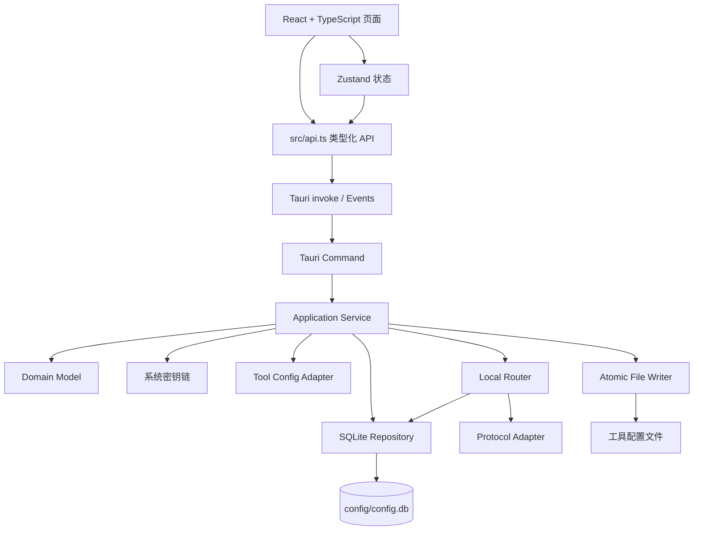
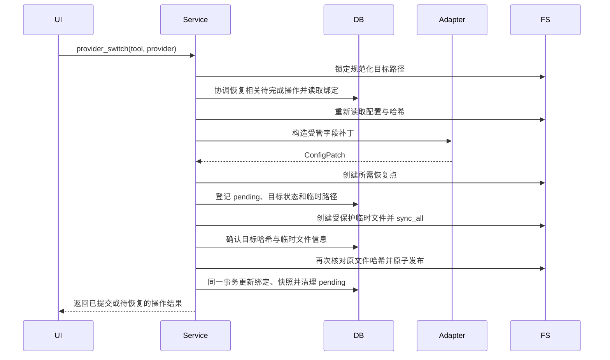

# Agent Dock 技术实现方案

> 文档类型：技术设计
>
> 文档状态：目标设计草案；未决项见第 20.2 节，未提供实现或验证证据的能力均为未验证。
>
> 适用范围：Agent Dock 全部开发内容
>
> 参考项目：[cc-switch](https://github.com/farion1231/cc-switch)
>
> 更新时间：2026-10-14
>
> 说明：本方案定义 Agent Dock 的技术架构、数据结构和实现规范。实施时按本文规定的模块边界与现有工程衔接。

功能范围及唯一验收入口见[需求规格说明书](需求开发.md#9-验收与需求追踪)，统一术语和维护约定见其第 1.2、1.3 节，执行与交付要求见[开发目标](goal.md)。本文的目录、接口和表结构描述目标设计，不代表现有代码已完成实现。Rust 代码块为接口示意，省略的类型须在对应功能开发前补齐，不作为可独立编译代码。

主要章节：[架构](#3-总体架构) · [数据目录](#4-数据目录与启动流程) · [数据库](#5-sqlite-数据库设计) · [工具适配](#8-工具配置适配器) · [安全发布](#9-provider-切换与安全写入) · [运行模式](#10-工具运行模式) · [路由](#11-本地路由实现) · [资源同步](#12-资源同步与项目配置) · [会话与用量](#13-会话管理与用量统计) · [前后端契约](#14-tauri-命令与前端通信) · [测试](#17-测试方案) · [待决事项](#202-待明确事项)。

## 1. 目标与设计原则

Agent Dock 是一个桌面应用，用于集中管理 Claude Code、Claude Desktop、Codex、Gemini CLI、Grok Build、OpenCode、OpenClaw、Hermes、Pi 和 MiniMax Code 的 Provider、MCP、Prompt、Skills、项目配置、路由、会话和用量数据。

设计原则如下：

1. 首先保证配置文件不丢失、不损坏，并且能够恢复。
2. SQLite 作为应用配置和业务数据的唯一主存储。
3. 工具配置文件只作为运行时投影，Provider 切换只修改连接相关字段。
4. Agent Dock 自身不生成 `settings.json`、Provider JSON、路由 JSON、运行状态 JSON 等文本配置文件。
5. Agent Dock 管理的 API Key、OAuth Access Token 和 Refresh Token 仅通过系统密钥链持久化；工具原生认证投影及含凭据原文件的加密备份遵循第 19 章。
6. 本地路由集成在 Tauri 进程内，不部署独立后台服务。
7. 适配器保持静态注册，优先选择容易调试、容易测试的实现。
8. 按功能边界完成 Provider、配置安全写入、路由、聚合、会话和同步能力。

## 2. 技术方案概述

### 2.1 存储与凭据

应用数据固定保存于 `<程序目录>/config`，SQLite 是应用配置和业务数据的唯一主存储。Provider、工具绑定、MCP、Prompt、Skills 元数据、项目快照、路由参数、用量和待完成操作（pending）统一进入 `config.db`。API Key 和 OAuth 凭据保存于系统密钥链，数据库只保存引用。

Provider 使用全局实体，公共连接字段独立存储，工具专属非敏感配置保存于绑定表。MCP、Prompt 和 Skills 通过独立绑定表关联工具。模型价格由默认价格表和 Provider 覆盖价共同确定，费用统一使用整数纳美元。路由和会话共用用量明细、持久去重映射及日汇总。

### 2.2 工具配置与恢复

每个工具使用独立配置适配器，只更新受管字段，保留插件、Hooks、权限、MCP 和未知配置。写入流程为：锁定规范化目标路径、读取并计算哈希、生成补丁、保存备份、登记待完成操作与临时路径、写入同目录临时文件并刷新、更新目标哈希、再次核对原文件、原子发布、提交数据库状态。多文件操作不是跨文件原子事务，须通过待完成操作恢复部分发布；发布前与发布后失败分别处理，见第 9 章。

### 2.3 后端与路由

后端使用 Tauri 命令（Command）→ 应用服务（Application Service）→ 数据仓储（Repository）分层。协议与工具适配器使用静态 Rust 实现。本地路由使用 Axum，与桌面应用运行于同一进程，支持 Direct、Routing 和 Aggregation 三种模式；路由选择、协议转换、流式转发、故障转移、熔断及用量统计由独立模块负责。余额查询使用统一接口。

## 3. 总体架构



图中箭头表示逻辑调用或数据访问方向，不表示完整 Rust 模块引用；Writer 和 Keychain 属于 Platform 封装。适配器只返回配置补丁，应用服务协调备份、待完成记录、安全发布和数据库提交。

后端依赖方向固定为：

```text
Command → Application Service → Domain / Repository / Platform
                                      ↓
                         Tool Adapter / Router / Keychain
```

约束：

- Command 层不能直接访问文件系统、SQLite 或密钥链。
- Domain 层不能依赖 Tauri 类型。
- Repository 只负责数据库读写，不生成业务决策。
- Platform 层封装路径、文件、进程、密钥链和系统差异。
- 工具适配器只负责工具配置格式和字段映射。
- 协议适配器（`ProtocolAdapter`）只负责协议转换，不直接修改工具配置。

Rust 目标模块目录结构：

```text
src-tauri/src/
├── commands/
│   ├── app.rs
│   ├── provider.rs
│   ├── tool.rs
│   ├── routing.rs
│   ├── mcp.rs
│   ├── prompt.rs
│   ├── skill.rs
│   ├── session.rs
│   └── usage.rs
├── application/
│   ├── provider_service.rs
│   ├── tool_service.rs
│   ├── routing_service.rs
│   ├── mcp_service.rs
│   ├── prompt_service.rs
│   └── skill_service.rs
├── domain/
│   ├── provider.rs
│   ├── tool.rs
│   ├── routing.rs
│   ├── credential.rs
│   ├── session.rs
│   └── usage.rs
├── repository/
│   ├── database.rs
│   ├── provider_repository.rs
│   ├── routing_repository.rs
│   ├── session_repository.rs
│   └── usage_repository.rs
├── config/
│   ├── claude.rs
│   ├── codex.rs
│   ├── gemini.rs
│   ├── grok.rs
│   ├── coexist.rs
│   └── patch.rs
├── platform/
│   ├── paths.rs
│   ├── filesystem.rs
│   ├── keychain.rs
│   └── process.rs
├── router/
│   ├── server.rs
│   ├── request.rs
│   ├── response.rs
│   ├── provider_router.rs
│   ├── failover.rs
│   ├── circuit_breaker.rs
│   └── protocols/
└── main.rs
```

数据库迁移文件统一放在 `src-tauri/migrations/`，由 Repository 的数据库初始化流程加载。

## 4. 数据目录与启动流程

### 4.1 配置文件管理原则

Agent Dock 自身只保留一个结构化配置文件：`config/config.db`。Provider、MCP、Prompt、Skills 元数据、项目快照、路由参数、运行状态、备份索引和 pending 操作全部进入 SQLite，不再额外生成以下文件：

- `settings.json`、`app-config.json`、`runtime-state.json`。
- `providers.json`、`mcp.json`、`routing.json`、`projects.json`。
- `*_auth.json`、`*_oauth_auth.json` 和其他认证文本文件。
- 用于保存数据库表镜像的 YAML、TOML、CSV 或 Markdown 配置文件。

仍然存在的文本或实体文件只限于以下几类：

| 文件类型 | 是否由 Agent Dock 维护 | 原因 |
| --- | --- | --- |
| Claude Code、Codex 等工具原生配置 | 是，作为投影更新 | 目标工具必须从自己的路径读取配置 |
| `config/skills/` 下的 Skill 实体文件 | 是 | 工具需要读取实际 Skill 文件 |
| Prompt 原生文件，如 `CLAUDE.md` | 是，作为投影更新 | 工具通过约定文件加载 Prompt |
| `backups/` | 是 | 保留原始配置和数据库恢复点 |
| `logs/` | 是 | 持续追加日志不适合写入 SQLite |
| `sessions/` | 只缓存外部原始会话 | 会话原文可能很大，且需要保留原始格式 |

除上述文件外，不创建应用级文本配置。工具模式、路由恢复意图、监听端口和最后一次写入结果从 `config.db` 读取；目录由 `AppPaths` 固定推导，进程是否正在监听以当前运行时状态为准。

SQLite 在 WAL 模式下可生成 `config.db-wal`、`config.db-shm`，它们属于数据库运行辅助文件，不是独立应用配置。用户主动生成的脱敏导出文件也不作为应用运行配置读取。

### 4.2 数据目录结构

生产环境只允许使用程序所在目录下的 `config`：

```text
<程序目录>/
├── agent-dock.exe
└── config/
    ├── config.db          # 唯一的应用配置和业务数据库
    ├── backups/
    │   ├── database/
    │   └── live-first-write/
    ├── logs/
    ├── skills/
    └── sessions/
```

规则：

- 不使用 `%APPDATA%`、`%LOCALAPPDATA%`、`~/.agent-dock` 或其他隐藏目录。
- 不在 `config` 根目录生成其他应用级 JSON、TOML、YAML 或 INI 配置文件。
- 不提供用户自定义数据目录和自动回退目录。
- 首次启动自动创建全部子目录。
- 程序目录或 `config` 不可写时直接提示用户移动程序后重试。
- 升级时只替换程序文件，不删除或重建 `config`。
- 所有路径由 `AppPaths` 统一生成，业务代码不能直接拼接路径。

### 4.3 路径解析（AppPaths）

```rust
pub struct AppPaths {
    pub executable_dir: PathBuf,
    pub config_dir: PathBuf,
    pub database_path: PathBuf,
    pub database_backup_dir: PathBuf,
    pub live_backup_dir: PathBuf,
    pub log_dir: PathBuf,
    pub skills_dir: PathBuf,
    pub sessions_dir: PathBuf,
}
```

生产环境调用 `AppPaths::from_current_executable()`。测试使用 `AppPaths::from_root(temp_dir)` 注入临时目录，但不能把该能力暴露给用户设置。

### 4.4 启动流程

```text
解析可执行文件路径
  → 创建 config 子目录
  → 检查目录读写权限
  → 打开 SQLite
  → 设置 SQLite PRAGMA
  → 检查数据库版本，需要升级时备份并执行迁移
  → 恢复 pending_operations
  → 检查工具配置文件快照
  → 从 config.db 恢复路由意图并重新确认实际监听状态
  → 启动 Tauri 窗口
```

启动失败必须区分：

- 目录不可写：提示移动程序目录。
- 数据库损坏：提示选择数据库备份恢复。
- 数据库版本过高：提示升级程序。
- 密钥链不可用：允许打开只读界面，但禁止保存敏感配置。
- 待完成操作无法安全恢复：保留当前目标文件、恢复依据和记录，提示冲突范围；不继续覆盖外部内容。

错误提示和数据库备份选择使用不依赖正常业务数据库的恢复入口，不能因“尚未启动主窗口”而无法反馈错误。跨进程实例协调未明确前，不同时打开同一配置目录执行写入；具体协调与文件锁规则见 D09。

## 5. SQLite 数据库设计

### 5.1 数据存储约定

通用约定：时间点统一保存为 UTC Unix 毫秒整数，耗时使用毫秒，日汇总日期使用 UTC 的 `YYYY-MM-DD`。布尔字段只接受 `0`、`1`，固定协议与状态集合由数据库约束和服务类型共同校验；分类或资源类型尚未确定的集合按 D03、D16 明确后补充迁移。文本主键显式声明 `NOT NULL`，数量及耗时不得为负。JSON 字段在数据库检查语法，在服务边界按具体类型校验，禁止写入密钥、OAuth Token 或认证 Header。

请求明细中未知 Token 用量为 `NULL`，确认未消耗才为 `0`；日汇总的 Token 字段保存已知数量之和，并通过未知用量尝试数表示不完整。不得将缺失字段的默认值当作真实零消耗。

### 5.2 数据库连接配置

每次打开数据库执行：

```sql
PRAGMA foreign_keys = ON;
PRAGMA journal_mode = WAL;
PRAGMA synchronous = NORMAL;
PRAGMA busy_timeout = 2000;
PRAGMA temp_store = MEMORY;
```

使用 `rusqlite` 管理 SQLite。常规配置操作使用受 Mutex 保护的连接；路由请求日志允许进入独立的异步批量写入队列，避免日志写入阻塞响应流。队列容量、背压、入库确认时点及崩溃前未持久化记录的处理见 D17；正常退出排空队列不等于异常退出时零丢失。页面不得将存在已知采集缺口的统计显示为完整账单。

### 5.3 核心数据表

#### 5.3.1 应用设置与备份索引

```sql
CREATE TABLE settings
(
    key        TEXT NOT NULL PRIMARY KEY,
    value_json TEXT    NOT NULL CHECK (json_valid(value_json)),
    updated_at INTEGER NOT NULL
);

CREATE TABLE backup_records
(
    id           TEXT NOT NULL PRIMARY KEY,
    backup_type  TEXT    NOT NULL CHECK (backup_type IN
        ('database', 'tool_first_write', 'tool_takeover', 'prompt')),
    tool_id      TEXT,
    source_path  TEXT,
    backup_path  TEXT    NOT NULL UNIQUE,
    content_hash TEXT    NOT NULL,
    file_size    INTEGER NOT NULL CHECK (file_size >= 0),
    created_at   INTEGER NOT NULL
);
```

`settings` 保存主题、语言、备份策略、同步配置的非敏感部分，以及唯一的路由监听地址和端口。`routing.restore_modes` 按工具保存用户期望在重启后恢复的模式，与 `tool_bindings` 中已经发布到工具文件的模式分开；退出应用时恢复直连不会清除该意图，用户主动关闭路由时则更新为直连。每个键在应用层有明确类型和默认值；Provider、绑定、用量和待完成操作的完整数据不复制到该表。同步认证信息也只保存密钥链引用，不提供数据目录覆盖设置。

`backup_records` 只保存文件索引，不保存备份正文。首次写入备份与每次路由接管前的恢复点分开记录；原文件不存在时在待完成操作中记录该状态，不生成备份文件。创建备份时先原子写入文件，再登记索引；启动时检查索引与文件是否一致。

含凭据的原始配置只能以加密形式保存恢复点，不能直接复制原文。加密格式、密钥管理和跨设备恢复规则须按第 20.2 节明确，相关索引元数据随该规则补充迁移；在规则与恢复能力未落实前，不得对这类文件执行需要备份的覆盖操作。

#### 5.3.2 Provider 基础信息

```sql
CREATE TABLE providers
(
    id             TEXT NOT NULL PRIMARY KEY,
    name           TEXT    NOT NULL,
    name_zh        TEXT,
    category       TEXT    NOT NULL,
    protocol       TEXT    NOT NULL CHECK (protocol IN ('anthropic_messages', 'openai_chat', 'openai_responses', 'gemini_native')),
    base_url       TEXT    NOT NULL,
    enabled        INTEGER NOT NULL DEFAULT 1 CHECK (enabled IN (0, 1)),
    sort_order     INTEGER NOT NULL DEFAULT 0,
    metadata_json  TEXT    NOT NULL DEFAULT '{}' CHECK (json_valid(metadata_json)),
    created_at     INTEGER NOT NULL,
    updated_at     INTEGER NOT NULL
);
```

`category` 至少包含 `official`、`custom`、`local`、`preset`。`protocol` 使用固定枚举字符串：`anthropic_messages`、`openai_chat`、`openai_responses`、`gemini_native`。凭据引用统一由 `provider_credentials` 读取，不在 Provider 主表重复保存。

#### 5.3.3 Provider 模型与能力

```sql
CREATE TABLE provider_models
(
    id                                     TEXT NOT NULL PRIMARY KEY,
    provider_id                            TEXT    NOT NULL,
    model_id                               TEXT    NOT NULL,
    display_name                           TEXT,
    context_window                         INTEGER CHECK (context_window >= 0),
    supports_tools                         INTEGER NOT NULL DEFAULT 0 CHECK (supports_tools IN (0, 1)),
    supports_thinking                      INTEGER NOT NULL DEFAULT 0 CHECK (supports_thinking IN (0, 1)),
    supports_vision                        INTEGER NOT NULL DEFAULT 0 CHECK (supports_vision IN (0, 1)),
    input_price_per_million_nano_usd        INTEGER CHECK (input_price_per_million_nano_usd >= 0),
    output_price_per_million_nano_usd       INTEGER CHECK (output_price_per_million_nano_usd >= 0),
    cache_read_price_per_million_nano_usd   INTEGER CHECK (cache_read_price_per_million_nano_usd >= 0),
    cache_write_price_per_million_nano_usd  INTEGER CHECK (cache_write_price_per_million_nano_usd >= 0),
    metadata_json                          TEXT    NOT NULL DEFAULT '{}' CHECK (json_valid(metadata_json)),
    UNIQUE (provider_id, model_id),
    FOREIGN KEY (provider_id) REFERENCES providers (id) ON DELETE CASCADE
);
```

模型能力只作为路由和界面提示，不能替代上游实际能力验证。四个价格字段是该 Provider 的覆盖价；`NULL` 表示使用默认价格，`0` 表示明确免费。

#### 5.3.4 模型默认价格

```sql
CREATE TABLE model_pricing
(
    model_id                              TEXT NOT NULL PRIMARY KEY,
    display_name                          TEXT    NOT NULL,
    input_price_per_million_nano_usd       INTEGER CHECK (input_price_per_million_nano_usd >= 0),
    output_price_per_million_nano_usd      INTEGER CHECK (output_price_per_million_nano_usd >= 0),
    cache_read_price_per_million_nano_usd  INTEGER CHECK (cache_read_price_per_million_nano_usd >= 0),
    cache_write_price_per_million_nano_usd INTEGER CHECK (cache_write_price_per_million_nano_usd >= 0),
    price_source                          TEXT    NOT NULL CHECK (price_source IN ('builtin', 'imported', 'user')),
    updated_at                            INTEGER NOT NULL
);
```

价格单位统一为“每百万 Token 的纳美元”。逐项优先使用 `provider_models` 覆盖价，再使用 `model_pricing` 默认价；缺少本次实际消耗类别的价格时标记未计价，不能把未知价格当作免费。内置价格更新和外部导入不得覆盖用户自定义价格。

#### 5.3.5 Provider 凭据引用

```sql
CREATE TABLE provider_credentials
(
    provider_id      TEXT    NOT NULL,
    credential_kind  TEXT    NOT NULL,
    keychain_service TEXT    NOT NULL,
    keychain_account TEXT    NOT NULL,
    account_label    TEXT,
    updated_at       INTEGER NOT NULL,
    PRIMARY KEY (provider_id, credential_kind),
    FOREIGN KEY (provider_id) REFERENCES providers (id) ON DELETE CASCADE
);
```

该表只保存密钥链引用，不保存 Key、Access Token 或 Refresh Token。使用 `(provider_id, credential_kind)` 联合主键，使同一 Provider 可以同时持有 OAuth Access Token 和 Refresh Token。

#### 5.3.6 工具模式与当前选择

```sql
CREATE TABLE tool_bindings
(
    tool_id             TEXT NOT NULL PRIMARY KEY,
    mode                TEXT    NOT NULL CHECK (mode IN ('direct', 'routing', 'aggregation')),
    current_provider_id TEXT,
    direct_provider_id  TEXT,
    route_provider_id   TEXT,
    updated_at          INTEGER NOT NULL,
    FOREIGN KEY (current_provider_id) REFERENCES providers (id),
    FOREIGN KEY (direct_provider_id) REFERENCES providers (id),
    FOREIGN KEY (route_provider_id) REFERENCES providers (id)
);
```

`mode` 是已经成功发布到工具配置的模式；`current_provider_id` 表示单 Provider 工具的当前选择，`direct_provider_id` 保存退出路由时恢复的直连选择。涉及工具配置的模式和选择只在配置发布成功后的同一事务中更新。`route_provider_id` 记录 Routing 的上游选择，可以在故障转移时单独更新；并发请求实际使用的 Provider 以请求明细为准。共存式工具可以将 `current_provider_id` 置空，由 `tool_provider_bindings` 记录多个 Provider。

#### 5.3.7 工具与 Provider 绑定

```sql
CREATE TABLE tool_provider_bindings
(
    tool_id            TEXT    NOT NULL,
    provider_id        TEXT    NOT NULL,
    enabled            INTEGER NOT NULL DEFAULT 1 CHECK (enabled IN (0, 1)),
    sort_order         INTEGER NOT NULL DEFAULT 0,
    config_patch_json  TEXT    NOT NULL DEFAULT '{}' CHECK (json_valid(config_patch_json)),
    model_mapping_json TEXT    NOT NULL DEFAULT '{}' CHECK (json_valid(model_mapping_json)),
    updated_at         INTEGER NOT NULL,
    PRIMARY KEY (tool_id, provider_id),
    FOREIGN KEY (provider_id) REFERENCES providers (id) ON DELETE CASCADE
);
```

该表供单 Provider 与共存式工具共用。`config_patch_json` 只保存适配器允许的工具专属非敏感连接字段，`model_mapping_json` 保存工具模型槽位到真实模型的映射；不得覆盖 Provider 的凭据或混入 Hooks、权限、MCP 等无关配置。工具原文件中的未知字段继续通过读取、合并和原子写入保留。生效时同时检查 Provider 和绑定的启用状态。

#### 5.3.8 工具配置快照

```sql
CREATE TABLE tool_snapshots
(
    tool_id          TEXT NOT NULL,
    file_path        TEXT NOT NULL,
    file_hash        TEXT,
    file_modified_at INTEGER,
    last_imported_at INTEGER,
    last_written_at  INTEGER,
    restore_backup_id TEXT,
    sync_status      TEXT NOT NULL CHECK (sync_status IN ('pending', 'synced', 'error')),
    PRIMARY KEY (tool_id, file_path),
    FOREIGN KEY (restore_backup_id) REFERENCES backup_records (id)
);
```

`restore_backup_id` 指向本次路由接管前的备份，而非首次写入备份。恢复时核对当前受管文件哈希；外部修改按第 9 节处理，不能直接用旧备份覆盖用户新内容。

#### 5.3.9 路由策略配置

```sql
CREATE TABLE routing_configs
(
    tool_id                    TEXT NOT NULL PRIMARY KEY,
    max_attempts               INTEGER NOT NULL DEFAULT 3 CHECK (max_attempts >= 1),
    first_byte_timeout_seconds INTEGER NOT NULL DEFAULT 60,
    idle_timeout_seconds       INTEGER NOT NULL DEFAULT 120,
    request_timeout_seconds    INTEGER NOT NULL DEFAULT 600,
    failover_enabled           INTEGER NOT NULL DEFAULT 0 CHECK (failover_enabled IN (0, 1)),
    circuit_failure_threshold  INTEGER NOT NULL DEFAULT 3 CHECK (circuit_failure_threshold >= 1),
    circuit_success_threshold  INTEGER NOT NULL DEFAULT 2 CHECK (circuit_success_threshold >= 1),
    circuit_cooldown_seconds   INTEGER NOT NULL DEFAULT 60 CHECK (circuit_cooldown_seconds >= 1),
    half_open_max_probes        INTEGER NOT NULL DEFAULT 1 CHECK (half_open_max_probes >= 1),
    pricing_model_source       TEXT    NOT NULL DEFAULT 'response' CHECK (pricing_model_source IN ('request', 'response')),
    updated_at                 INTEGER NOT NULL
);
```

所有工具共用一个进程内路由服务，监听地址和端口统一保存在 `settings` 的 `routing.listen_address`、`routing.listen_port`，默认分别为 `127.0.0.1` 和 `15721`，避免各工具保存相互冲突的监听参数。运行意图由工具模式和待完成操作恢复，实际监听状态通过内存和事件报告，历史运行记录不作为当前监听状态的依据。

`max_attempts` 包含首次请求，默认最多尝试三次；`failover_enabled` 只作用于 Routing。`pricing_model_source` 明确按请求模型还是响应模型计价，请求模型中的聚合别名先解析为真实模型。选定的计价模型及价格快照写入请求明细，历史费用以已记录的计价依据为准。

#### 5.3.10 路由成员

```sql
CREATE TABLE routing_members
(
    tool_id     TEXT    NOT NULL,
    provider_id TEXT    NOT NULL,
    member_type TEXT    NOT NULL CHECK (member_type IN ('failover', 'aggregation')),
    sort_order  INTEGER NOT NULL DEFAULT 0,
    enabled     INTEGER NOT NULL DEFAULT 1 CHECK (enabled IN (0, 1)),
    is_default  INTEGER NOT NULL DEFAULT 0 CHECK (is_default IN (0, 1)),
    PRIMARY KEY (tool_id, provider_id, member_type),
    FOREIGN KEY (provider_id) REFERENCES providers (id) ON DELETE CASCADE
);
```

`member_type` 取值为 `failover` 或 `aggregation`。Aggregation 不读取 `failover` 队列。

#### 5.3.11 聚合模型别名

```sql
CREATE TABLE routing_model_aliases
(
    tool_id     TEXT NOT NULL,
    alias       TEXT NOT NULL,
    provider_id TEXT NOT NULL,
    model_id    TEXT NOT NULL,
    updated_at  INTEGER NOT NULL,
    PRIMARY KEY (tool_id, alias),
    FOREIGN KEY (provider_id, model_id)
        REFERENCES provider_models (provider_id, model_id) ON DELETE CASCADE
);
```

聚合别名显式保存，添加模型或重启后不会重新分配既有别名。服务层在同一事务中校验并更新聚合成员、唯一默认 Provider 和别名关系。

#### 5.3.12 Provider 健康状态

```sql
CREATE TABLE provider_health
(
    tool_id               TEXT    NOT NULL,
    provider_id           TEXT    NOT NULL,
    state                 TEXT    NOT NULL DEFAULT 'closed' CHECK (state IN ('closed', 'open', 'half_open')),
    consecutive_failures  INTEGER NOT NULL DEFAULT 0 CHECK (consecutive_failures >= 0),
    consecutive_successes INTEGER NOT NULL DEFAULT 0 CHECK (consecutive_successes >= 0),
    total_requests        INTEGER NOT NULL DEFAULT 0 CHECK (total_requests >= 0),
    failed_requests       INTEGER NOT NULL DEFAULT 0 CHECK (failed_requests >= 0),
    opened_at             INTEGER,
    last_error            TEXT,
    updated_at            INTEGER NOT NULL,
    PRIMARY KEY (tool_id, provider_id),
    FOREIGN KEY (provider_id) REFERENCES providers (id) ON DELETE CASCADE
);
```

#### 5.3.13 待完成操作与文件发布记录

```sql
CREATE TABLE pending_operations
(
    operation_id       TEXT NOT NULL PRIMARY KEY,
    tool_id            TEXT    NOT NULL,
    operation_type     TEXT    NOT NULL,
    target_provider_id TEXT,
    target_state_json  TEXT    NOT NULL DEFAULT '{}' CHECK (json_valid(target_state_json)),
    published          INTEGER NOT NULL DEFAULT 0 CHECK (published IN (0, 1)),
    created_at         INTEGER NOT NULL,
    updated_at         INTEGER NOT NULL
);

CREATE TABLE pending_operation_files
(
    operation_id TEXT    NOT NULL,
    file_path    TEXT    NOT NULL,
    before_hash  TEXT,
    after_hash   TEXT,
    temp_path    TEXT,
    published    INTEGER NOT NULL DEFAULT 0 CHECK (published IN (0, 1)),
    PRIMARY KEY (operation_id, file_path),
    FOREIGN KEY (operation_id) REFERENCES pending_operations (operation_id)
        ON DELETE CASCADE
);
```

`target_state_json` 保存本次操作发布成功后需要提交的工具模式、绑定和别名等非敏感状态，使恢复流程能够重放数据库提交；不只依靠目标 Provider 推断整个操作。

#### 5.3.14 请求明细、用量去重与日汇总

```sql
CREATE TABLE request_logs
(
    attempt_id         TEXT NOT NULL PRIMARY KEY,
    request_id         TEXT    NOT NULL,
    tool_id            TEXT    NOT NULL,
    data_source        TEXT    NOT NULL CHECK (data_source IN
        ('routing', 'claude_session', 'codex_session', 'gemini_session')),
    session_id         TEXT,
    provider_id        TEXT,
    requested_model    TEXT,
    actual_model       TEXT,
    pricing_model      TEXT,
    is_final_attempt   INTEGER NOT NULL DEFAULT 0 CHECK (is_final_attempt IN (0, 1)),
    is_success         INTEGER CHECK (is_success IN (0, 1)),
    status_code        INTEGER,
    input_tokens       INTEGER CHECK (input_tokens >= 0),
    output_tokens      INTEGER CHECK (output_tokens >= 0),
    cache_read_tokens  INTEGER CHECK (cache_read_tokens >= 0),
    cache_write_tokens INTEGER CHECK (cache_write_tokens >= 0),
    latency_ms         INTEGER CHECK (latency_ms >= 0),
    first_byte_ms      INTEGER CHECK (first_byte_ms >= 0),
    request_latency_ms INTEGER CHECK (request_latency_ms >= 0),
    request_first_byte_ms INTEGER CHECK (request_first_byte_ms >= 0),
    cost_nano_usd      INTEGER CHECK (cost_nano_usd >= 0),
    pricing_status     TEXT    NOT NULL DEFAULT 'unpriced' CHECK (pricing_status IN ('priced', 'unpriced', 'not_billable')),
    pricing_snapshot_json TEXT NOT NULL DEFAULT '{}' CHECK (json_valid(pricing_snapshot_json)),
    error_code         TEXT,
    error_summary      TEXT,
    created_at         INTEGER NOT NULL,
    CHECK ((pricing_status = 'unpriced' AND cost_nano_usd IS NULL)
        OR (pricing_status = 'priced' AND cost_nano_usd IS NOT NULL AND cost_nano_usd >= 0)
        OR (pricing_status = 'not_billable' AND cost_nano_usd IS NOT NULL AND cost_nano_usd = 0))
);

CREATE TABLE usage_dedup
(
    tool_id         TEXT    NOT NULL,
    data_source     TEXT    NOT NULL,
    source_event_id TEXT    NOT NULL,
    semantic_id     TEXT,
    request_id      TEXT    NOT NULL,
    attempt_id      TEXT    NOT NULL,
    created_at      INTEGER NOT NULL,
    PRIMARY KEY (tool_id, data_source, source_event_id)
);

CREATE TABLE usage_daily_rollups
(
    id                     INTEGER PRIMARY KEY,
    usage_date             TEXT    NOT NULL,
    tool_id                TEXT    NOT NULL,
    data_source            TEXT    NOT NULL,
    provider_id            TEXT,
    requested_model        TEXT,
    actual_model           TEXT,
    pricing_model          TEXT,
    request_count          INTEGER NOT NULL DEFAULT 0 CHECK (request_count >= 0),
    success_count          INTEGER NOT NULL DEFAULT 0 CHECK (success_count >= 0),
    outcome_sample_count   INTEGER NOT NULL DEFAULT 0 CHECK (outcome_sample_count >= 0),
    attempt_count          INTEGER NOT NULL DEFAULT 0 CHECK (attempt_count >= 0),
    input_tokens           INTEGER NOT NULL DEFAULT 0 CHECK (input_tokens >= 0),
    output_tokens          INTEGER NOT NULL DEFAULT 0 CHECK (output_tokens >= 0),
    cache_read_tokens      INTEGER NOT NULL DEFAULT 0 CHECK (cache_read_tokens >= 0),
    cache_write_tokens     INTEGER NOT NULL DEFAULT 0 CHECK (cache_write_tokens >= 0),
    cost_nano_usd          INTEGER NOT NULL DEFAULT 0 CHECK (cost_nano_usd >= 0),
    unpriced_attempt_count INTEGER NOT NULL DEFAULT 0 CHECK (unpriced_attempt_count >= 0),
    unknown_usage_attempt_count INTEGER NOT NULL DEFAULT 0 CHECK (unknown_usage_attempt_count >= 0),
    latency_sum_ms         INTEGER NOT NULL DEFAULT 0 CHECK (latency_sum_ms >= 0),
    latency_sample_count   INTEGER NOT NULL DEFAULT 0 CHECK (latency_sample_count >= 0),
    updated_at             INTEGER NOT NULL
);
```

`request_logs` 是路由和会话扫描共用的用量明细，不再各存一份计费记录。一次逻辑请求保持同一 `request_id`，每次上游尝试拥有不同的 `attempt_id`；会话记录也由扫描器生成稳定的内部 ID。路由进行中各尝试保持 `is_final_attempt = 0`，请求结束时只将最终尝试标记为 `1`，用于请求次数及最终成功次数；会话扫描确认请求完成后也显式标记终态。尝试次数、Token 和已知费用按所有尝试汇总，失败重试不会覆盖先前消耗。无法确认成功状态的会话记录保留 `is_success = NULL`。进程异常退出遗留的请求在启动恢复时标记中断并确定最终尝试，不永久留作未结束请求。

`latency_ms`、`first_byte_ms` 表示单次上游尝试耗时；最终尝试的 `request_latency_ms`、`request_first_byte_ms` 保存包含重试等待的完整逻辑请求耗时。日汇总的耗时合计和样本数只使用最终尝试的完整请求耗时，不能将最后一次尝试的耗时当成用户实际等待时间。

`pricing_snapshot_json` 保存实际使用的四类单价、价格来源、单位和舍入规则。未计价费用为 `NULL`，不是 `0`；日汇总保存已知费用合计并通过 `unpriced_attempt_count` 标记费用不完整。四类 Token 在明细中分别允许 `NULL`，表示该类别用量未知，不能用默认零补齐；日汇总只累加各类别已知值，并以 `unknown_usage_attempt_count` 记录至少一个类别未知的尝试数。只有能确认无对应消耗时才写零；会话列表的 Token 缓存也保留未知语义。界面同时显示不完整标记，不能把已知数量或费用当成完整账单。

`usage_dedup` 保存来源事件到规范请求、尝试 ID 的映射。`source_event_id` 优先使用工具原生事件 ID，否则组合原生会话 ID、稳定的事件位置和内容哈希，不能仅用文件路径、扫描偏移或正文哈希；`semantic_id` 只使用能证明同一上游响应的稳定标识，支持跨来源或会话分支匹配。该表不外键关联明细，明细归档后仍保留去重依据。无法可靠匹配的跨来源记录按来源分别展示统计，不靠时间接近或 Token 相同直接合并，也不直接相加为统一总额。

同一来源重复扫描直接更新已有尝试，累计 Token 快照先转换成增量事件。跨来源可靠匹配时以路由记录为准补全同一尝试，并将两个来源事件映射到同一组内部 ID；会话先到、路由后到也按该规则在事务内合并。已归档事件再次出现时通过去重映射跳过，不能因明细不存在而重新插入；需要修正历史用量时显式按日重算受影响汇总，不能再次追加旧事件。

默认保留最近 30 天的请求明细。最终尝试也早于保留期且请求已结束时，才将整个请求的全部尝试在同一事务内按 UTC 日期、工具、来源、Provider、请求模型、实际模型和计价模型汇总，再删除对应明细；未结束请求整体保留，避免丢失后续终态。日汇总与在线明细以尝试 ID 为界互斥，统计时合并两者，不直接丢弃保留期外仍未归档的明细；重复执行归档不会重复累加。平均耗时由总耗时除以样本数计算，最终成功率只使用成功状态已知的 `outcome_sample_count` 作为分母。`usage_dedup` 保留到对应统计范围被用户明确删除，保证文件重写、分支或重扫不会重新累计已归档事件。

30 天外保留汇总维度、已知用量与未知用量标记、已知费用和未计价数量，不承诺逐请求审计或自动重新计价；需要历史重算时必须有完整原始来源或备份，不能使用当前单价覆盖历史汇总。

请求明细不保存 API Key、Authorization Header 和默认请求正文。错误只保存脱敏摘要；Provider 和会话标识不设置级联删除外键，删除配置或会话不会自动删除历史用量记录。明细索引和日汇总唯一性见第 5.6 节。

### 5.4 资源、项目与会话数据表

#### 5.4.1 MCP 服务与工具绑定

```sql
CREATE TABLE mcp_servers
(
    id          TEXT NOT NULL PRIMARY KEY,
    name        TEXT    NOT NULL,
    config_json TEXT    NOT NULL CHECK (json_valid(config_json)),
    description TEXT,
    created_at  INTEGER NOT NULL,
    updated_at  INTEGER NOT NULL
);

CREATE TABLE mcp_bindings
(
    mcp_id  TEXT    NOT NULL,
    tool_id TEXT    NOT NULL,
    enabled INTEGER NOT NULL DEFAULT 0 CHECK (enabled IN (0, 1)),
    PRIMARY KEY (mcp_id, tool_id),
    FOREIGN KEY (mcp_id) REFERENCES mcp_servers (id) ON DELETE CASCADE
);
```

#### 5.4.2 Prompt 与工具绑定

```sql
CREATE TABLE prompts
(
    id          TEXT NOT NULL PRIMARY KEY,
    name        TEXT    NOT NULL,
    prompt_type TEXT    NOT NULL,
    content     TEXT    NOT NULL,
    enabled     INTEGER NOT NULL DEFAULT 1 CHECK (enabled IN (0, 1)),
    source_path TEXT,
    source_hash TEXT,
    created_at  INTEGER NOT NULL,
    updated_at  INTEGER NOT NULL
);

CREATE TABLE prompt_bindings
(
    prompt_id   TEXT    NOT NULL,
    tool_id     TEXT    NOT NULL,
    target_path TEXT    NOT NULL,
    enabled     INTEGER NOT NULL DEFAULT 0 CHECK (enabled IN (0, 1)),
    sort_order  INTEGER NOT NULL DEFAULT 0,
    PRIMARY KEY (prompt_id, tool_id, target_path),
    FOREIGN KEY (prompt_id) REFERENCES prompts (id) ON DELETE CASCADE
);
```

#### 5.4.3 Skills 仓库、安装与工具绑定

```sql
CREATE TABLE skill_repos
(
    id             TEXT NOT NULL PRIMARY KEY,
    repository_url TEXT    NOT NULL,
    branch         TEXT    NOT NULL DEFAULT 'main',
    enabled        INTEGER NOT NULL DEFAULT 1 CHECK (enabled IN (0, 1)),
    created_at     INTEGER NOT NULL,
    updated_at     INTEGER NOT NULL,
    UNIQUE (repository_url, branch)
);

CREATE TABLE skills
(
    id                TEXT NOT NULL PRIMARY KEY,
    name              TEXT    NOT NULL,
    repository_id     TEXT,
    repository_path   TEXT,
    source_url        TEXT,
    installed_version TEXT,
    install_path      TEXT    NOT NULL,
    content_hash      TEXT,
    enabled           INTEGER NOT NULL DEFAULT 1 CHECK (enabled IN (0, 1)),
    created_at        INTEGER NOT NULL,
    updated_at        INTEGER NOT NULL,
    FOREIGN KEY (repository_id) REFERENCES skill_repos (id)
);

CREATE TABLE skill_bindings
(
    skill_id         TEXT    NOT NULL,
    tool_id          TEXT    NOT NULL,
    target_path      TEXT    NOT NULL,
    enabled          INTEGER NOT NULL DEFAULT 0 CHECK (enabled IN (0, 1)),
    sync_status      TEXT    NOT NULL DEFAULT 'pending' CHECK (sync_status IN ('pending', 'synced', 'error')),
    last_synced_hash TEXT,
    last_synced_at   INTEGER,
    PRIMARY KEY (skill_id, tool_id, target_path),
    FOREIGN KEY (skill_id) REFERENCES skills (id) ON DELETE CASCADE
);
```

#### 5.4.4 项目与配置快照

```sql
CREATE TABLE projects
(
    id         TEXT NOT NULL PRIMARY KEY,
    name       TEXT    NOT NULL,
    directory  TEXT    NOT NULL UNIQUE,
    created_at INTEGER NOT NULL,
    updated_at INTEGER NOT NULL
);

CREATE TABLE project_snapshots
(
    project_id             TEXT NOT NULL PRIMARY KEY,
    provider_snapshot_json TEXT    NOT NULL CHECK (json_valid(provider_snapshot_json)),
    mcp_snapshot_json      TEXT    NOT NULL CHECK (json_valid(mcp_snapshot_json)),
    skill_snapshot_json    TEXT    NOT NULL CHECK (json_valid(skill_snapshot_json)),
    prompt_snapshot_json   TEXT    NOT NULL CHECK (json_valid(prompt_snapshot_json)),
    updated_at             INTEGER NOT NULL,
    FOREIGN KEY (project_id) REFERENCES projects (id) ON DELETE CASCADE
);
```

#### 5.4.5 会话扫描与消息索引

```sql
CREATE TABLE session_files
(
    file_path        TEXT NOT NULL PRIMARY KEY,
    tool_id          TEXT    NOT NULL,
    file_size        INTEGER NOT NULL DEFAULT 0 CHECK (file_size >= 0),
    modified_at      INTEGER,
    byte_offset      INTEGER NOT NULL DEFAULT 0 CHECK (byte_offset >= 0),
    tail_fingerprint TEXT,
    last_scanned_at  INTEGER,
    index_status     TEXT    NOT NULL DEFAULT 'pending' CHECK (index_status IN ('pending', 'indexed', 'missing', 'error')),
    last_error       TEXT
);

CREATE TABLE sessions
(
    id            TEXT NOT NULL PRIMARY KEY,
    tool_id       TEXT    NOT NULL,
    source_session_id TEXT NOT NULL,
    project_id    TEXT,
    directory     TEXT,
    title         TEXT,
    source_path   TEXT    NOT NULL,
    started_at    INTEGER,
    ended_at      INTEGER,
    input_tokens  INTEGER CHECK (input_tokens >= 0),
    output_tokens INTEGER CHECK (output_tokens >= 0),
    updated_at    INTEGER NOT NULL,
    UNIQUE (tool_id, source_session_id)
);

CREATE TABLE session_messages
(
    id            TEXT NOT NULL PRIMARY KEY,
    session_id    TEXT    NOT NULL,
    sequence      INTEGER NOT NULL CHECK (sequence >= 0),
    message_type  TEXT    NOT NULL,
    content       TEXT,
    metadata_json TEXT    NOT NULL DEFAULT '{}' CHECK (json_valid(metadata_json)),
    created_at    INTEGER,
    FOREIGN KEY (session_id) REFERENCES sessions (id) ON DELETE CASCADE,
    UNIQUE (session_id, sequence)
);
```

#### 5.4.6 关联与同步约束

MCP、Prompt、Skills 的全局启用状态（存在时）与工具绑定状态共同决定是否投影；绑定表中的工具和目标路径由适配器解析，路径写入前统一规范化。Prompt 可按 `sort_order` 合并到多个工具或项目文件；`prompts.source_path`、`source_hash` 只描述导入来源，目标文件的当前哈希和同步状态统一保存于 `tool_snapshots`，按工具和目标路径分别维护。

`skill_repos` 保存启用的搜索、安装及更新来源，`skills.repository_path` 标识仓库内的 Skill 子目录，ZIP 安装可不关联仓库并使用 `source_url` 记录来源。关闭仓库不会卸载已安装 Skill。`skill_bindings` 保存目标目录及上次实际同步哈希，工具同步状态以实际目标文件的哈希为准；同一工具不得将两个 Skill 写入同一个目标目录。

项目快照的四个 JSON 字段内部均按 `tool_id` 分组，保存模式、资源 ID、顺序、工具专属配置和资源版本标识，不保存认证正文。项目引用通过应用层在删除和快照应用时检查。会话使用全局内部 `id`，原生 ID 保存于 `source_session_id`，避免不同工具的同名会话互相覆盖。

### 5.5 数据库迁移

迁移规则：

1. 每个迁移使用递增版本号和单独 SQL 文件，通过 `PRAGMA user_version` 记录已提交版本。
2. 迁移前使用 SQLite Backup API 创建数据库备份，不直接复制正在写入的 WAL 数据库主文件；备份失败则停止升级。
3. 每次迁移在事务内完成。
4. 迁移失败时回滚事务，保留迁移前备份。
5. 数据库版本高于当前程序时拒绝写入并提示升级。
6. 迁移完成后执行 `PRAGMA integrity_check`。
7. 不自动删除未知表、未知字段和未知数据。

### 5.6 索引与一致性约束

```sql
CREATE INDEX idx_tool_provider_bindings_provider_id_tool_id
    ON tool_provider_bindings (provider_id, tool_id);
CREATE INDEX idx_mcp_bindings_tool_id_enabled
    ON mcp_bindings (tool_id, enabled);
CREATE INDEX idx_prompt_bindings_tool_id_target_path_enabled_sort_order
    ON prompt_bindings (tool_id, target_path, enabled, sort_order);
CREATE INDEX idx_routing_members_tool_id_member_type_enabled_sort_order
    ON routing_members (tool_id, member_type, enabled, sort_order);
CREATE UNIQUE INDEX uidx_routing_members_tool_id_default_aggregation
    ON routing_members (tool_id)
    WHERE member_type = 'aggregation' AND is_default = 1 AND enabled = 1;
CREATE INDEX idx_request_logs_tool_id_created_at
    ON request_logs (tool_id, created_at DESC);
CREATE INDEX idx_request_logs_provider_id_created_at
    ON request_logs (provider_id, created_at DESC);
CREATE INDEX idx_request_logs_created_at
    ON request_logs (created_at);
CREATE INDEX idx_request_logs_session_id_created_at
    ON request_logs (session_id, created_at);
CREATE INDEX idx_request_logs_request_id
    ON request_logs (request_id);
CREATE UNIQUE INDEX uidx_request_logs_request_id_final
    ON request_logs (request_id) WHERE is_final_attempt = 1;
CREATE INDEX idx_usage_dedup_tool_id_semantic_id
    ON usage_dedup (tool_id, semantic_id) WHERE semantic_id IS NOT NULL;
CREATE INDEX idx_usage_dedup_attempt_id
    ON usage_dedup (attempt_id);
CREATE UNIQUE INDEX uidx_usage_daily_rollups_dimensions
    ON usage_daily_rollups (
        usage_date, tool_id, data_source, COALESCE(provider_id, ''),
        COALESCE(requested_model, ''), COALESCE(actual_model, ''), COALESCE(pricing_model, '')
    );
CREATE INDEX idx_sessions_tool_id_started_at
    ON sessions (tool_id, started_at DESC);
CREATE UNIQUE INDEX uidx_skill_bindings_tool_id_target_path
    ON skill_bindings (tool_id, target_path);
CREATE INDEX idx_backup_records_backup_type_created_at
    ON backup_records (backup_type, created_at DESC);
```

日汇总的可空维度使用表达式唯一索引，使未知 Provider 或模型也只能形成一个分组；数据仍以 `NULL` 表达未知，空字符串只用于索引归一化。写入边界拒绝空 ID，空模型名转换为 `NULL`。`request_id` 和 `attempt_id` 使用全局内部 ID，不直接复用可能在不同工具间冲突的原生 ID。

唯一索引保证聚合默认项最多一个；至少一个默认项、默认项有效、成员与工具绑定一致等跨表规则由服务层在事务内校验。禁用或移除默认项时必须同时选择替代项，或退出聚合模式。配置绑定、别名和文件快照与 pending 完成状态一起提交；用量明细、去重映射和扫描游标也在同一事务提交。

## 6. 系统密钥链

### 6.1 引用格式

```text
Service: agent-dock
Account: provider/{provider_id}/{credential_kind}
```

上例仅适用于 Provider。`credential_kind` 示例：`api-key`、`oauth-access-token`、`oauth-refresh-token`、`custom-header`；MCP 和同步服务凭据也使用 `CredentialRef`，其所有者命名、多个认证 Header 的槽位及删除规则按 D16 明确，不能借用无关 Provider ID。

非敏感 JSON 中的凭据引用须有类型化表示，区分字面值与引用，不使用字符串猜测替换。凭据更新先验证所有者和引用，删除前检查其他引用；数据库与密钥链之间的失败补偿、孤立凭据清理及 OAuth 刷新并发也由 D16 明确。

### 6.2 抽象接口

```rust
pub struct CredentialRef {
    pub service: String,
    pub account: String,
}

pub trait CredentialStore {
    fn get(&self, reference: &CredentialRef) -> Result<SecretValue, CredentialError>;
    fn set(&self, reference: &CredentialRef, value: &SecretValue)
           -> Result<(), CredentialError>;
    fn delete(&self, reference: &CredentialRef) -> Result<(), CredentialError>;
}
```

实现：

- Windows 使用 Windows Credential Manager。
- macOS 使用 Keychain。
- Linux 使用 Secret Service。
- 密钥链不可用返回 `CredentialUnavailable`，禁止降级到 SQLite 或普通文件。
- 日志只能记录凭据引用、类型和操作结果，不能记录实际内容。
- 配置导出不包含凭据正文，只保留非敏感内容与凭据引用。

## 7. Provider 模型与预设

### 7.1 Provider 统一模型

```rust
pub struct Provider {
    pub id: String,
    pub name: String,
    pub name_zh: Option<String>,
    pub category: ProviderCategory,
    pub protocol: Protocol,
    pub base_url: String,
    pub credential_ref: Option<CredentialRef>,
    pub models: Vec<ProviderModel>,
    pub capabilities: ProviderCapabilities,
    pub enabled: bool,
    pub sort_order: i32,
}
```

Provider 的非敏感设置保存在 SQLite，`credential_ref` 由 Repository 根据 `provider_credentials` 的主认证类型组装，Key 再由密钥链读取；Refresh Token 等辅助凭据按类型单独查询，不重复保存引用。协议和地址不能为空；自定义 Provider 必须至少提供地址、协议和模型。

### 7.2 Provider 预设范围

内置：

- 官方 Provider。
- Anthropic Messages 通用 Provider。
- OpenAI Chat Completions 通用 Provider。
- OpenAI Responses 通用 Provider。
- Gemini Native 通用 Provider。

具体服务清单及更新规则见第 20.2 节。其他服务使用“自定义 Provider”接入，不因为没有预设而限制使用。预设使用版本化种子数据写入 SQLite，可以增量添加，不修改用户已编辑字段。

### 7.3 Provider 删除规则

删除前必须检查：

- 是否是单 Provider 工具当前生效项。
- 是否是 Routing 当前路由项。
- 是否是 Aggregation 默认 Provider。
- 是否被项目快照引用。
- 是否存在故障转移或聚合队列引用。

当前生效 Provider 必须先切换到其他 Provider 后才能删除。

### 7.4 账号认证与路由资格

官方 API 服务与官方订阅账号分开处理。ChatGPT、GitHub Copilot、Grok 等不同账号分别建立 Provider，OAuth Access Token 与 Refresh Token 按凭据类型保存在密钥链，账号切换不覆盖其他账号的凭据。

认证方式、主凭据类型和路由资格属于独立的类型契约，字段及判断依据按 D16 明确；凭据存在不等于已验证，资格未知时不得按已通过显示。`category` 描述来源分类，不能同时承担账号类型与路由资格判断。

官方 API Provider 按其协议能力接入路由；官方订阅账号默认禁止路由及聚合。Codex 官方账号只有在对应版本的认证与协议兼容性明确后才能接管，不根据 Provider 名称或 `category` 字段直接放行。未确认兼容的账号配置不得显示为已通过连接或路由验证。

## 8. 工具配置适配器

### 8.1 静态适配器接口

```rust
pub trait ToolConfigAdapter {
    fn tool_id(&self) -> ToolId;
    fn detect(&self, paths: &AppPaths) -> DetectResult;
    fn read(&self, paths: &AppPaths) -> Result<ToolSnapshot, ConfigError>;
    fn import_provider(
        &self,
        snapshot: &ToolSnapshot,
    ) -> Result<ProviderDraft, ConfigError>;
    fn build_direct_patch(
        &self,
        current: &ToolSnapshot,
        provider: &Provider,
        binding: &ToolProviderBinding,
    ) -> Result<ConfigPatch, ConfigError>;
    fn build_route_patch(
        &self,
        current: &ToolSnapshot,
        route: &RouteProjection,
    ) -> Result<ConfigPatch, ConfigError>;
}
```

`ToolProviderBinding` 对应第 5.3.7 节的工具绑定，适配器按允许字段合并公共 Provider 与该工具的配置差异；路由投影同样使用该工具的模型映射，不修改其他工具的绑定。

通过静态 `match` 注册适配器，不使用运行时动态加载：

```rust
pub fn adapter(tool_id: ToolId) -> &'static dyn ToolConfigAdapter {
    match tool_id {
        ToolId::Claude => &CLAUDE_ADAPTER,
        ToolId::Codex => &CODEX_ADAPTER,
        ToolId::Gemini => &GEMINI_ADAPTER,
        ToolId::GrokBuild => &GROK_ADAPTER,
        ToolId::ClaudeDesktop => &CLAUDE_DESKTOP_ADAPTER,
        ToolId::OpenCode => &OPENCODE_ADAPTER,
        ToolId::OpenClaw => &OPENCLAW_ADAPTER,
        ToolId::Hermes => &HERMES_ADAPTER,
        ToolId::Pi => &PI_ADAPTER,
        ToolId::MiniMaxCode => &MINIMAX_CODE_ADAPTER,
    }
}
```

每个注册实例返回唯一且匹配的 `tool_id`，独立声明路径、字段映射和能力。共存式工具可以复用内部解析逻辑，但不共用一个无法区分工具身份的静态实例；上例中的枚举和实例均为目标接口示意，准确工具 ID 编码按 D03 统一。认证正文由应用服务从密钥链读取并在原生投影边界短暂注入，不要求适配器自行访问密钥链。

### 8.2 配置格式处理

- JSON 使用 `serde_json::Value` 和明确 KeyPath，只修改已知路径。
- TOML 使用 `toml_edit`，保留注释、顺序和未管理字段。
- YAML 用于 MCP 等配置，修改管理节点，保留未知节点。
- dotenv 按行查找 Key，保留注释、空行和未知环境变量。
- 解析失败必须在写入前返回错误。
- 未知字段和用户自定义配置默认保留。

“保留”按格式区分：JSON 承诺未受管字段的语义，不承诺空白和键顺序；TOML 按 `toml_edit` 的受支持能力保留注释和格式；YAML 承诺未知节点语义，不默认承诺注释或原始排版；dotenv 保留未改写行。JSONC 等变体是否接受、YAML 标签和特殊值的保真范围须在 D03 中确认，未支持格式在写入前拒绝，不静默转成丢失语义的普通结构。

### 8.3 单 Provider 切换与多 Provider 共存

单 Provider 工具：Claude Code、Claude Desktop、Codex、Gemini CLI、Grok Build。切换时只写一个当前 Provider 的投影。

共存式工具：OpenCode、OpenClaw、Hermes、Pi、MiniMax Code。新增或编辑 Provider 时将该 Provider 合并到工具配置的受管节点，不删除其他 Provider。

## 9. Provider 切换与安全写入

### 9.1 切换流程



箭头表示操作顺序，不表示数据库能够原子提交文件系统变更。任一阶段失败均按第 9.3 节报告实际发布状态。

### 9.2 切换步骤

1. 解析实际目标路径，按固定顺序获取目标文件锁；工具级锁只用于业务串行，不能替代共享目标文件锁。符号链接、大小写、项目文件及跨进程实例协调规则由 D09 明确。
2. 先恢复与这些目标相关的待完成操作，再读取当前绑定与文件；恢复改变文件后重新读取，不使用锁前快照。
3. 读取原始字节并计算 SHA-256；原文件不存在时以明确的不存在状态记录，不用空文件哈希替代。
4. 解析配置并验证格式、必要字段和目标可写性；创建文件时检查父目录。
5. 从数据库读取目标 Provider、工具绑定和所需密钥链凭据，在投影边界构造受管字段补丁。
6. 计算目标内容和目标哈希；内容相同则核实实际文件后只更新对应状态，不重写文件。
7. 首次改写前保存恢复点并登记索引；含凭据原文件按第 19 章加密。每次进入路由另存本次接管恢复点，原文件不存在则记录该状态。
8. 为每个目标分配同目录唯一临时路径，先将操作、写前哈希、目标哈希、目标数据库状态和临时路径登记到待完成表，再创建临时文件。登记不含凭据正文。
9. 以限制性权限创建临时文件，写入并 `sync_all`；读取校验临时文件哈希，确认后更新记录。创建后立即失败的文件仍有所属操作，不能成为无索引的明文遗留物。
10. 发布前重新读取目标并核对写前哈希。检测到外部变更且尚无文件发布时，只有可安全合并才重算，最多三次；先安全清理仍归本操作的旧临时文件，再更新 pending 中的写前／目标哈希和新路径，重新准备临时文件。清理或登记失败则停止，不沿用旧目标。
11. 根据第 9.4 节执行新建或替换。已有文件发布后检测到其他目标冲突时，不把整个操作回报为未发布，按第 9.3 节保留实际状态。
12. 全部文件发布成功后，在同一数据库事务提交绑定、模式、别名、快照并清理 pending；提交失败保留恢复依据。
13. 清理仍归本操作的无用临时文件并释放锁，返回完整成功、发布前失败或待恢复结果。

哈希核对与文件发布之间仍存在不参与锁协作的外部写入窗口；原子替换只保证单个文件发布完整性，不等于条件写入或跨文件事务。D09 须明确平台协调方案、无法协作的外部写入边界和冲突后的用户处理，不能宣称能够阻止所有外部修改。

### 9.3 外部修改检测与异常恢复

待完成记录中的 `before_hash = NULL` 表示发布前原文件不存在；`after_hash` 为预期目标内容哈希，临时文件必须实际校验后才能发布。`published` 是进度提示，恢复以目标与临时文件实际状态为依据，不能只信该标记。

| 失败阶段 | 目标状态与报告 | 恢复规则 |
| --- | --- | --- |
| 尚未发布任何文件 | Agent Dock 未改变目标文件；外部编辑保持原样 | 清理已确认归本操作的临时文件，结束未发布操作；清理失败保留记录与指引 |
| 已发布部分文件 | 明确列出已发布和待发布目标，不报告完整成功 | 保留 pending、恢复点和目标状态，按下述哈希规则恢复 |
| 全部发布但数据库提交失败 | 文件可能已是目标版本，数据库仍是旧状态 | 核实所有文件后补交数据库状态，不重复覆盖 |
| 与写前、目标哈希均不匹配 | 存在外部冲突或未知状态 | 保留当前文件与待完成记录，提示重新加载或明确的恢复选择，不自动覆盖 |

启动或再次写入前逐文件核对：

1. 任一文件既不匹配写前状态，也不匹配目标状态时停止自动恢复，进入冲突处理。
2. 全部文件仍为写前状态时，按未发布操作结束；清理临时文件前验证所属路径、类型和哈希。
3. 部分文件已是目标状态，其余仍为写前状态时，只有剩余临时文件存在且与目标哈希一致，才继续发布并提交数据库。
4. 临时文件缺失、损坏、权限不满足或备份不可用时，不从哈希推测目标正文，也不重新读取已改变的凭据生成旧操作；保留状态并提示恢复。
5. 全部文件已是目标状态时，仅重放目标数据库提交。外部编辑不能因恢复旧操作被丢弃。

不承诺多文件失败后所有文件字节都未变化；承诺发布前失败不修改目标、已发布状态可识别、恢复依据不丢失，无法安全恢复时停止自动覆盖。

### 9.4 原子发布与权限

Windows 已存在目标：同目录以 `CREATE_NEW` 创建临时文件，在写入正文前设置符合目标保护要求的 ACL，写入和刷新后使用 `ReplaceFileW` 或经验证的等价方式发布。不能只在发布后设置权限。

Windows 首次创建：目标不存在时使用适用的新建发布方式，并事先确定新文件 ACL；不将替换已有文件的 API 当作新建保证。具体 API、同名目标突然出现和权限继承规则按 D09 确认，不能覆盖期间新出现的未知文件。

macOS/Linux：同目录以排他方式创建临时文件；含凭据文件从创建起使用 `0600`，写入并 `sync_all` 后按已确认的新建／替换规则发布，需要持久化目录项时同步父目录。普通 `rename` 不提供基于旧内容哈希的条件替换保证。

替换失败时保留已登记的临时文件与恢复记录；清理只处理可证明属于该操作的文件。文件不存在、为空、为链接或被外部替换属于不同状态，处理和测试须分别覆盖。

## 10. 工具运行模式

每个工具的模式为：

```text
Direct       工具直接访问当前 Provider
Routing      工具访问本地路由，由路由选择 Provider
Aggregation  工具模型列表映射多个 Provider
```

### 10.1 直连模式（Direct）

Direct 模式向工具写入 Provider 的真实地址、模型和工具需要的连接字段。API Key 从密钥链读取后，仅按工具原生格式写入工具规定路径；Agent Dock 自有配置、明文备份及导出文件不得保存凭据正文。目标文件与临时文件的权限按第 9.4 节处理。

### 10.2 路由模式（Routing）

Routing 模式向工具写入本地地址和占位值：

```text
base_url = http://127.0.0.1:15721
api_key  = PROXY_MANAGED
```

真实 Provider 地址和模型从数据库读取，真实凭据只从密钥链进入请求内存。进入路由前保存直连 Provider 和接管恢复点；退出路由时基于当前文件恢复直连受管字段、保留外部编辑，必要时使用恢复点与待完成记录重放。应用退出前保存 `routing.restore_modes`，先恢复直连，再停止路由；恢复失败时保留待恢复操作并按 D11 的退出／停止策略处理，不能只登记下次启动恢复就报告已恢复直连。启动时重新检测实际监听状态并按恢复意图接管，不将退出时已发布的直连模式误认为用户关闭了路由。

默认监听地址为 `127.0.0.1`，默认端口为 `15721`。端口被占用时直接返回错误，不能自动改端口，否则工具配置可能指向未知端口。

### 10.3 聚合模式（Aggregation）

支持 Claude Code 和 Codex：

- 默认 Provider 使用原始模型 ID。
- 其他 Provider 使用 `ad-{provider-slug}-{model-id}` 别名。
- 别名映射保存于 `routing_model_aliases`，关系为 `alias → provider_id → model_id`。
- 冲突时追加稳定哈希后缀。
- Aggregation 不使用故障转移队列。
- 默认 Provider 不能直接删除。
- Codex 模型目录变化后按版本兼容矩阵提示重启客户端或守护进程。
- 默认 Provider 变更、原始模型 ID 与别名冲突、成员移除及旧别名有效期须在 D03、D04 中明确；更新成员、别名、工具模型目录及数据库状态使用同一安全发布流程，未定义情形不自动重分配既有别名。

## 11. 本地路由实现

### 11.1 服务结构

```rust
pub struct RoutingService {
    pub server: Arc<ProxyServer>,
    pub provider_router: Arc<ProviderRouter>,
    pub http_client: reqwest::Client,
    pub shutdown: CancellationToken,
}
```

Axum 监听回环地址并在 Tauri 进程内运行。Reqwest 使用共享 Client 和连接池，避免每个请求重新建立连接。

### 11.2 统一请求模型

```rust
pub struct UnifiedRequest {
    pub request_id: String,
    pub tool_id: ToolId,
    pub model: String,
    pub messages: Vec<UnifiedMessage>,
    pub tools: Vec<UnifiedTool>,
    pub thinking: Option<ThinkingConfig>,
    pub images: Vec<UnifiedImage>,
    pub stream: bool,
    pub metadata: RequestMetadata,
}

pub enum UnifiedEvent {
    MessageStart,
    ContentDelta { item: StreamItemRef, text: String },
    ThinkingDelta { item: StreamItemRef, text: String },
    ToolCallStart { item: StreamItemRef, call: ToolCall },
    ToolCallDelta { item: StreamItemRef, delta: String },
    ItemEnd(StreamItemRef),
    Usage(UsageSnapshot),
    MessageEnd,
    Error(UpstreamError),
}

pub struct StreamItemRef {
    pub item_id: String,
    pub content_index: u32,
}
```

同一请求内的内容块和工具调用使用稳定关联标识，增量与结束事件必须能定位原块，不能依赖“最近一次工具调用”推断交错事件。`UnifiedMessage`、`UnifiedImage` 等待补齐类型须保留角色、内容顺序、图片位置及工具调用／结果关联；不能因统一模型简化而丢失语义。字段和协议映射按 D04 确认，未覆盖参数按能力矩阵拒绝或执行已获允许的降级。

### 11.3 协议适配器

```rust
pub trait ProtocolAdapter {
    fn protocol(&self) -> Protocol;
    fn decode_request(&self, request: HttpRequest)
                      -> Result<UnifiedRequest, ProtocolError>;
    fn encode_request(&self, request: &UnifiedRequest)
                      -> Result<HttpRequest, ProtocolError>;
    fn decode_response(&self, response: HttpResponse)
                       -> Result<UnifiedResponse, ProtocolError>;
    fn encode_response(&self, response: &UnifiedResponse)
                       -> Result<HttpResponse, ProtocolError>;
    fn decode_stream_event(&self, state: &mut ProtocolStreamState, event: &[u8])
                           -> Result<Vec<UnifiedEvent>, ProtocolError>;
    fn encode_stream_event(&self, state: &mut ProtocolStreamState, event: &UnifiedEvent)
                           -> Result<Vec<u8>, ProtocolError>;
}
```

非流式响应先解码为统一响应，再由客户端协议适配器编码。流式解码与编码上下文按请求、方向独立创建，用于事件关联、片段拼接、结束与用量累计，不能放入共享静态适配器污染其他请求；`ProtocolStreamState` 的具体结构和协议终态映射按 D04 补齐。

实现：

- `AnthropicMessagesAdapter`
- `OpenAIChatAdapter`
- `OpenAIResponsesAdapter`
- `GeminiNativeAdapter`

协议适配器必须处理：模型字段、消息角色、工具调用、图片输入、Thinking 参数、流式事件、错误格式和 Token 用量。不影响请求语义的可选参数可按能力矩阵移除；图片、工具调用等影响语义的内容不受支持时返回明确错误，只有已定义且经用户允许的降级才能执行，不得静默丢弃用户内容。处理结果写入脱敏日志，兼容边界按第 20.2 节明确。

### 11.4 请求处理流程

1. 按已确认入口契约校验 HTTP 方法、路径、Content-Type 和来源要求。
2. 对所有 JSON 请求体设置大小限制，包含要求流式响应的请求；响应是否流式不决定请求体是否受限，分块上传也不能绕过累计限制。
3. 按 D08 定义的规则唯一确定 `tool_id`，再验证客户端协议与工具能力；不根据上游 Provider 或模糊路径猜测归属。
4. 解码为 `UnifiedRequest` 并执行能力校验。
5. 解析模型聚合别名或 Routing 上游选择，确定实际 Provider 和模型。
6. 获取熔断器放行许可，从密钥链读取凭据并构造上游请求。
7. 转换请求并发送；分别处理非流式响应和流式事件，编码回客户端协议。
8. 客户端取消或超时后停止转发、取消上游任务并释放连接与探测许可；已知用量仍按尝试记录。
9. 记录状态、完整耗时、各尝试模型与用量，更新健康状态；日志持久性按 D17 说明。

所有工具共用地址不意味着天然共享策略。D08 必须给出请求归属机制、入口与工具映射、来源／认证边界及缺失或伪造标识的错误语义。若依赖“协议路径与工具一一对应”，须明确支持集合并证明无歧义；`PROXY_MANAGED` 仅是工具投影占位值，不是已定义的请求归属或访问凭据。

| 配置 | 默认值 | 计时与边界 |
| --- | --- | --- |
| `first_byte_timeout_seconds` | 60 秒 | 起点及“首字节”按上游响应头、首个协议事件还是首个有效内容计，由 D04 明确 |
| `idle_timeout_seconds` | 120 秒 | 空闲重置事件及心跳是否有效由 D04 明确 |
| `request_timeout_seconds` | 600 秒 | 逻辑请求与单次尝试的适用范围、重试等待是否计入由 D10 明确 |
| 请求体限制 | 待确认 | 单位、默认大小及错误映射由 D08 明确，不能只保护非流式响应请求 |

超时、取消和错误一旦触发，必须有可观察终态；上游执行结果未知时不能按“未执行”处理。

### 11.5 故障转移规则

以下失败类型仅为重试候选，仍须满足重试安全条件、次数上限和流式发布边界：

- TCP 连接失败。
- DNS 或 TLS 连接失败。
- 请求超时。
- HTTP 429。
- HTTP 500、502、503、504。

禁止重试：

- 客户端主动取消。
- 已向客户端发送响应头或响应体后上游失败。
- 参数格式错误。
- 认证失败。
- 模型不存在或权限不足。
- 已知不具备安全重试条件的非幂等操作。

须区分连接前失败、确认未被上游接受、以及已发送但结果未知。客户端尚未收到响应头不能证明上游未执行或未计费；发送后超时、连接断开等未知结果的处理，以及重试等待／退避、`Retry-After` 和候选耗尽后的错误由 D10 明确。未决策略不得以无条件重试代替，也不能将可能发生的额外消耗隐藏为单次尝试。

按工具的 `routing_configs.max_attempts` 限制尝试次数，默认包含首次请求在内最多尝试三个 Provider。每次尝试使用独立 `attempt_id`，同一用户请求保持一个 `request_id`；分别写入 `request_logs`，请求结束时标记最终尝试。切换原因写入错误摘要，不能写入 Authorization Header。

### 11.6 熔断器

状态机：

```text
Closed → Open → HalfOpen → Closed
                  └──────→ Open
```

阈值保存在 `routing_configs`，各工具可以独立调整，默认值：

- 连续失败阈值：3。
- 冷却时间：60 秒。
- 半开状态（HalfOpen）探测并发数：1。
- 恢复成功阈值：2。

内存状态用于快速判断，SQLite 状态用于页面展示和重启恢复。SQLite 更新失败不能阻塞当前响应，但必须写入脱敏日志并在下次状态同步时修复。失败计数的入选错误、取消／客户端错误是否计入、连续状态重置及冷却后的探测依据按 D04、D10 明确，测试不能将所有非成功统一计入熔断。

## 12. 资源同步与项目配置

### 12.1 MCP 同步

MCP 正文保存于 `mcp_servers.config_json`，工具启用关系保存于 `mcp_bindings`。

保存或导入前，将已知认证字段及用户标记的环境变量、Header 凭据提取到密钥链，`config_json` 只保存非敏感内容与引用。同步到工具时在内存中解析引用，再按工具原生格式投影；不得将含认证信息的原始配置直接存入数据库。

同步流程：

1. 读取目标工具的当前配置。
2. 根据稳定 ID、名称、启动命令和地址识别已有 MCP。
3. 生成 Agent Dock 管理节点。
4. 合并已启用 MCP，保留未知节点。
5. 使用原子写入更新工具配置。
6. 写回同步哈希和时间。

批量启用和禁用先生成目标绑定，执行一次合并写入；文件发布成功后将绑定和快照一起提交，失败时保留待完成记录，避免页面启用状态与实际文件不一致。

每个适配器明确稳定 ID、原生名称、命令和地址的匹配优先级及冲突处理；不能仅因名称相同就覆盖未知节点。新增节点记录受管归属，更新与禁用只修改可证明受管的节点；同一目标连续同步两次应产生相同语义结果，第二次内容无变化时不重写。具体原生字段映射及身份冲突确认规则在 D03 中记录，未明确前不能覆盖有歧义节点。

### 12.2 Prompt 同步

支持 `CLAUDE.md`、`AGENTS.md`、`GEMINI.md` 等文件。保存 Prompt 前：

1. 检查编辑器是否有未保存草稿。
2. 读取外部文件并计算哈希。
3. 将外部内容保存为数据库版本或备份。
4. 合并启用的 Prompt。
5. 原子替换文件。
6. 更新该工具、目标路径对应的 `tool_snapshots` 哈希和同步状态；只有重新导入来源时才更新 Prompt 的来源哈希。

Prompt 合并须使用可识别的受管片段或等价归属机制，明确顺序、分隔、外部编辑和重复同步规则；具体表示随工具原生格式由 D03 确认，不能每次向全文无条件追加。禁用只移除本资源拥有的片段；无法证明归属时停止覆盖并提示重新导入。外部内容保存为可恢复正文或备份，“数据库版本”不能仅指 `updated_at` 或哈希。

离开编辑页时，若草稿哈希与已保存哈希不同，必须二次确认。

### 12.3 Skills 安装与同步

实体文件保存于：

```text
config/skills/{skill_id}/
```

`skill_repos` 保存仓库地址、分支和启用状态，`skills` 保存仓库子目录、安装版本、内容哈希和安装路径，`skill_bindings` 保存每个工具或项目目标的启用及同步状态。

Windows 使用增量复制，比较文件哈希后只复制变化文件，避免依赖符号链接权限；其他平台根据权限和文件系统能力支持符号链接或纯复制。搜索来源与安装来源分开登记，skills.sh 搜索结果指向的实际下载源和版本按 D03 核实。

安装流程：下载到已登记的临时位置 → 解压前逐条校验路径及链接目标不越过暂存根目录 → 解压并校验 Skill 结构 → 计算清单与哈希 → 在目标文件系统内准备发布 → 发布实体 → 提交数据库元数据。不能先解压越界路径再靠结构校验补救；跨文件系统移动不承诺原子性，须在目标文件系统重新暂存。

更新保留发布前版本和恢复依据，明确已有目录的替换方式；工具同步按清单处理新增、修改和已移除的受管文件，不删除未知文件。仅在目标实际内容校验通过后更新 `last_synced_hash` 和 `synced` 状态；复制中断、链接不可用、实体发布后数据库失败均报告实际状态并提供恢复，不把部分复制显示为同步成功。具体目录发布和链接回退规则按 D03、D09 确认。

### 12.4 项目快照

项目通过规范化目录路径识别。项目快照按工具保存模式、Provider、MCP、Skills、Prompt 的 ID、顺序、工具专属配置及版本标识（如 `updated_at`、`content_hash`），不复制完整敏感凭据。应用快照前检查资源是否存在、版本是否匹配；有变化时提示选择当前版本或从备份恢复，不把 ID 引用当成不可变历史内容。切换项目按工具执行安全发布流程，文件成功发布后再提交对应绑定；中途失败通过 pending 恢复。

## 13. 会话管理与用量统计

### 13.1 增量扫描

`session_files` 记录文件大小、修改时间、字节偏移和尾部指纹。

扫描规则：

- 文件不存在：标记索引失效。
- 文件长度增加：验证上次已提交字节偏移前的既定窗口指纹，匹配后从该偏移继续读取；不是比较新文件末尾与旧末尾。
- 文件被重写、截断或尾部指纹变化：重新扫描。
- 单个文件解析失败：记录错误，继续处理其他文件。
- 会话、消息、用量事件、去重映射和扫描游标按批次事务一起写入。

指纹算法、窗口长度、编码、半行／不完整事件缓冲及重写检测能力按 D03 明确；偏移只推进到已完整解析并提交的边界。尾部窗口匹配不能证明文件较早内容未被重写，须说明源格式的追加假设和失效检测范围，不宣称能够发现任意历史修改。

### 13.2 会话消息

统一消息类型：

- 文本。
- 思考内容。
- 工具调用。
- 工具结果。
- 图片引用。
- 错误。
- 系统事件。

前端使用虚拟列表展示长会话，详情页支持按轮次折叠、会话内搜索、复制和 Markdown 导出。轮次／步骤边界、失败依据、工具调用与结果关联、图片导出及恢复命令随工具版本在 D03 中明确，无法确认的状态不自行推断。

批量删除前展示原始日志、`config/sessions/` 缓存、索引及消息的实际影响；对象范围、重扫是否恢复显示及部分删除失败由 D14 决议。历史用量不因会话删除级联清除，删除会话也不能顺带删除用量去重映射；需要删除统计时应使用明确的统计删除范围。

### 13.3 用量与费用计算

统计字段：请求次数、成功次数、输入 Token、输出 Token、缓存读取 Token、缓存写入 Token、首字节耗时、总耗时、Provider、请求模型、实际模型和费用。

费用使用整数纳美元保存：

```text
cost_nano_usd INTEGER
```

价格使用第 5.3.3、5.3.4 节的 Provider 覆盖价和默认价，统一以每百万 Token 的纳美元表示。输入、输出、缓存读取、缓存写入按互不重叠的 Token 数量计算；适配器先将上游“输入已包含缓存”等差异归一化，累计用量转成增量，避免同一 Token 反复计价。

单次尝试费用先累加四类 `token_count × price_per_million_nano_usd`，最后除以 `1_000_000`，以纳美元为单位四舍五入一次。Rust 使用受检查的 `i128` 中间值，再校验转换为 SQLite 的 `INTEGER`；价格快照随尝试保存，后续价格更新不自动改变历史账目。任一实际计费类别的用量或所需单价缺失时标记未计价，不能用 `NULL` 参与计算后按零补齐；只有可以确认未产生计费用量时才标记 `not_billable`。

路由与会话用量统一写入 `request_logs`，通过 `usage_dedup` 完成重扫、分支和跨来源去重。统计读取互不重叠的在线明细与 `usage_daily_rollups`；逻辑请求次数只统计最终尝试，费用包含所有实际消耗的尝试。会话列表的 Token 合计只是展示缓存，不再额外加入费用总量。无可靠跨来源标识时分开展示来源，未知用量尝试数、未计价数量与已知合计一并显示。

失败率为已知失败终态逻辑请求数除以 `outcome_sample_count`，分母为零时显示无有效样本。首字节耗时、输出速率、缓存命中率的有效样本、时间区间与公式按需求第 5.7 节及 D15 明确；日汇总只保留已定义维度，不能以汇总数据推断已删除的逐请求速度或分位数。

## 14. Tauri 命令与前端通信

### 14.1 命令分组

```text
app_initialize
app_get_paths
app_get_runtime_status

provider_list
provider_create
provider_update
provider_delete
provider_switch
provider_import_live
provider_test_connection

tool_detect
tool_read_config
tool_get_binding
tool_set_mode

routing_get_config
routing_update_config
routing_start
routing_stop
routing_get_status
routing_switch_provider
routing_get_health
routing_reset_circuit
routing_get_logs

mcp_list
mcp_import
mcp_save
mcp_sync
mcp_set_enabled

prompt_list
prompt_save
prompt_sync

skill_search
skill_install
skill_update
skill_sync

session_search
session_get
session_export_markdown
session_delete

usage_summary
usage_details
pricing_get
pricing_update

settings_get
settings_update
backup_list
backup_create
backup_restore
```

上述名称是初步命令目录，不是完整可调用 API；项目快照、凭据按需复制、导入导出、任务取消、云同步、额度查询和 CLI 管理等需求须在对应功能开发前补齐命令与需求映射，不能以清单未列为由省略功能。

Command 层只做参数校验、服务调用和错误序列化。业务规则放在 Application Service。所有新增 Command 都必须在 Tauri handler 注册列表中注册，并在前端提供类型化 API 封装。

每个命令在实现前定义：所属需求编号、输入类型与校验、返回类型、稳定错误码与脱敏消息、实际发布状态、重试／幂等语义以及权限和取消边界。Rust `snake_case` 与前端命名通过显式序列化映射保持一致，不能依赖未声明的字段名猜测。配置操作结果至少区分已提交、未发布和需要恢复，序列化类型需在实现时明确；不直接向前端暴露底层异常。

### 14.2 事件定义

任务进度、操作结果和持续状态通过以下事件推送：

```text
provider-switched
config-write-progress
routing-status
provider-health-changed
skill-install-progress
session-index-progress
backup-progress
```

长任务事件包含任务 ID、阶段、完成状态和错误信息，进度在总量可知时提供；持续状态事件包含对象标识、状态和更新时间，不要求虚构任务进度。事件不携带 API Key、Token 或完整请求正文。

启动长任务先返回可关联任务 ID，事件载荷与状态查询使用同一标识；明确成功、失败、取消和需要恢复的终态，页面重新进入可查询实际状态，不能只依靠已错过的事件。每个可安全取消任务定义取消入口、允许阶段和重复取消结果，进入原子提交阶段不强行中断；具体命令名和载荷类型在对应模块开发前补齐。

### 14.3 前端状态管理

Zustand Store 按领域划分：

```text
appStore
providerStore
toolStore
routingStore
mcpStore
promptStore
skillStore
sessionStore
usageStore
```

编辑草稿与后端已保存数据分开。离开页面前检查草稿是否有未保存的修改。列表按工具和筛选条件缓存，长列表使用虚拟滚动。

### 14.4 前端工程方案

#### 14.4.1 技术栈与职责边界

前端采用 React 19、TypeScript、Vite、Tailwind CSS 4、Zustand 和 Lucide React，页面路由使用 React Router。基础组件按需采用 shadcn/ui 的组件组织方式，组件代码纳入仓库并按项目主题调整，不依赖运行时远程资源。依赖版本由项目锁文件统一管理。

前端职责限定为页面展示、输入校验、草稿管理、交互状态和 Tauri API 调用。文件、数据库、系统密钥链、进程及路由服务能力只能通过 `src/api.ts` 中的类型化 API 与 Tauri Command 通信。组件不直接调用 `invoke`。API Key 或 OAuth Token 不写入全局 Store、浏览器持久化、错误提示或日志；用户编辑凭据时仅短暂保存在表单局部状态，提交后清空输入。复制凭据由用户显式触发，按需读取并写入剪贴板，不缓存凭据正文。

#### 14.4.2 目录与模块组织

前端目录按功能边界组织：

```text
src/
├── app/                 # 应用外壳、导航、全局提示和路由
├── pages/               # 概览、工具、Provider、路由等页面入口
├── features/            # provider、mcp、prompt、skills 等业务组件
├── components/ui/       # 按需纳入并主题化的基础交互组件
├── api.ts               # Tauri invoke 封装、前后端数据类型
├── store.ts             # Zustand 状态与跨页面草稿状态
├── styles.css           # Tailwind 入口、主题变量和浏览器重置
└── main.tsx             # React 应用启动
```

页面组件负责组合视图和触发操作；`features/` 组件负责可复用的业务表单、列表和详情；`api.ts` 负责命令名、参数和返回类型。Store 按业务领域组织，只保存需要跨组件共享的状态；简单页面状态保留在组件内，页面只依赖对应业务模块的状态。

#### 14.4.3 布局、主题与可访问性

界面采用桌面优先的工作台布局：固定侧边栏承载主导航，顶部区域显示页面标题、当前工具和主要操作，内容区按任务组织表格、筛选、详情和编辑表单。列表页支持搜索、筛选、排序、空状态和加载/错误状态；编辑页区分已保存数据与草稿，并在关闭、切换页面或切换工具时保护未保存内容。窄窗口下侧边栏折叠为可操作的导航面板，表格转为可横向滚动或紧凑列表，不隐藏关键操作。

样式遵循需求文档中的 Tailwind 工具类与 shadcn/ui 变体约束。全局 CSS 只管理 Tailwind 导入、字体、滚动条、主题变量和必要重置；颜色、边框、间距及状态语义由统一令牌表达。暗色、浅色和系统主题共享相同组件结构。图标使用 Lucide React；图标按钮提供可访问名称和悬停提示，表单控件关联标签，界面使用语义化标题、导航和主内容区域。键盘操作必须可达，焦点样式使用 `focus-visible` 且保持清晰；普通文字与背景满足 WCAG AA 4.5:1 对比度，组件边界和状态指示至少达到 3:1。动效不得妨碍操作，并遵循减少动态效果偏好。

#### 14.4.4 交互反馈与实施顺序

涉及配置修改的操作统一呈现校验、保存中、成功和失败状态；破坏性操作确认目标对象；Provider 切换展示关键差异；敏感字段默认掩码且不得进入错误提示、事件或普通日志。长任务订阅 Tauri 事件，以任务 ID 区分进度并在页面卸载时解除监听；可取消任务提供明确取消入口。已加载数据的展示筛选在前端完成；数据库范围的会话搜索通过 `session_search` 执行。明确每个搜索的提交／输入触发时机、结果范围与取消或过期结果处理，不把数据库搜索误作纯界面行为。

前端实现按页面纵向交付：先完成应用外壳、主题、概览、工具和 Provider，再逐步接入路由、MCP、Prompt、Skills、项目、会话、用量和设置。每个页面先确定数据类型和 Command，再完成加载/空/错误/成功状态、表单校验及敏感信息处理，最后补充必要的交互验证。长会话和大数据列表使用虚拟滚动；普通规模列表优先保持简单实现，不提前引入复杂缓存或组件抽象。

## 15. 页面与交互规范

主导航：概览、工具、Provider、路由、MCP、Prompt、Skills、会话、用量、项目、设置。

统一交互规则：

- 删除操作二次确认。
- Provider 切换前显示地址、模型、协议和模式差异。
- API Key 默认掩码，复制操作需要明确按钮。
- 配置写入显示成功、失败和恢复提示。
- 检测到外部文件修改时提示重新加载。
- 长任务显示阶段与进度；总量未知时显示进行中状态。可安全取消的阶段提供取消入口，原子提交阶段不强行中断。
- 路由页面显示监听地址、端口、运行状态、当前 Provider 和失败策略。
- 样式优先使用 Tailwind 工具类和 shadcn/ui 组件变体，不新增语义化 CSS 类。

## 16. 实施计划

以下按依赖顺序列出实施模块，各模块均纳入开发范围。

### 16.1 基础设施

实现：

- Tauri 2、React、TypeScript 和 Vite 初始化。
- 程序目录解析和 `config` 目录创建。
- SQLite 连接、迁移、备份和错误模型。
- 密钥链封装。
- 日志脱敏。
- 原子文件写入器。
- Provider、Tool、Credential 基础类型。

验收：程序能启动，目录不可写时给出明确提示，数据库迁移可重复执行，数据库备份可恢复。

### 16.2 Provider 与配置管理

实现：

- Claude Code、Claude Desktop、Codex、Gemini CLI、Grok Build、OpenCode、OpenClaw、Hermes、Pi 和 MiniMax Code 配置适配器。
- Provider CRUD、预设和自定义 Provider。
- 多账号 Provider 的凭据隔离、OAuth 刷新及官方订阅账号的路由资格检查。
- Direct 模式切换。
- 首次写入备份、原子写入和冲突检测。
- 基础工具和设置页面。

验收：能够发现配置文件、导入当前配置、新增 Provider、切换 Provider；切换后非 Provider 配置不丢失；写入失败不破坏原文件。

### 16.3 资源同步与项目配置

实现：

- MCP 导入、编辑、按工具启用和同步。
- Prompt 编辑、外部内容回收和同步。
- Skills 安装、更新、哈希和增量复制。
- 项目快照和切换。
- 深度链接导入。

### 16.4 本地路由与模型聚合

实现：

- Axum 本地路由服务。
- Anthropic、OpenAI Chat、OpenAI Responses、Gemini Native 协议转换。
- 路由接管、恢复和退出。
- 故障转移、健康检查和熔断。
- 请求日志和模型聚合。

### 16.5 会话管理与用量统计

实现：

- Claude Code、Codex、Gemini CLI 会话扫描。
- 增量索引和全文搜索。
- Token、耗时、失败率和费用统计。
- Markdown 导出、恢复命令和批量删除。
- 自定义模型价格。

### 16.6 跨平台适配、云同步与 CLI 管理

实现：

- macOS/Linux 密钥链和路径适配。
- WebDAV 和 S3 一致性配置快照同步。
- WSL 配置支持。
- CLI 工具版本检测、安装和升级。
- Provider 余额和订阅额度查询接口。

WebDAV 与 S3 不直接同步活动数据库主文件、WAL 文件或设备运行状态；快照通过一致性读取生成，只包含允许跨设备同步的非敏感配置与资源。密钥链凭据不上传，设备专属路径及凭据引用在导入端重新关联，项目快照范围按第 20.2 节明确。云盘仅传递已关闭应用的便携目录，不支持多台设备同时打开同一数据库，也不引入自定义数据目录设置。

## 17. 测试方案

### 17.1 单元测试

- Provider 字段补丁只修改目标字段。
- JSON、YAML 的未受管字段语义保留，TOML 的受支持注释和格式保留，dotenv 未改写行保留；未支持变体在写入前拒绝。
- 首次写入备份只生成一次。
- 临时文件写入失败时原文件不变。
- 已有目标替换与首次创建分别验证；失败时已登记临时文件可定位，权限从创建起正确。
- 外部修改后的哈希冲突和最多三次重算。
- 待完成记录登记前后、临时文件准备、哈希重算、部分发布及数据库提交各阶段的恢复与外部冲突处理；临时文件缺失或损坏不继续覆盖。
- 密钥链不可用时禁止明文回退。
- 含凭据恢复点的加密与解密失败、备份不可用时禁止覆盖原文件。
- 四种协议已确认样例的请求、非流式响应与流式事件转换，交错工具调用关联、不完整事件和明确拒绝的语义。
- 熔断器 Closed、Open、HalfOpen 状态转换。
- 模型聚合别名和冲突处理。
- 整数费用计算和舍入。
- Provider 覆盖价、默认价回退、明确免费和缺价未计价的区别。
- 缓存 Token 口径归一化、累计快照转增量、未知用量与真实零值区分、整数溢出处理。

### 17.2 集成测试

- SQLite 初始化、迁移和完整性检查。
- 数据库备份和恢复。
- 多文件配置操作中途失败和重启恢复。
- Provider 切换后数据库指针和文件内容一致。
- 路由服务启动、端口占用、停止和退出恢复。
- Provider 故障转移、不可重试失败、结果未知场景、取消与熔断恢复；日志队列背压和写入失败按决议策略呈现。
- MCP、Prompt、Skills 重复同步、禁用和移除时保留未受管内容；Skills 删除旧受管文件及复制中断后状态准确。
- 会话日志增量扫描、重写检测和去重。
- 同一 Provider 的工具专属配置互不覆盖，OAuth 双凭据可独立读取。
- 聚合默认项唯一、别名重启后稳定，单次请求的多次尝试只计一次逻辑请求。
- 路由与会话按不同到达顺序去重，归档后重扫和重复归档不增加费用。
- 日汇总正确合并未归档明细、缺价数量和完整请求耗时，不把未知成功状态算成失败。

### 17.3 端到端测试

- 新增 Provider。
- 编辑 Provider。
- 切换 Provider。
- 启动和停止路由。
- Provider 故障后自动切换。
- MCP 批量启停和同步。
- Prompt 未保存离开提示。
- Skill 安装和更新。
- 搜索和导出会话。
- 备份恢复。
- API Key 默认隐藏。
- 云同步、导入导出、项目快照、CLI／WSL 和账号隔离等条目，按需求第 9.2 节和已确认支持矩阵补齐端到端或真实环境验证，不以本列表穷举范围。

## 18. 性能目标

以下保留既定目标值；测量环境与统计口径尚待 D15 确认，当前不是已验证结果。

| 指标 | 目标 | 验收前须明确 |
| --- | --- | --- |
| 1000 个 Provider 列表查询 | 小于 50 ms | 数据大小、数据库冷／热状态，计时是否仅含查询及返回转换 |
| 普通配置切换额外耗时 | 小于 100 ms | 文件数量和大小、是否含备份／刷新／数据库提交；系统密钥链弹窗和磁盘异常单独记录 |
| 本地路由增加的回环处理开销 | 小于 10 ms，不含上游响应时间 | 请求规模、协议组合、并发量和计时边界，分别测量普通响应和流式事件 |

每次性能验证记录系统、硬件、存储、工具／依赖版本、固定数据集、并发、样本数、冷／热状态及原始结果。采用均值、分位数或其他统计量须先明确，不用单个最快样本证明达标；不擅自改变以上阈值。

工程约束：

- Provider 投影内容未变化时不重写工具文件。
- 使用共享 Reqwest Client 和连接池。
- 会话增量扫描不因单个文件变化重新解析全部历史，重写检测边界见第 13.1 节。
- 路由日志使用异步批量队列，容量与背压见 D17；不能以静默丢弃记录达成耗时目标。
- 启动阶段不全量扫描所有会话和 Skills，后台任务推送可关联进度。
- 长会话和达到确认规模的长列表使用虚拟滚动，普通列表保持简单实现。

## 19. 安全与故障处理

- API Key、OAuth Token 和 Authorization Header 不写普通日志。
- 默认不保存完整请求和响应正文。
- 配置导出不包含凭据正文，只保存非敏感内容与凭据引用。
- 密钥链不可用时禁止明文回退。
- 所有配置写入前检查文件可读写权限。
- 首次改写工具文件自动保存原始恢复点；含凭据文件必须加密备份，加密与恢复不可用时停止改写。
- 数据库迁移和恢复前自动创建安全备份。
- 本地路由默认只监听 `127.0.0.1`。
- 删除 Provider 前检查当前引用和项目引用。
- 路由停止前先恢复工具直连配置；恢复失败的退出和停止策略由 D11 明确，不把保留待完成记录等同于恢复成功。
- 应用退出时停止接收新的修改操作，等待原子提交完成或保留待恢复记录，保存路由恢复意图；恢复直连成功后停止路由、结束后台任务并排空数据库写入队列，恢复失败进入 D11 明确的处理流程。
- 路由日志中的错误信息统一脱敏，限制单条错误长度。

## 20. 配置约定与待明确事项

### 20.1 配置约定

本方案的配置约定如下：

- 同时支持 Windows、macOS 和 Linux。
- 实现 Claude Code、Claude Desktop、Codex、Gemini CLI、Grok Build、OpenCode、OpenClaw、Hermes、Pi 和 MiniMax Code。
- Provider 预设覆盖官方 Provider 和四种通用协议。
- 默认路由地址为 `127.0.0.1:15721`。
- WebDAV、S3、余额查询和 CLI 管理纳入完整开发范围。
- 不生成 `*_auth.json`、OAuth JSON 或其他明文认证文件。
- Agent Dock 自身只生成 `config.db` 这一份结构化配置文件；不生成独立的应用级 JSON、TOML、YAML 或 INI 配置。
- 不提供用户自定义数据目录。
- 不使用动态插件加载。
- Aggregation 支持 Claude Code 和 Codex。

### 20.2 待明确事项

下表为统一待决登记。D01～D07 保留原七类事项，新增编号补充审查中暴露的契约缺口。责任人当前均待指派，状态均为待明确；此状态不表示可以跳过对应功能。每项形成决议时记录结论、依据、版本／核实日期和受影响章节，再将状态改为已明确；实现和验证状态另行记录，不能混同。

| 编号 | 决议必须包含的内容 | 影响范围 | 责任人 | 状态 |
| --- | --- | --- | --- | --- |
| D01 | 三平台发布产物、安装与便携形式、运行依赖、签名及程序目录定义 | 数据目录、打包、T1、T5 | 待指派 | 待明确 |
| D02 | Provider 预设服务清单、种子版本与更新来源、用户编辑字段识别规则 | P1、P2、预设更新 | 待指派 | 待明确 |
| D03 | 各工具版本、配置路径及受管字段；MCP／Prompt／Skills／会话／账号能力矩阵；资源归属、格式变体、增量扫描窗口与消息语义；会话支持集合和聚合目录更新规则 | 全部工具适配、需求第 3.1 节、P11、A、M、S | 待指派 | 待明确 |
| D04 | 四种协议的参数、错误、普通响应与流式事件、交错工具调用、图片、Thinking、降级边界及超时事件；模型目录和别名兼容 | P4、R2、R6、R8、A、§11 | 待指派 | 待明确 |
| D05 | 余额、订阅额度和重置时间的数据源、认证、刷新频率、未知值及失败语义 | U7、U8 | 待指派 | 待明确 |
| D06 | 项目快照及资源跨设备范围、设备路径和凭据引用重关联；云盘整目录的异机恢复边界 | P13、T3～T5 | 待指派 | 待明确 |
| D07 | 含凭据备份的加密格式、密钥管理、不可用行为、解密校验、跨设备恢复及索引迁移 | P8、T13、全部敏感文件改写 | 待指派 | 待明确 |
| D08 | 回环入口路径与工具归属、来源／认证边界、大小限制及错误；共享服务下歧义或未知请求处理 | R1、R3、R7、R9、§11.4 | 待指派 | 待明确 |
| D09 | 规范化目标锁、共享路径、符号链接、跨进程实例协调；新建／替换 API 与权限，外部不协作写入的保证边界及目录发布 | T14、§9、Skills 发布 | 待指派 | 待明确 |
| D10 | 非幂等和结果未知的重试规则、候选耗尽、等待／退避、Retry-After、各层超时计时与失败计数 | R5、R6、§11.5～11.6 | 待指派 | 待明确 |
| D11 | 恢复直连失败时是否阻止退出或允许退出，用户提示、手工恢复及下次启动行为 | R10、路由停止、§19 | 待指派 | 待明确 |
| D12 | 各类导入导出和同步快照的格式版本、资源清单、校验、重复对象、冲突、删除传播、部分失败与重试；深度链接契约；备份触发、保留、清理与恢复范围 | P5、M5、M6、U10、T3、T4、T13、T19 | 待指派 | 待明确 |
| D13 | 各 CLI 支持渠道、版本比较、权限、执行环境、升级失败与重复安装；WSL 发行版、路径转换和进程归属 | T6～T9、S8 | 待指派 | 待明确 |
| D14 | 会话批量删除的原始文件、缓存、索引范围，重扫行为、部分失败及历史用量保留提示 | S9 | 待指派 | 待明确 |
| D15 | 缓存命中率、输出速率的公式与有效样本，界面时区／日边界；性能环境、计时范围和统计口径 | U2～U5、S10、§18 | 待指派 | 待明确 |
| D16 | Provider 认证类型、主凭据与路由资格；MCP／同步凭据引用、Header 槽位、OAuth 刷新并发、更新与删除补偿 | P12、R11、MCP、§6～7 | 待指派 | 待明确 |
| D17 | 日志队列容量、背压、持久化确认、故障与异常退出的记录缺口，以及页面完整性提示 | R7、U6、用量恢复与统计 | 待指派 | 待明确 |

相关功能开发前须明确对应输入、输出、失败结果和验收样例。已确定的固定数据目录、系统密钥链、四种协议、目标工具模式、全部优先级功能范围及性能目标不因待决项改变。冲突项形成决议前不擅自选定一方，不以模拟成功、静默覆盖、丢弃语义或未声明默认策略替代决议。

### 20.3 决议与依赖核实记录

每项决议记录：编号、责任人、结论、依据、适用工具／平台／依赖版本、核实日期、影响章节和验收条目；未能获取依据时标注待核实。平台 WebView 与运行依赖、`keyring` 后端、skills.sh、models.dev 和账号接口均需按实际版本核实，不因写入选型表就视为可用。

准确依赖版本在工程建立后由锁文件和工具链配置固定；当前目标路径不是现有文件证明。决议更新时同步三份文档的引用和能力矩阵，需求编号及原开发优先级保持不变。

## 21. 核心验收标准

唯一验收入口为[需求规格说明书第 9 章](需求开发.md#9-验收与需求追踪)。第 9.1 节维护整体闭环标准，第 9.2 节逐项覆盖全部 78 项需求，第 9.3 节规定交付状态和验证证据；本章不再复制另一份验收清单。

第 17 章是测试计划，第 18 章是待明确测量条件的性能目标，第 20.2 节是开发前置决议。测试计划、设计接口、文档检查结果均不能代替实现或真实环境验证证据。
